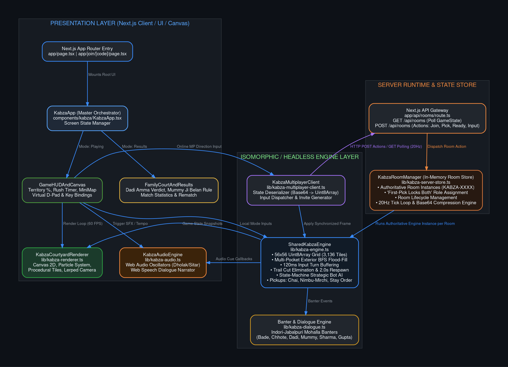

# KABZA — THE GREAT PROPERTY WAR
## Complete Technical Architecture, File Walkthrough, Decision Matrix & Viva / Presentation Guide

---

## 📑 TABLE OF CONTENTS
1. [Project Overview & Narrative Concept](#1-project-overview--narrative-concept)
2. [Laymen Glossary (Desi Hinglish Explanations)](#2-laymen-glossary-desi-hinglish-explanations)
3. [Complete File-by-File Logical Walkthrough](#3-complete-file-by-file-logical-walkthrough)
4. [Full Tech Stack & Role Table](#4-full-tech-stack--role-table)
5. [System Architecture & Data Flow (DOT Graph Included)](#5-system-architecture--data-flow)
6. [Key Architectural Decisions Taken & Why](#6-key-architectural-decisions-taken--why)
7. [Step-by-Step Execution Lifecycle (How Everything Runs)](#7-step-by-step-execution-lifecycle)
8. [Teacher & Viva Defense Guide (How to Explain & Key Questions)](#8-teacher--viva-defense-guide)

---

## 1. Project Overview & Narrative Concept

**"Baap ki property hai Badshah, par kabza karke dikha!"**

**KABZA** ek full-stack, real-time 2D territory-capture arcade game hai (Paper.io / Qix mechanics par based), jisme do bhaiyon—**Bade Bhaiya** aur **Chhote Badshah**—ke beech Indore/Jabalpur ke ancestral banglow aur aangan (courtyard) par kabza karne ki ladai chal rahi hai.

### Characters & Mohalla Dynamics:
* **Bade Bhaiya**: Bada bhai, aggressive, handlebar moustache, hari lawn (Green Lush Grass) ka maalik.
* **Chhote Badshah**: Chhota bhai, sunglasses, laal eenton (Terracotta Bricks) ka maalik, tez dimaag aur jugaadu.
* **Dadi Amma**: Veranda charpai se laathi lekar dekhne wali Supreme Family Judge jo match ke baad faisla sunati hai.
* **Mummy Ji**: Kitchen veranda se Belan lekar aane wali High Command jo haare huye bhai ko bartan dhone bhejti hai.
* **Sharma Ji**: Padosi jo boundary wall par chai-akhbaar ke saath colony WhatsApp group mein live updates bhejte hain.
* **Gupta Ji**: 2% commission ke chakkar mein gate par stamp-paper aur calculator lekar khada property broker.

---

## 2. Laymen Glossary (Desi Hinglish Explanations)

* **Grid / Courtyard Tiles**: Jaise aangan mein 56×56 floor tiles lage hote hain (total 3,136 tiles), wahi hamara playfield board hai.
* **Isomorphic / Headless Engine**: Ek aisa game engine jiska screen ya visual se koi direct lena-dena nahi hota. Woh sirf ganit (math), rules aur coordinates sambhalta hai. Iska fayda ye hai ki wahi same engine browser mein graphics dikhata hai, wahi same server par bina screen ke match control karta hai, aur terminal tests mein bina browser ke run ho jaata hai.
* **Deterministic Delta-Time Loop (`dt`)**: Game har frame par dekhta hai ki pichle frame se ab tak kitna time (`dt`) beeta hai. Chahe 60Hz monitor ho ya 120Hz gaming phone, player hamesha fixed tiles-per-second daudega.
* **Exterior BFS Flood-Fill**: Jab aap aangan mein ghoom kar wapas safe area mein aate ho, toh bandh ghere ke andar ka area kaise pakdein? Hum aangan ke baahar ke neutral kinaron se paani (Breadth-First Search) chhodte hain. Jo tiles paani se bach gaye aur boundary mein band the, woh automatically captured zameen ban jaate hain.
* **Input Buffering (120ms)**: Turn dabane par move turant drop nahi hota, balki agle 120 millisecond tak yaad rakha jata hai taaki mod (intersection) par player bina rukawat 90° smooth turn le sake.
* **180° Anti-Self-Reversal**: Agar player Right jaa raha hai aur galti se Left daba diya, toh code use block kar deta hai taaki player khud ki ban rahi trail par chalkar apni gardan na kaat le.
* **Base64 Serialization**: 3,136 tiles ka data memory mein sirf 1 byte per tile (`Uint8Array`) hota hai. Use ek 3.1 KB ki choti string mein pack karke internet par bheja jata hai taaki mobile multiplayer bina lag ke chale.
* **Procedural Web Audio**: Bina koi MP3/WAV download kiye, browser ke andar math/frequencies ke oscillations se Dholak, Tabla kicks aur Sitar ki beats banana.

---

## 3. Complete File-by-File Logical Walkthrough

### Core Library (`/lib`)
1. **`lib/kabza-types.ts` (The Blueprint & State Contracts)**
   - Game ki saari definitions, enums aur interfaces define karta hai: `BrotherId` ('bade' | 'chhote'), `Direction`, `AIDifficulty`, `GameMode`, `PlayerState`, `LandmarkZone`, `MatchStats`.
   - Courtyard constants: `GRID_W = 56`, `GRID_H = 56`, `TOTAL_TILES = 3136`, `TILE_SIZE = 44px`.

2. **`lib/kabza-engine.ts` (Core Headless Game Engine)**
   - Game ka dimaag jahan haar, jeet, movement aur collisions calculate hote hain.
   - **Safe Territory vs Trail**: Safe zone se nikalte hi trail record hoti hai; safe zone mein ghuste hi flood-fill loop trigger hota hai.
   - **Trail Cut**: Agar dushman trail par chadh gaya toh player out (eliminate), 2.0s respawn timer, unclosed trail gayab, par already captured zameen secure rehti hai.
   - **Power-Ups**: Kadak Chai (1.35x speed), Nimbu-Mirchi (1 cut block shield), Stay Order (rival 35% slow).
   - **AI Bot**: Lappu (Easy), Chalu (Medium), Asli Badshah (Hard) state machines.
   - **Registry Rush**: Aakhri 20 seconds mein speed 1.15x badh jaati hai.

3. **`lib/kabza-dialogue.ts` (Banter & Speech Pool)**
   - Indori-Jabalpuri taano ka database.
   - Game ke alag-alag events (match start, big capture, trail cut, panic, victory) par matching speaker (Bade, Chhote, Dadi, Mummy, Sharma Ji, Gupta Ji) ka dialogue select karta hai.
   - Match khatam hone par Dadi Amma ki Family Court ka script generate karta hai.

4. **`lib/kabza-renderer.ts` (HTML5 Canvas 2D Graphics Engine)**
   - 60 FPS par aangan ko draw karta hai.
   - Procedural textures: Sandstone courtyard, Bade ki hari ghaas, Chhote ki terracotta eentein.
   - Smooth camera interpolation (lerping) jo hamesha local player ko screen ke center mein focus rakhta hai.
   - Ambient leaf particles (hawa mein udti pattiyaan), captured tiles ka 3D flip effect, aur player head speech bubbles.

5. **`lib/kabza-audio.ts` (Web Audio Synthesizer & TTS Narrator)**
   - Zero external MP3 downloads. Browser ke Web Audio Context se oscillators chala kar Dholak, Tabla, Sitar rhythm banata hai.
   - Capture, trail cut, respawn ke sound effects dynamically generate karta hai.
   - Web Speech API ke zariye characters ke dialogues bol kar sunata hai.

6. **`lib/kabza-server-store.ts` (Server-Side Multiplayer Memory)**
   - Server memory mein live multiplayer rooms (`KABZA-XXXX`) ka record rakhta hai.
   - **First-Pick Rule**: Host ne Bade liya toh Guest automatically Chhote lock ho jaata hai.
   - Server 20Hz clock loop chala kar game state ko Base64 mein compress karta hai.

7. **`lib/kabza-multiplayer-client.ts` (Client-Side Network Driver)**
   - Browser ko server ke saath sync rakhta hai (20Hz polling).
   - Server se aayi Base64 grid ko unpack karke local engine mein inject karta hai.
   - WhatsApp invite message aur share link generator (`buildBadshahInviteMessage`).

8. **`lib/utils.ts` (CSS Class Merger)**
   - Tailwind utility function (`cn`) jo dynamic class names ko safely merge karta hai.

---

### App Layer & Routes (`/app`)
9. **`app/api/rooms/route.ts` (Multiplayer API Gateway)**
   - **GET**: Room code lene par current room metadata aur Base64 encoded game state return karta hai.
   - **POST**: Player actions (Create Room, Join Room, Character Pick, Ready Toggle, Arrow Key Input, Rematch) handle karta hai.

10. **`app/join/[code]/page.tsx` (Direct WhatsApp / Deep Link Landing Page)**
    - Jab koi friend invite link click karta hai, toh ye page room code URL se read karke user ko seedha match lobby mein enter karwa deta hai.

11. **`app/page.tsx` (Root Homepage Entry)**
    - Next.js root page jo main `KabzaApp` component ko render karta hai.

12. **`app/layout.tsx` & `app/globals.css` (Global Canvas & Theme Setup)**
    - Dark Indian heritage theme (#0D1117 background), Cinzel & Outfit typography, custom scrollbars aur responsive container.

---

### UI Components (`/components/kabza`)
13. **`components/kabza/KabzaApp.tsx` (Master Director Component)**
    - Screen states manage karta hai: `CINEMATIC_INTRO` -> `MAIN_MENU` -> `CHARACTER_SELECT` -> `MULTIPLAYER_LOBBY` -> `PLAYING` -> `FAMILY_COURT` -> `RESULTS`.

14. **`components/kabza/CinematicIntro.tsx` (5-Scene Story Intro)**
    - Bangla, charpai par Dadi, aur aangan mein dono bhaiyon ke vivad ki animated kahani (Skip option ke saath).

15. **`components/kabza/CharacterSelectAndLobby.tsx` (Selection & Waiting Room)**
    - Character pick (Bade vs Chhote), AI difficulty selector, room code copy, WhatsApp share button, ping indicator, aur Ready toggle.

16. **`components/kabza/GameHUDAndCanvas.tsx` (Live Match Screen)**
    - Screen ke upar Live Territory Percentage bar, Countdown Timer, MiniMap.
    - Beech mein HTML5 Canvas 2D render view.
    - Keyboard inputs (WASD/Arrows), On-screen virtual D-pad (mobile touch), active powerup badges, aur 10-step interactive tutorial overlays.

17. **`components/kabza/FamilyCourtAndResults.tsx` (Post-Match Verdict)**
    - Dadi Amma ki Family Court verdict, Mummy Ji ka bartan dhone ka aadesh, confetti animation, match stats breakdown, aur Rematch / Main Menu options.

18. **`components/kabza/Modals.tsx` (Settings & Rulebooks)**
    - Settings Modal (audio/commentary volume sliders), How To Play Modal (rules guide), aur Credits Modal.

---

### Automated Verification (`/tests`)
19. **`tests/kabza-suite.test.ts` (Automated Test Suite)**
    - Complete CI verification without browser:
      - Initial 64-tile territory seeding (2.04% each).
      - 180° instant turn prevention & 120ms buffer.
      - Multi-Pocket Exterior BFS flood-fill loop capture.
      - Trail cut elimination, 2.0s respawn, and territory preservation.
      - Nimbu-Mirchi shield absorption.
      - Room creation, First-pick character locking, state synchronization via HTTP API.

---

## 4. Full Tech Stack & Role Table

| Layer                      | Technology                         | Version     | Purpose in Architecture                                                                    |
| :------------------------- | :--------------------------------- | :---------- | :----------------------------------------------------------------------------------------- |
| **Framework**              | **Next.js (App Router)**           | 15.4.9      | Full-stack serverless foundation, Dynamic SSR routes (`/join/[code]`), API gateway.        |
| **Language**               | **TypeScript**                     | 5.9.3       | Type-safety, zero-runtime bugs in network packet contracts and engine math.                |
| **Frontend Core**          | **React**                          | 19.2.1      | Component state management, conditional screens, HUD overlays.                             |
| **Styling & Motion**       | **Tailwind CSS v4 + Motion**       | v4 / 12.23  | Dark Indian courtyard theme (#0D1117) and smooth spring transitions.                       |
| **Visual Canvas**          | **HTML5 Canvas 2D API**            | Native      | 60 FPS lerped 2D camera, 3,136 procedural tiles, leaf particles, tile-flip effects.        |
| **Audio Engine**           | **Web Audio + Web Speech API**     | Native      | Zero MP3 asset downloads. Real-time procedural Dholak/Tabla beats + Hindi TTS narrator.    |
| **Multiplayer Networking** | **REST 20Hz + Base64 Stream**      | Native HTTP | Ultra-low bandwidth 3.1 KB board synchronization without needing sticky WebSocket servers. |
| **Icons & VFX**            | **Lucide React + Canvas-Confetti** | Latest      | Minimal UI icons and celebratory post-match confetti bursts.                               |

---

## 5. System Architecture & Data Flow

```
┌─────────────────────────────────────────────────────────────────────────────┐
│                             PRESENTATION LAYER                              │
│       Next.js Pages (app/page.tsx, app/join/[code]/page.tsx)                │
│       UI Components: Intro, Menu, Lobby, GameHUD, FamilyCourt, Modals       │
└──────────────────────────────────────┬──────────────────────────────────────┘
                                       │
                    ┌──────────────────┴──────────────────┐
                    ▼                                     ▼
        ┌──────────────────────────┐         ┌────────────────────────┐
        │      CLIENT ENGINE       │         │    RENDER & AUDIO      │
        │  SharedKabzaEngine       │         │  KabzaCourtyardRenderer│
        │  - Input Buffering (120ms│────────►│  - Smooth 2D Camera    │
        │  - Local Trail Tracing   │         │  - Procedural Textures │
        │  - State Machine AI Bots │         │  KabzaAudioEngine      │
        └───────────▲──────────────┘         └────────────────────────┘
                    │
            (Serialized Sync)
                    │
┌───────────────────▼─────────────────────────────────────────────────────────┐
│                           SERVER RUNTIME LAYER                              │
│  app/api/rooms/route.ts (REST Gateway: GET / POST)                          │
│  kabza-server-store.ts (Authoritative In-Memory Room Manager)               │
│  - Individual SharedKabzaEngine instance per live room                      │
│  - 'First-Pick Locks Both' character coordination                           │
│  - 20Hz Tick Loop & Base64 Compression Engine                               │
└─────────────────────────────────────────────────────────────────────────────┘
```

### Complete Graphviz DOT Architecture Specification
Aapke repository mein [architecture.dot](file:///home/ani/kabza/architecture.dot) file aur uski generated image [architecture.png](file:///home/ani/kabza/architecture.png) saved hai. Uska DOT code:



---

## 6. Key Architectural Decisions Taken & Why

### 1. Headless Isomorphic Engine Pattern
* **Decision**: Game logic ko Canvas aur React components se alag karke ek pure TypeScript class (`SharedKabzaEngine`) banaya gaya.
* **Why**: Isse ek hi codebase bina kisi modification ke teen alag jagah chalti hai:
  1. Client browser mein local gameplay ke liye.
  2. Server par authoritative multiplayer arbitration ke liye.
  3. Headless Node.js CI test runner mein bina browser khole saare rules verify karne ke liye.

### 2. Multi-Pocket Exterior BFS Flood-Fill
* **Problem**: Traditional flood-fill concave (tedhe-medhe) loops aur multiple pockets mein fail ho jata hai.
* **Decision**: **Inverted (Exterior) Flood-Fill**.
  * Courtyard ke 4 corners aur exterior neutral tiles se flood-fill (BFS) start kiya jata hai.
  * Jo tiles paani ke flow mein touch nahi huye aur player ki boundary dwara bandh the, woh automatically player ke captured tiles ban jaate hain.
* **Why**: Ye mathematically O(N) linear time mein har tarah ke complex pockets ko reliably capture karta hai bina recursion stack overflow ke.

### 3. Uint8Array Memory Layout & Base64 Streaming
* **Problem**: 56x56 = 3,136 tiles ka JSON array har 50ms par bhejna network congestion aur Garbage Collection pause create karta.
* **Decision**: Har tile ko memory mein sirf 1 byte diya gaya (`0=neutral, 1=Bade, 2=Chhote`). Poora board ek flat `Uint8Array(3136)` hai jisko server Base64 string mein convert karke bhejta hai aur client `atob()` se instant memory mein decode karta hai.
* **Why**: Payload size 3.1 KB se bhi kam rehta hai, ensuring 60 FPS gameplay on slow mobile 4G networks.

### 4. 120ms Corner-Assist Input Buffering
* **Problem**: Fast arcade grid movement mein agar player intersection aane se 50 millisecond pehle bhi turn dabata hai, toh strict grid games mein woh input ignore ho jaata hai aur movement rigid lagti hai.
* **Decision**: Directional inputs ko timestamp ke saath 120ms ke buffer mein queue kiya jata hai. Jaise hi player tile center ke threshold mein aata hai, turn execute ho jata hai. Saath hi 180° reverse turns ko block kiya jata hai.

### 5. "First-Pick Locks Both" Lobby Consensus
* **Problem**: 2-player multiplayer games mein dono khiladi ek hi character lene ke liye ladte hain ya sync race conditions hoti hain.
* **Decision**: Strict two-brother lock: jaise hi Host ne "Bade" choose kiya, guest automatically "Chhote" ban jata hai (aur vice-versa). Zero conflicts, instant readiness.

### 6. Zero-Asset Procedural Audio Synthesis
* **Problem**: Audio files download karne se bundle size badhta hai aur network request fail hone par game silent ho jata hai.
* **Decision**: Web Audio API oscillators se mathematically beats (Dholak/Tabla frequencies) aur sound effects generate kiye gaye. Final 20 second ke "Registry Rush" mein oscillators ka tempo live mathematically multiply ho jata hai.

---

## 7. Step-by-Step Execution Lifecycle

Jab koi match start hota hai, toh software ke andar ye lifecycle chalti hai:

1. **Initialization**:
   - `SharedKabzaEngine` initialize hota hai.
   - Dono bhaiyon ko 8x8 = 64 tiles (2.04% each) starting territory di jaati hai (Bade left lawn par, Chhote right brick court par).
   - 3 ancestral landmarks spawn hote hain: Scooter Spot, Tulsi Chaura, Mango Tree.
2. **Game Loop (Tick)**:
   - RequestAnimationFrame ya server interval par `engine.update(dt)` call hota hai.
   - Player continuous coordinate `x, y` par calculate hota hai based on current speed.
   - Intersection aane par 120ms buffer se directional turns apply hote hain.
3. **Leaving Safe Zone**:
   - Jaise hi player apni territory se bahar pair rakhta hai, `inSafeZone = false` ho jaata hai aur har tile coordinate uske `trail` array mein append hota hai.
4. **Closing Loop (KABZA)**:
   - Jaise hi player apni already captured territory par wapas kadam rakhta hai:
     - Multi-pocket exterior BFS flood-fill trigger hota hai.
     - Unclosed trail clean hoti hai.
     - Naye enclosed tiles `TileFlipEffect` animation ke saath player ke naam ho jaate hain.
     - High-capture banter line aur audio chime trigger hota hai.
5. **Trail Cut Combat**:
   - Agar brother A ne brother B ki exposed trail tile par step kar diya:
     - Agar B ke paas *Nimbu-Mirchi Shield* hai -> Shield consume ho jaati hai, player bach jaata hai.
     - Agar shield nahi hai -> Brother B eliminate ho jata hai, unclosed trail destroy hoti hai, already captured land secure rehti hai, aur 2.0s respawn timer start hota hai.
6. **Registry Rush & Endgame**:
   - Match time remaining <= 20s hone par "Registry Rush" on hota hai (speed 1.15x, high-tempo dholak).
   - Timer 0 hone par `FamilyCourtAndResults` trigger hota hai: Dadi Amma verdict deti hai, Mummy Ji belan aadesh deti hain, aur winner ko stamp paper victory award milta hai.

---

## 8. Teacher & Viva Defense Guide

### 30-Second Viva Pitch:
> *"Sir/Ma'am, humne 'KABZA' develop kiya hai—ek full-stack territory-capture multiplayer arcade game jisme Indian ancestral property dispute ka narrative layer hai.
> Technical perspective se humne isme ek headless isomorphic engine pattern implement kiya hai, jahan core math aur flood-fill algorithms browser, backend server aur terminal test suite teeno jagah seamlessly run hote hain. Game 60 FPS Canvas 2D par render hota hai, aur zero external audio assets ke saath browser ke Web Audio Context se real-time Indian folk beats synthesize karta hai."*

---

### Top 5 Expected Viva Questions & Answers:

**Q1: Aapne React DOM ya SVG ke bajaye HTML5 Canvas 2D kyu chuna?**
> **Answer**: Courtyard mein 56×56 = 3,136 tiles hain. Agar hum 3,136 DOM `<div>` elements ya SVG nodes ko 60 frames per second par animate karte, toh browser ka DOM tree choke ho jata aur layout recalculation se lag aata. Canvas 2D direct GPU memory buffer mein draw karta hai, jisse smooth 60 FPS aur camera lerping bina kisi performance drop ke achieve hoti hai.

**Q2: Aapka Flood-Fill algorithm regular Paint bucket tool se alag kaise hai?**
> **Answer**: Regular flood-fill seed point dhoondhne par depend karta hai, jo concave ya irregular shapes mein fail ho jata hai. Humne **Inverted Exterior BFS** approach use ki hai: hum aangan ke chaaro bahaari neutral kinaron se BFS paani chhodte hain. Jo bhi tiles paani se touch nahi ho paate aur player ki trail boundary se enclosed the, woh automatically captured pockets ban jaate hain. Ye linear $O(N)$ time complexity mein bina recursion stack overflow ke execute hota hai.

**Q3: Multiplayer mein network lag kaise handle kiya gaya hai?**
> **Answer**: Humne heavyweight JSON payloads ke bajaye **Flat Uint8Array Serialization** implement kiya hai. Poora board sirf 3,136 bytes ka binary buffer hai. Server ise Base64 encode karke bhejta hai jo network par sirf 3.1 KB leta hai. Client par hum turn buffering (120ms) aur client-side prediction use karte hain taaki player input instantly respond kare.

**Q4: Isomorphic Architecture ka kya faayda hua?**
> **Answer**: Frontend aur backend ke liye alag-alag game rules likhne se logic drift aur sync bugs aate hain. Hamara `SharedKabzaEngine` pure TypeScript class hai jisme koi UI dependency nahi hai. Wahi class client par prediction karti hai, wahi server par authoritative referee banti hai, aur wahi headless automated unit tests (`tests/kabza-suite.test.ts`) mein bina browser open kiye run ho jaati hai.

**Q5: Audio assets ke bina sound kaise play ho raha hai?**
> **Answer**: Humne Web Audio API ke native Oscillators aur GainNodes use kiye hain. Dholak kicks ke liye 120Hz se 30Hz exponential frequency drops use kiye hain, aur rhythm tempo ko mathematical interval timer se sync kiya hai. Aakhri 20 second ke "Registry Rush" mein tempo mathematically 1.2x accelerate ho jata hai bina audio distortion ke.

---
*Created as part of the KABZA Architecture Documentation Suite.*
