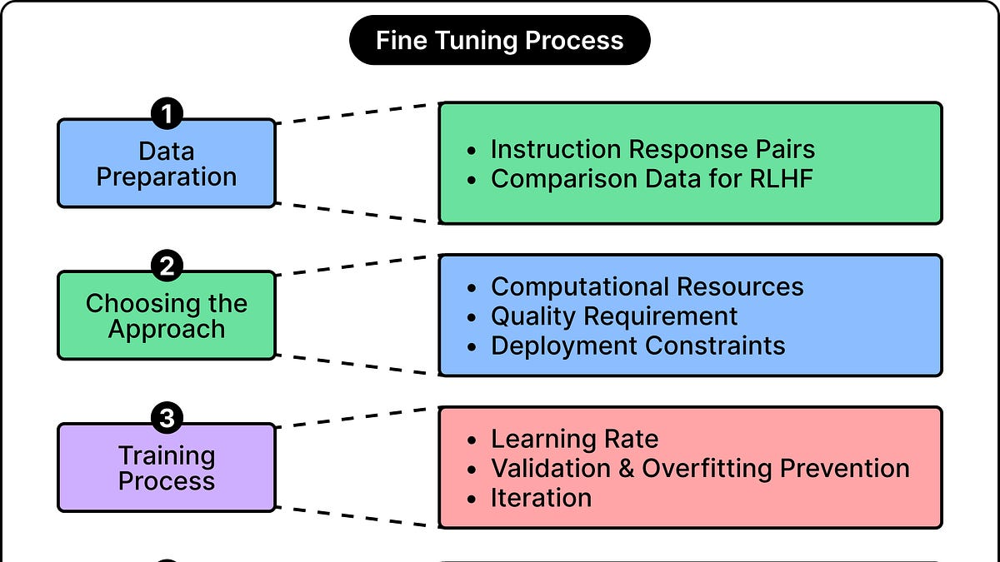

# How to Customize a Model to Learn New Tricks

> Originally published at [ByteByteGo](https://blog.bytebytego.com/p/how-to-customize-a-model-to-learn) · 2026-09-23

---

# How to Customize a Model to Learn New Tricks

[ByteByteGo](<https://substack.com/@bytebytego399569>)

Sep 23, 2026

## [Just Announced: The Agentic Data Summit, Dec 9 (Sponsored)](<https://go.bytebytego.com/Redpanda_092326>)

AI is rewriting the rules for data infrastructure. Streaming keeps critical data moving in real time, while AI introduces new demands for how that data is accessed, governed, and acted on. The Agentic Data Summit, just announced for December 9, brings together engineers, architects, and industry leaders building mission-critical data and AI workloads in production. You’ll hear real lessons from real deployments — governing agent access, migrating off Kafka at scale, and running streaming, SQL, and AI on one unified platform. It’s free, virtual, and built for teams working on what’s next in data and AI.

[Register Free](<https://go.bytebytego.com/Redpanda_092326>)

* * *

Modern language models are skilled at many tasks. They can write code, summarize documents, and answer questions across many subjects. However, an application may still need something the model does not provide consistently. Its answers might omit important details, the way it classifies information might confuse similar categories, or its responses might ignore a particular expected writing style.

These things don’t mean that the model is not intelligent or doesn’t have knowledge. Often, it has the underlying capability but needs additional help applying it according to specific expectations.

That is the purpose of customizing a model. One way is to follow clearer instructions and provide better information. But when those also leave gaps between the expectation and reality of the model, further training needs to be imparted. Techniques such as LoRA and QLoRA make that training more practical by reducing the resources needed to adapt an existing model.

In this article, we are going to look at the various strategies to customize and fine-tune a model.

Here are the key learning points in brief:

  * When instructions and information are not enough

  * How fine-tuning changes a model

  * LoRA: Learning a smaller set of changes

  * QLoRA: Reducing the memory footprint of the model

  * Tuning the techniques into a training process

 _Disclaimer: This post is based on publicly shared details from various sources. References at the end. Please comment if you notice any inaccuracies._

##  When Instructions and Information Are Not Enough

The natural starting point in customizing a model is prompting.

A prompt describes the task, identifies constraints, and specifies what a good answer should contain. For example, we can add examples of the type of answer we expect to give the model a clearer demonstration of the expected behavior. This approach is called few-shot prompting.

This simple approach can be quite effective. The task of summarizing a document becomes more useful when it specifies which details matter and how the summary should be organized. Many applications need no customization beyond well-designed instructions and prompts.

However, instructions can’t provide information that is missing. If an answer depends on an internal document or a recently updated policy, the application must provide that material explicitly to the model.

Retrieval-augmented generation (RAG) is the main technique for addressing this requirement. It finds relevant information in an external source and includes it in the model’s input. The model can then use that material when producing its answer.

Prompting and RAG both work through the information supplied during a request. They can guide behavior in a big way, but they don’t ordinarily change the model’s learned parameters.

Sometimes, recurring weaknesses remain. A model might still struggle with specialized document categories or keep producing summaries that highlight the wrong details. While adding more examples as part of every request may help, it also increases the amount of input the application must maintain and process.

This is where fine-tuning offers a different option. In fine-tuning, we can train the model on many examples so that the desired behavior becomes more firmly learned as part of the model’s default behavior.

This is not an absolute division between behavior and knowledge. Fine-tuning can also teach facts. However, retrieval remains useful when information changes frequently, or answers must be traceable to an external source.

## How Fine-Tuning Changes an Existing Model

As you might be aware, a model’s behavior depends on billions of numerical values called parameters or weights. Many of these are weights that influence how information moves through the model’s calculations.

During pretraining, these values are adjusted using large amounts of training data. A text-generating model learns to predict the next token, which is basically a piece of text such as a word, part of a word, or punctuation. This process helps develop broad language capabilities within the model. Models intended for conversation usually receive additional training to follow instructions.

In contrast, fine-tuning continues from an existing model using a more focused dataset. Since fine-tuning builds on top of capabilities that are already present within the model, it reduces the amount of training required for specialization.

A common approach is supervised fine-tuning (SFT). In SFT, each training example contains an input and the response the model should produce. Examples might pair documents with approved summaries, messages with category labels, or programming requests with suitable code.

During training, the model predicts the desired response tokens. The training process measures how well those predictions match the supplied targets. This measurement is called the loss. Backpropagation identifies how the trainable parameters influence that loss, and an optimizer adjusts them to improve the predictions going forward.

For example, a model may initially answer a classification request with a long explanation. However, training examples that repeatedly pair such requests with short category labels encourage the model to aim for more direct responses. The same principle applies to the details provided in summaries or the conventions followed while generating code.

Across many examples, these adjustments can increase the likelihood of desired behavior based on new inputs. Since the saved changes persist, future requests don’t need to include the entire training dataset in every input they provide.

Supervised fine-tuning does improve things, but it has limitations. Writing explicit examples for every possible scenario the model might encounter is impractical. This is where reinforcement learning from human feedback (RLHF) provides further refinement. The process begins with the model generating multiple responses to various prompts. Human raters then rank these responses based on quality, helpfulness, and safety. These rankings train a separate reward model that learns to predict scores human raters would assign to any response.

SFT and RLHF describe how examples teach the model. On the other hand, LoRA and QLoRA describe how that training is carried out efficiently. The same instruction-response dataset can be used with these different approaches.

The more straightforward type of fine-tuning, known as full fine-tuning, allows every model parameter or weight to change. This provides flexibility, but is also quite expensive. Training must store the weights along with the information used to calculate and apply their updates. Also, intermediate results that were produced while processing examples must also be stored.

This is why a model that fits on a GPU for generating answers might require much more memory for full fine-tuning. Longer examples and larger groups of examples processed together only push the resource requirements higher.

However, as we discussed, the model already has a pretty good grasp on the language aspects. Adapting it to a particular task may not require adjusting every parameter independently. This possibility leads to LoRA.

## LoRA: Learning a Smaller Set of Changes

LoRA stands for Low-Rank Adaptation. It is a form of parameter-efficient fine-tuning, which means it reduces the number of parameters that training needs to update.

LoRA keeps the original model weights frozen. They still perform their calculations, but training doesn’t modify them. Instead, small trainable components are attached to selected calculations inside the model.

These additions are called adapters. They learn adjustments that are combined with the original calculations. This way, the overall output generated by the model changes because the model now uses both its existing capabilities and the learned adjustments.

An adapter operates inside the model. It doesn’t wait for a completed answer and rewrite it afterward. Its adjustments influence the internal processing that eventually produces the answer.

These small components are implemented using two compact tables of numbers, called matrices:

  * The first creates a compact intermediate representation from the input for a calculation.

  * The second turns that representation into an adjustment that can be added to the original result.

Training changes the values in these small tables.

The compact representation belongs only to the adapter. The original model still performs its full calculation, so the adapter doesn’t have to recreate all the capabilities the model already possesses. The reason this works is that changes often have shared patterns. If we want a model to write concise technical explanations, we don’t need it to relearn grammar, programming, and sentence construction. Much of that ability already exists within the original base model. Training simply needs to adjust how those abilities are applied.

The term “low rank” refers to representing such an adjustment through a limited set of coordinated patterns. These are learned numerical relationships, rather than explicit rules provided by a developer. Therefore, LoRA restricts how the model can change. This restriction saves resources, but it also creates a trade-off. A small adapter may be sufficient for one task and too limited for another.

A setting called rank controls the adapter’s capacity. Higher rank gives it more room to learn varied adjustments, while increasing its size and training overhead. Values such as 8, 16, 32, and 64 are possible starting points. But a higher rank is not automatically better.

At the beginning of standard LoRA training, the adapters contribute no change. Therefore, the combined model starts with its original behavior. Their adjustments develop as training processes the new examples. LoRA can also target selected attention calculations, which help the model relate different parts of its input, as well as other transformations inside its layers. Targeting more locations provides additional opportunities to adapt.

The savings are related to managing updates for a much smaller collection of parameters. The original model is still necessary and performs substantial computation. LoRA makes training more manageable without turning the underlying model into a tiny model.

## QLoRA: Reducing the Memory the Frozen Model Still Needs

LoRA solves much of the expense of updating parameters, but the frozen base model still occupies memory. For a sufficiently large model, storing those weights can remain a major obstacle.

QLoRA, or quantized LoRA, addresses this by combining LoRA with quantization.

Quantization stores numbers using fewer bits and a more limited set of possible values. It preserves an approximation of each original weight while discarding some numerical detail. This reduces storage, but it can also introduce errors into the model’s calculations. The overall model structure and parameter count remain the same. Each weight simply has a more compact representation.

QLoRA commonly stores the frozen base weights in 4-bit form. The adapters remain at higher precision, allowing training to make even finer adjustments to their values. Depending on the implementation, adapter parameters and calculations can use 16-bit or 32-bit formats.

We need to distinguish between storage and computation here. A weight can be stored compactly and reconstructed as a higher-precision value when needed for a calculation. This reconstruction creates an approximation, but doesn’t recover the complete detail discarded during quantization. QLoRA uses this approach to perform the base model’s calculations, combines their results with the adapter adjustments, and trains the adapters using the combined output. The original quantized weights remain frozen.

Although training updates only the adapters, the original calculations still influence what those updates should be. Even if we freeze a part of the model, it is not removed from the learning process. Only the weights are not changed.

Since the adapters learn alongside the quantized model, they adapt to that actual combination. They can help recover task performance affected by compression, although they cannot be assumed to correct every quantization error.

For a fixed memory budget, this can make it possible to customize a larger model than ordinary LoRA would allow. The original QLoRA work has shown great savings, but the practical requirement still depends on the model, length, batch size, and training implementation.

Compressed weights are only part of training memory. The system still needs adapters, their update information, intermediate results, and working space. Lower memory use also does not guarantee proportionally faster training.

LoRA and QLoRA are therefore closely related. LoRA reduces how much must be trained, while QLoRA also reduces the space occupied by the frozen base model.

## Turning the Techniques Into a Training Process

The first decision is to choose a suitable starting model. The model should already perform reasonably well in the required language and task. This is because a model that struggles with basic instructions or lacks the necessary capabilities will not do wonders even after customization.

Before training, we need to establish a baseline using a carefully developed prompt. This provides a clear picture of the remaining problems and a reference for measuring improvement.

Next, we need to prepare examples that demonstrate the desired behavior. For extraction, include messages with different wording, missing information, and details. For summarization, provide varied documents and consistent examples of how it should be structured.

Correctness is important here because training rewards agreement with the supplied answers. If similar inputs receive contradictory labels, the model can receive conflicting guidance. If approved summaries contain unsupported claims, those claims also become part of the behavior being taught.

Next, we need to prepare separate training, validation, and test sets:

  * Training examples cause parameter updates.

  * Validation examples help compare settings and choose a saved version of the model.

  * Test examples provide a final assessment after those decisions.

Duplicate or closely related examples should not leak across these groups.

The training configuration then controls capacity, update size, and resource use. For example:

  * Rank and adapter placement determine how much adjustment LoRA can learn. This learning rate controls the size of training updates. Excessively large updates can destabilize learning, while very small ones can produce little progress.

  * Batch size describes how many examples are processed together. Larger batches generally require more memory. Gradient accumulation allows several smaller batches to contribute to an update. This helps a lot when memory is limited.

  * Another memory-saving option is gradient checkpointing. It keeps fewer intermediate calculation results and recreates some of them when needed. This trades additional computation for lower memory use and can complement LoRA or QLoRA.

Training duration is measured in epochs, where one epoch means one pass through the training dataset. One to three epochs can be an initial experiment, but repeated exposure isn’t always better. Training longer can make the model overly dependent on the examples it has already seen. This problem is called overfitting. A warning sign for this is when performance on training examples improves alongside worsening performance on validation examples. The useful checkpoint may come before the final training step.

The evaluation process should measure the actual task. For example, classification needs correct labels, extraction needs correct values, and summarization needs faithful coverage of important details. Well-formed output alone doesn’t establish correctness.

Also, we need to check the capabilities the application still depends on. An adapter can improve one behavior while weakening another, even though the original weights remain frozen. The combined model’s behavior has changed, so it must be evaluated as a whole.

## Using the Specialization in an Application

LoRA training produces adapter weights that can be saved separately from the base model. These files are generally much smaller than a complete model, but they require the compatible base checkpoint to function.

Keeping adapters separate makes it easier to manage different specializations. Where the serving software supports it, the same base model can be used with different adapters for different tasks.

Another option is to merge the adapter’s learned adjustments into the base weights. This produces a standalone customized model and removes the need for separate adapter calculations. The resulting file contains the full model, so it loses the storage advantage of an adapter-only file.

Merging and quantization support depend on the implementation. We need to evaluate the exact version that will be deployed, since changing its numerical representation can affect results.

The application can still use prompts to specify the current task, RAG to supply relevant information, and validation code to check outputs. Fine-tuning improves learned behavior while these other features continue handling their own responsibilities as before.

## Conclusion

Fine-tuning is useful when a model has broad capabilities but needs more reliable specialization. It learns from demonstrations and reflects recurring response patterns more firmly in the model’s behavior.

LoRA makes this less expensive by learning compact adjustments while preserving the original weights. QLoRA reduces the memory requirement further by storing those frozen weights at lower precision.

Neither technique replaces good examples or careful evaluation. The goal is a measurable improvement on new inputs, at a cost the application can support. A clear task, a suitable starting model, and representative training data matter as much as the choice of training method.

**References:**

  * [ LoRA: Low-Rank Adaptation of Large Language Models](<https://arxiv.org/abs/2106.09685>)

  * [QLoRA: Efficient Fine-tuning of Quantized LLMs](<https://arxiv.org/abs/2305.14314>)

---
*Fetched by article-pipeline · 2026-09-24*
