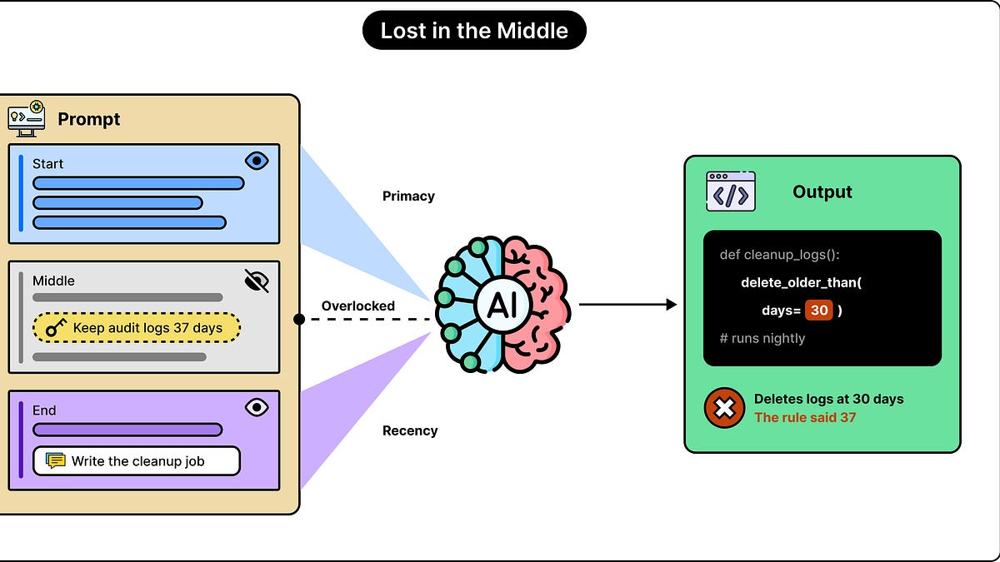

# The LLM Blindspot: Why Models Forget What’s in the Middle of Your Prompt

> Originally published at [ByteByteGo](https://blog.bytebytego.com/p/the-llm-blindspot-why-models-forget) · 2026-10-05

---

# The LLM Blindspot: Why Models Forget What’s in the Middle of Your Prompt

[ByteByteGo](<https://substack.com/@bytebytego399569>)

Oct 05, 2026

## [Govern Agent Access. Don’t Guess. (Sponsored)](<https://go.bytebytego.com/Redpanda_100526>)

AI agents are moving from demos into production, and they need more than a model. They need real-time data, fast answers, and strict limits on what they can read, write, and act on. At the Agentic Data Summit on December 9, the session Guardrails, Not Guesswork shows how to lock down agent access with the Agentic Data Plane. You’ll also see how streaming, SQL, and agents run on one platform, and get a look at where the Agentic Data Plane is headed next. It’s free, virtual, and built for engineers taking AI agents to production.

[Register Free](<https://go.bytebytego.com/Redpanda_100526>)

* * *

We can provide an LLM with exhaustive information through our prompts, but it can still fail to use it properly. When the required information sits somewhere in the middle of a long prompt, this type of failure becomes even more likely. We call it the “lost in the middle” effect or an LLM blind spot.

For example, imagine that we give an AI-based coding assistant a long collection of project documents. One specific paragraph explains that audit logs must be retained for 37 days. However, the coding assistant writes a cleanup function that deletes them after 30 days. The relevant rule was mentioned clearly. It was also part of the prompt and fit the model’s limits. Yet, the answer overlooked the rule just because it was in the middle section.

In this article, we’ll look at why LLMs have this bias against middle information. Here’s what we will cover:

  * What information is available to the model

  * Does moving the same information to different parts of the prompt change the answer

  * Why LLMs give more attention to the beginning and end of the prompt

  * Why larger context windows cannot solve the problem

  * Strategies to reduce the bias against middle information

## What Information is Available to the Model

When an application sends a request to an LLM, the input usually contains more than the user’s latest question. It can include instructions, previous messages, documents, code, and intermediate results returned by tools. Together, these form the model’s input context.

The model processes all of this information as tokens, which are basically small units of text. A token might represent a word, part of a word, punctuation, or another text fragment. The context window sets a limit on how many tokens the model can handle. This window must also be able to accommodate the generated response.

Let’s say a model supports a context window of 128,000 tokens. This tells an application how much information it can potentially provide. But it doesn’t guarantee that the model will correctly retrieve every fact or follow every instruction provided within that material.

This is similar to the difference between a system’s capacity and reliability. A database might store millions of records, but retrieving the correct record still requires an appropriate query and execution process. Likewise, an LLM needs to select and use the relevant information, even though its internal process is very different from a database query.

## Does the LLM Have a Blindspot

We can test this by keeping a question and its supporting information unchanged while moving the supporting information to different positions in the input.

For example, imagine a collection of project notes containing this fact: “The owner of Project Cedar is Adam.” The question is always, “Who owns Project Cedar?”

In the first test, the relevant note appears first within the input prompt. In another test, it appears halfway through the collection. In a third, the note appears at the very end. The other notes remain the same.

If accuracy changes substantially, the model is sensitive to where the evidence appears. A study named “Lost in the Middle”, released in 2023 and published in 2024, studied this behaviour and found that performance was often strongest near the beginning and end. However, performance in the middle was weaker. This produces a U-shaped accuracy curve. Here’s how it stacks up:

  * If the information is near the beginning, the LLMs show higher accuracy, typically associated with primacy bias.

  * If the information is near the end, the LLMs again show higher accuracy. But this is associated with recency bias.

  * Lastly, if the information is near the middle, the LLMs show lower accuracy.

Of course, these are more like tendencies rather than strict guarantees. We can get wrong answers even from beginning and ending positions. Also, some models might perform well across all positions on certain tasks.

Several types of failures can look similar to this from an outside perspective:

  * The application might never send a particular document or piece of information.

  * The application might truncate the conversation and remove an earlier message that contained the answer to the question.

  * The retrieval system might select the wrong passages.

  * Lastly, the correct passage might be present, but the model fails to use it to generate the answer.

Lost in the middle concerns this last situation. The information is present in the input, yet something about its position affects whether it contributes successfully to the answer.

## Why LLMs Give More Attention to the Beginning and End of the Prompt

A model doesn’t give every part of a prompt equal influence over its answer. Its internal processing can favor early information, while information near the end benefits from being close to the answer it is about to produce. The middle gets less of either advantage.

Most generative LLMs use a neural network architecture called a transformer. A central component of this architecture is attention.

Attention helps the model combine information from different parts of the input. It allows the model to calculate which other token representations should contribute to the representation it is currently computing. All of these contributions have different weights. Some receive more influence, while others receive less.

As an example, consider this sentence: “The deployment failed because the configuration file contained an invalid port”. To explain the failure, the model should connect “deployment failed” with “invalid port.” Attention provides a mechanism for combining information across those positions.

This happens repeatedly through multiple processing layers. Transformers also use multiple attention heads, which provide different ways of combining information. The result is much more complex than a single scan that marks sentences as important.

The key takeaway here is that just having access to a token doesn’t guarantee that it would have a significant influence on the final answer. Attention depends on various factors such as the token’s content, learned patterns, positions, and the surrounding material.

Causal masking creates an asymmetry between early and late positions.

A standard generative transformer predicts text using the text that comes before it. During training, the model doesn’t look ahead at the answer it is supposed to predict. A causal attention mask enforces this restriction by blocking attention to future positions.

Consider a prompt containing 6 tokens. Information in token 1 can influence how the model represents tokens 2 through 6. Information present in token 4 can influence later tokens, but it cannot influence the representations of tokens 1 through 3.

The model performs several layers of processing. Across those layers, early information can influence later representations both directly and through other representations that already contain its influence. This can give the beginning a structural advantage. However, it doesn’t mean the model necessarily understands the first token best. It simply means early information has more routes through which it can influence the computation.

The end of the prompt gets a different advantage. It is closer to the actual question and the answer. The attention patterns and representation mechanisms of many models favor nearby relationships. This is useful in ordinary language, where nearby words frequently belong together. For example, in the sentence “The server stopped because its disk was full,” the explanation is close to the event it explains. Models learn to make extensive use of such nearby information.

When a question comes after a long document, the final paragraphs are nearby, while the middle paragraphs are much farther away. Depending on the model, those nearby paragraphs can be easier to use.

However, there are two important qualifications to the simplified “token 1 accumulates massive attention” explanation:

  * First, permission to attend doesn’t determine the actual attention weight given to a token. The model doesn’t maintain one continuously accumulating importance score for each token.

  * Second, when generating an answer after the prompt, standard full causal attention can access all earlier prompt positions, including the middle.

Therefore, the middle is not directly hidden from the answer by the causal mask. The issue involves how information is represented and combined throughout the network.

## Why Larger Context Windows Cannot Solve the Problem

Larger context windows are great at increasing the overall capacity of a model. But they don’t guarantee uniform reliability when it comes to making every position equally useful.

We can distinguish between the two in terms of maximum context size and effective context size for a task. The first concerns the overall supported input size. The second concerns how much context the application can actually use while maintaining acceptable performance.

Effective context size depends on the task. For example, the task of finding one distinctive identifier within some documents is different from comparing several documents, resolving contradictions, or tracking changes across a long conversation.

This is where the RULER benchmark becomes relevant. The original benchmark evaluated 17 models using tasks that went beyond simple retrieval, including following chains of information and aggregating results. It found widespread degradation as input length increased. However, its limitations explicitly state that it reported scores by input length without controlling for and reporting evidence position.

## Strategies to Mitigate the Bias

While it is difficult to completely remove the bias against middle information from a model, there are a few strategies that we can use to mitigate it.

Let’s look at them in more detail:

### Prompt Optimization

Prompt organization helps make important material easier to use. A good starting point is to make the task, essential constraints, and final questions easy to identify for the model. We should not bury important information inside a large block of unrelated material.

For a coding task, a short opening statement might clearly mention a compatibility requirement. The relevant source files can follow, with a precise request at the end. For document question answering, putting the question after the documents is another useful arrangement to test.

Clear boundaries to mark different types of content also help. Markdown headings, document labels, and XML-style tags can distinguish instructions from source material and separate one document from another. However, these are practical starting points whose effectiveness should be checked on the chosen model.

For example, an application could assemble a prompt like this:
[code]
    Task: Propose a change to the cleanup worker.
    Critical constraint: Audit logs must remain available for 37 days.
    
    <document id="retention-policy">
    Audit logs must be retained for 37 days.
    </document>
    
    <document id="cleanup-worker">
    [Relevant implementation]
    </document>
    
    Request:
    Identify the required retention period and its source.
    Then propose the code change.
    Check that the change preserves the retention requirement.
[/code]

Here, the constraint comes from the supplied source. The documents have distinct identities, and the final request specifies what evidence the answer must use.

Adding these tags doesn’t change the model’s attention mask or guarantee compliance. Their main purpose is to reduce ambiguity about the organization of the input. Brief repetition can also help keep a crucial constraint visible. However, repeating the entire prompt several times adds length and can introduce contradictions if the copies diverge.

### Pruning Unnecessary Context

It is much more useful to reduce unnecessary context than enforcing an arbitrary token limit.

For example, model providers would often advise staying below a certain number of tokens, such as 20K tokens. This is more of an application-specific budget rather than a scientific boundary. There is no universal threshold at which 19,999 tokens are reliable and 20,001 become unreliable. A short prompt can fail if its instructions conflict. On the other hand, a much longer prompt can succeed when the evidence is clear, and the task is straightforward.

A better approach is to add the information needed for the task while removing material that adds little value. We should select relevant information and manage context as an application resource.Let’s say an AI assistant is investigating a database connection error. Supplying months of logs, every configuration file, and an entire deployment history creates considerable unnecessary material. A more focused input might contain the error, the relevant connection settings, the affected code, and recent changes.

As you can notice, the main difficulty is deciding what is unnecessary. If we remove an exception, dependency, or earlier decision, it will make the prompt shorter but also make it less accurate. Therefore, context selection needs to preserve the evidence required to answer the question while removing useless information.

The same care should be applied to long conversations. An application can maintain a concise record of current requirements and decisions, with references back to the original material. Summaries are useful, but they can omit details, so they should not become the only surviving source when exact information matters.

### Retrieval with RAG

Retrieval can reduce the amount of searching the model must perform inside its prompt.

A retrieval system searches a larger collection and selects relevant material before the LLM answers. This approach is commonly called retrieval-augmented generation (RAG).

Consider an AI-based support application with thousands of documentation pages. For a question about webhook retries, the system could retrieve the retry policy, relevant configuration documentation, and applicable exceptions. The LLM then answers from that smaller collection.

Retrieval can use keyword search, database queries, semantic search, or combinations of these methods. The key change is that the application takes responsibility for finding likely evidence instead of always placing the entire collection in the prompt and hoping for the best.

To be clear, this approach also has its own problems. The retrieval search may still miss the relevant passage. A retrieved excerpt may omit a necessary exception. Retrieving too many passages may recreate the original problem.

For that reason, RAG doesn’t eliminate “lost in the middle”. The retrieved material still needs sensible selection, ordering, and evaluation.

## Conclusion

The lost-in-the-middle problem reveals a blind spot for LLMs. Availability of information doesn’t guarantee that it will be used effectively. A fact can remain inside the context window and still contribute very little to the answer. What looks like forgetting is often a quirk of the attention mechanism to give relevant information enough influence during generation.

This happens partly because different positions can receive different advantages. Early information has more opportunities to influence later processing, while information near the end can benefit from its proximity to the question and the answer. Information in the middle does not benefit from both. However, the strength of this effect varies with the model, its training, and the task.

We can try to have a larger context window to expand capacity, but reliable use of that capacity still needs testing. Clear instructions, well-organized source material, and careful placement of essential details can help generate better results. Removing unnecessary context and retrieving relevant passages can also make the task easier, provided important details and exceptions are preserved. These techniques reduce the chances of overlooking information. But they don’t guarantee perfect answers.

---
*Fetched by article-pipeline · 2026-10-05*
