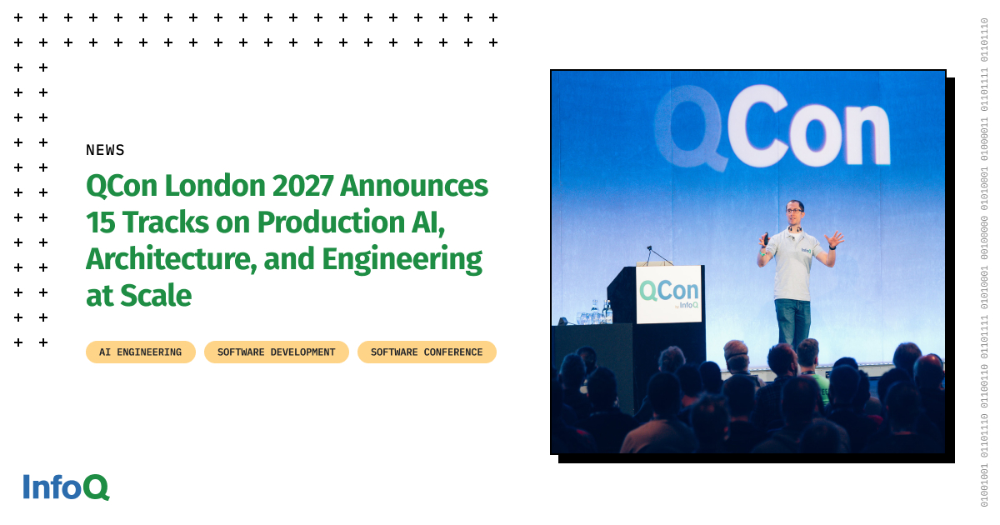

# QCon London 2027 Announces 15 Tracks on Production AI, Architecture, and Engineering at Scale

> Originally published at [InfoQ](https://www.infoq.com/news/2026/10/qconlondon-2027-track/?utm_campaign=infoq_content&utm_source=infoq&utm_medium=feed&utm_term=global) · 2026-10-06

---

[InfoQ Homepage](</> "InfoQ Homepage") [News](</news> "News") QCon London 2027 Announces 15 Tracks on Production AI, Architecture, and Engineering at Scale

[ AI, ML & Data Engineering ](</ai-ml-data-eng/> "AI, ML & Data Engineering")

[When AI Accelerates Development, Can Your CI Pipeline Keep Up? (Webinar Oct 8th) ](<https://www.infoq.com/url/t/98a0cfa1-f39c-4fa3-a936-3678f07e2250/?label=Datadog-EventPromoBox >)

#  QCon London 2027 Announces 15 Tracks on Production AI, Architecture, and Engineering at Scale 

Oct 06, 2026 4 min read 

by

  *  [Artenisa Chatziou](</profile/Artenisa-Chatziou/>)

#### Follow us on 

[Youtube232K Followers](<https://bit.ly/4bg6QM8>) [Linkedin26K Followers](<https://bit.ly/44IzAtf>) [InstagramNew](<https://bit.ly/4eYXrtM>) [RSS19K Readers](<https://bit.ly/3RaJalC>) [X57.1k Followers](<https://bit.ly/4pfxivv>) [Facebook21K Likes](<https://bit.ly/3QrGMH2>) [BlueskyNew](<https://bit.ly/4eS8FjG>)

Listen to this article - 0:00

Audio ready to play

Your browser does not support the audio element. 

0:00

0:00

  * [Reading list](</showbookmarks.action>)

AI is changing decisions across architecture, security, software delivery, and team design. But senior engineers cannot adopt every emerging practice or copy an approach without understanding the system and organizational conditions behind it. The useful questions are why an approach worked, which compromises it required, and whether the same reasoning applies to another team’s systems.

The [15 tracks at QCon London 2027](<https://qconlondon.com/?utm_source=infoq&utm_medium=referral&utm_campaign=newspost_oct6_qlondon27#program>), taking place April 13–16, are organized around those questions. More than 75 practitioner speakers will share production systems they have built, the trade-offs behind them, and what they learned when designs encountered real workloads and organizational constraints.

The program connects emerging AI practices with established concerns in architecture, distributed systems, data platforms, observability, performance, and technical leadership.

## Evaluating and controlling agentic systems

Moving an agent from a prototype into production requires teams to define acceptable behavior, test changing outputs, enforce boundaries, and respond when an autonomous system acts unpredictably.

The "[Eval Platforms & Guardrails for Agentic AI Systems](<https://qconlondon.com/?utm_source=infoq&utm_medium=referral&utm_campaign=newspost_oct6_qlondon27#program>)" track will examine the evaluation systems, feedback loops, and safety mechanisms teams are building around AI-powered software. "Protecting Systems from Humans and Agents" will explore how security changes when failures can originate from human error as well as autonomous agents.

Engineers responsible for production AI can compare how teams test failure modes and divide controls across models, applications, platforms, and operational processes. The aim is not to find one universal guardrail architecture, but to understand which controls address which risks and where gaps can remain.

## Deciding what architecture and delivery practices need to change

Adding AI to an existing system introduces new dependencies, probabilistic outputs, data flows, and scaling characteristics. The architectural challenge is not simply deciding where to call a model. Teams must integrate intelligent components without weakening reliability, operability, security, or the ability to change the system later.

The "[Architecture in the Age of AI](<https://qconlondon.com/?utm_source=infoq&utm_medium=referral&utm_campaign=newspost_oct6_qlondon27#program>)" track will examine patterns for integrating AI while maintaining scalable and reliable systems. "Architectures You’ve Always Wondered About" will look beyond simplified diagrams to the compromises involved when emerging architectural ideas meet production constraints.

AI is also changing how software is planned, written, reviewed, and released. "Designing the SDLC for the Next Era of Software Engineering" will consider how workflows and responsibilities need to evolve. "Using AI for Engineering" will address what it takes to build, scale, and maintain AI-driven systems after the prototype stage.

Together, these tracks address a practical question: which parts of architecture and delivery genuinely need to change for AI, and which established engineering principles remain essential?

## Finding the trade-offs across production systems

Teams adopting AI still need to diagnose distributed failures, maintain dependable data flows, understand system behavior, and scale without losing control.

The "[Debugging Distributed Systems](<https://qconlondon.com/?utm_source=infoq&utm_medium=referral&utm_campaign=newspost_oct6_qlondon27#program>)" track will cover techniques for diagnosing problems across microservices and distributed architectures. "[Connecting Systems: APIs, Protocols, Observability](<https://qconlondon.com/?utm_source=infoq&utm_medium=referral&utm_campaign=newspost_oct6_qlondon27#program>)" will examine the work required to keep interconnected systems reliable and understandable as they evolve.

The "[Modern Data Architectures and Platforms](<https://qconlondon.com/?utm_source=infoq&utm_medium=referral&utm_campaign=newspost_oct6_qlondon27#program>)" track will focus on scalable, real-time platforms supporting analytics and AI. "[Engineering for High Performance](<https://qconlondon.com/?utm_source=infoq&utm_medium=referral&utm_campaign=newspost_oct6_qlondon27#program>)" will examine how teams reduce latency and scale under high load.

These concerns cannot be evaluated independently. A throughput improvement may make debugging harder. A data platform designed for AI workloads may create new operational dependencies. A flexible integration layer may make failure behavior harder to reason about. Production accounts help engineers see these second-order effects before making similar investments.

## Extending technical judgment across teams

Architecture and AI decisions increasingly cross team boundaries. Senior engineers must establish direction, challenge assumptions, and create alignment without always having organizational authority.

The "[Staff+ Engineering Skills](<https://qconlondon.com/?utm_source=infoq&utm_medium=referral&utm_campaign=newspost_oct6_qlondon27#program>)" track will examine influencing across teams and contributing to technical strategy. "Managing Teams in an AI-Driven World" will explore how roles, skills, workflows, and organizational structures are changing as companies adopt AI.

For Staff+ engineers and architects, the relevant question is not only whether a technical decision is sound. It is whether its reasoning can be communicated, challenged, and applied consistently across an organization.

## Testing ideas against your own context

The conversations continue outside the scheduled presentations. [Unconference sessions](<https://qconlondon.com/beyond-the-talks?utm_source=infoq&utm_medium=referral&utm_campaign=newspost_oct6_qlondon27>) allow attendees to bring a current problem and compare possible approaches with other practitioners. Longer breaks provide time to continue technical discussions, and most session recordings remain available for 12 months.

The goal is not to collect practices to copy unchanged. It is to understand the conditions under which an approach worked, the compromises involved, and whether the same reasoning applies to the systems and teams you are responsible for.

Attendees who want to apply the program to a specific architecture challenge can join the [InfoQ Certified Software Architect in Emerging Technologies program](<https://qconlondon.com/training/apr2027/become-infoq-certified-software-architect-emerging-technologies-icsaet?utm_source=infoq&utm_medium=referral&utm_campaign=newspost_oct6_qlondon27>). It combines the three conference days with a dedicated peer cohort and a half-day workshop on April 16 led by Luca Mezzalira, an O’Reilly author and former AWS and DAZN architect. Participants work through real architecture challenges and earn the ICSAET credential after completing the program.

QCon London 2027 takes place at the QEII Centre in London. The conference runs April 13–15, followed by the certification workshop on April 16. Early-bird conference tickets are £2,290 through October 13. Conference and certification tickets are £2,800 through October 13.

[Explore all 15 tracks at QCon London 2027](<https://qconlondon.com/?utm_source=infoq&utm_medium=referral&utm_campaign=newspost_oct6_qlondon27#program>).

## About the Author

#### **Artenisa Chatziou**

Show moreShow less

####  This content is in the [AI, ML & Data Engineering](</ai-ml-data-eng/>) topic 

##### Related Topics:

  * [Development](</development/>)
  * [Architecture & Design](</architecture-design/>)
  * [AI, ML & Data Engineering](</ai-ml-data-eng/>)
  * [Software Engineering](</SoftwareEngineering/>)
  * [Architecture](</architecture/>)
  * [QCon London 2027](</qcon-london-2027/>)
  * [Artificial Intelligence](</artificial_intelligence/>)
  * [AI Architecture](</ai-architecture/>)
  * [QCon Software Development Conference](</qcon/>)

  * #### Related Editorial

  * #### Related Sponsors

  * #### Related Sponsor

    * October 29, 2026, 1 PM EDT

##### [From Tokens to Features: Architecting Cost Attribution for AI-Assisted Engineering](</url/f/37766b8a-e117-471a-a61f-a61696a39baf/>)

[Presented by: Martin Reynolds - Field CTO at Harness](</url/f/8cbca51d-6b08-4bf2-9b5a-da2958a15695/>)

---
*Fetched by article-pipeline · 2026-10-06*
