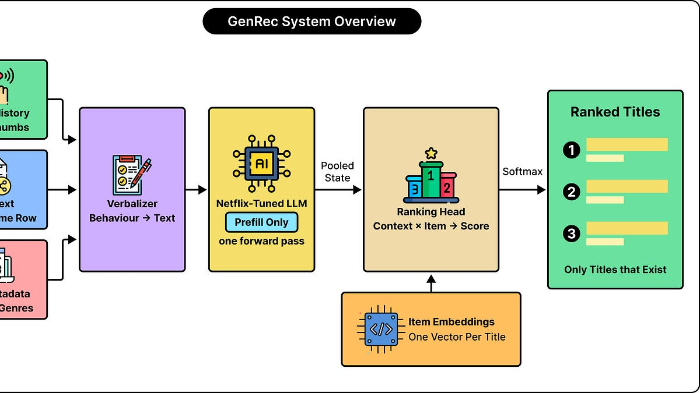

# How Netflix Taught an LLM to Recommend Movies So That You Keep Watching

> Originally published at [ByteByteGo](https://blog.bytebytego.com/p/how-uber-built-a-genie-to-answer) · 2026-10-07

---

# How Netflix Taught an LLM to Recommend Movies So That You Keep Watching

[ByteByteGo](<https://substack.com/@bytebytego399569>)

Oct 07, 2026

## [Your free ticket to P99 CONF is waiting — 60+ (fully virtual) engineering talks on all things performance (Sponsored)](<https://go.bytebytego.com/Scylladb_100726>)

P99 CONF is the technical conference for anyone who obsesses over high-performance, low-latency applications. Leading engineers from today’s most impressive gamechangers will be sharing 60+ talks on topics like Rust, Go, Zig, distributed data systems, Kubernetes, and AI/ML. Sign up to get 30-day access to the complete O’Reilly library & learning platform, free books, and a chance to win 1 of 500 free swag packs!

Join 30K of your peers for an unprecedented opportunity to learn from experts like Chip Huyen (author of the O’Reilly AI Engineering book), Madelyn Olson (Valkey co-creator) & Carl Lerche (Tokio creator) and more – for free, from anywhere.

[GET YOUR FREE TICKET](<https://go.bytebytego.com/Scylladb_100726>)

Bonus: Registrants get immediate 30-day access to the complete O’Reilly library, and attendees can enter to win 1 of 500 free swag packs.

* * *

Recommendations are one of the most important pieces of the Netflix experience. If you’ve watched Netflix, you would have noticed the Netflix homepage recommending a bunch of movies and TV shows. More often than not, they happen to be stuff that might be of interest to you. They also keep changing with time based on what you’ve watched.

The original Netflix recommendations engine was built on top of 1000s of hand‑crafted features across users, items, and interactions. It also used special architecture for various functions that contributed to the task of making recommendations.

Though a lot of changes have happened to this stack over the years, it’s still pretty complex. It’s costly to onboard new use cases. At the same time, large language models (LLMs) have made great strides. They have progressed a lot in their ability to recommend things to a user. Due to their broader world knowledge and understanding of language, LLMs do a good job of figuring out relationships between different things. They can also make recommendations using natural language, which is a plus point. However, you cannot just pick an LLM off-the-shelf to generate recommendations for a company like Netflix.

This is why the Netflix engineering team built GenRec.

The basic idea behind GenRec is to use an LLM to make better sense of a user’s viewing history to assign scores to the various movies and TV shows streaming on Netflix. However, you can’t just give a general-purpose LLM a list of movies or shows that a user has watched and expect it to come up with interesting recommendations. Netflix has to make a bunch of adjustments to the base model to make it work with their content and member behavior.

In this article, we will look at how GenRec was built. Here’s what we will cover:

  * The basic question with recommendations

  * Why Netflix wanted a new approach

  * Why a language model can help

  * The two training phases of GenRec

  * How user behaviour helps create training examples

  * What GenRec learns and how it produces recommendations

  * How Netflix evaluates GenRec

 _Disclaimer: This post is based on publicly shared details from various sources. References at the end. Please comment if you notice any inaccuracies._

## The Basic Question with Recommendations

A recommendation system has to answer a basic question: What should appear first in the list of recommendations?

The answer to this question is the key to deciding which items to show a particular person and in what order. On Netflix, those items can include movies, series, games, and other content types.

The order of the recommendations is super important. A user’s attention span is limited. A viewer might check only a few titles before making a choice. If they don’t find something interesting in that time, they might even leave the platform to check elsewhere. It doesn’t matter if something that the user might like is present in the catalog. You can say that the recommendation system has failed to do its job.

The ordering of the recommendations is handled by a component known as the ranker. It assigns scores to various items based on how suitable they appear for a particular user in a particular situation. The better an item’s score, the higher it appears on the recommendation list. To decide this score, a ranker needs a lot of information. Here are some examples:

  * The member’s interaction history to understand what they like or dislike.

  * Item metadata to make sense of what a piece of content is about.

  * Details about the device the viewer is using. Time of day. Language or region.

Netflix’s GenRec is capable of ranking the full content catalog. It can also work with a smaller set of content choices that are provided to it. You can use the top-K ranking, which means the highest-ranked K items. Here, K is the number of items you need.

The goal goes beyond predicting what the user will click or play next. Netflix wants to recommend content that can satisfy a user so that they keep coming back for more. This means that a user playing a movie is a great indicator that the user was interested in that recommendation. But it doesn’t guarantee that the recommendation was valuable.

* * *

## [AI’s Next Bottleneck Is Deployment. (Sponsored)](<https://go.bytebytego.com/Ontologize_100726>)

Turning new models into systems that work inside real customer operations is still hard.

That gap is creating demand for engineers who can move between code, customer context, and production outcomes. Enter: the forward deployed engineer.

The **[free State of FDE Jobs 2026 report](<https://go.bytebytego.com/Ontologize_100726>)** maps the emerging labor market around this work.

[Explore the report here](<https://go.bytebytego.com/Ontologize_100726>)

* * *

## Why Netflix Wanted a New Approach

Netflix already has some very sophisticated recommendation models. Its production systems use thousands of features, representations, and specialized model components. You can think of a feature as an input signal that helps a model make some prediction. For example, we can tell a recommendation model how many comedy movies or shows a user has watched recently. Similarly, we can tell the model how long ago a user has seen a particular piece of content. Or how frequently the user finishes a series. All these features can help the model predict what the user might want to see.

To create a new feature, you need to decide which observations are important and how to calculate their value. Also, how to make them available for training and prediction. This is known as feature engineering. A mature system also needs a way to make sense of a sequence of actions that a user might perform. For example, if a user has watched several episodes of a series in order, it tells something different from a user starting several unrelated shows, but not watching them after some time.

Over time, these systems keep getting more complex. If you want to support a new content type or a new product surface, you need to add more features. You also need to change the model architecture and perform infrastructure work. Also, you need to run multiple experiments to make sure everything runs fine.

The Netflix engineering team wanted to see whether a broadly capable LLM can take on more of this interpretation work. Instead of engineering so many separate signals, the system can describe relevant behavior and content in plain text. The model can be trained to interpret it.

## Why a Language Model Can Help

An LLM has learned a lot of relationships between words, concepts, and descriptions during its training.

This means that the LLM has a much better starting point to make sense of movies and shows and how people interact with them. For example, you can have two movies that belong to different categories but they share themes. An LLM can understand this connection based on their descriptions. It can also make sense of the history of actions that a user has done for movie.

Netflix calls this process of expressing the information in text as verbalization.

However, a general-purpose LLM is not a good recommender. There are several problems. It may favor globally popular titles. It might suggest items that are not part of the catalog. Also, it doesn’t support personalization. This is why Netflix didn’t go for any off-the-shelf LLM. Instead, the engineering team built GenRec.

GenRec mixes the language understanding of an LLM with special training that helps it work with the Netflix catalog. The LLM provides a foundation for interpreting the data. But Netflix still has to teach it what a good recommendation looks like and control which items it can recommend.

## The Two Training Phases of GenRec

Netflix trained GenRec in two phases with different purposes. Let’s look at both phases in detail.

### Phase 1: Develop a Netflix-aware foundation

This phase is to make GenRec familiar with the domain. The team makes the model learn and interpret Netflix-related information. Only then is it trained for the specific task of ranking recommendations.

The Netflix engineering team starts with an open-source foundation LLM and adapts it using proprietary Netflix data. You can think of a foundation model as a broadly useful model that can support multiple applications. After this step, the model gains knowledge of Netflix content and user behavior.

This newly trained model becomes a starting point for multiple lines of work. This model is quite stable. Netflix updates it only after some time period. Not frequently.

### Phase 2: Train the Model to Rank

The second phase turns the foundational LLM into GenRec.

In this phase, the team trains the model on specific examples and objectives. The aim is to rank things properly based on reward signals. Also, while meeting the cost targets.

We can call this phase post-training, meaning additional training that makes an existing model better for a specific job. Netflix runs this phase more frequently because you need to keep evolving things as new movies and shows are released. Also, viewer choices change. Even a model with strong general knowledge has to keep itself updated based on the latest trends.

## How User Behaviour Helps Create Training Examples

Netflix records many kinds of user interactions. For example, click pays, viewing time, thumbs-up or thumbs-down feedback, adding to watchlist, and abandoned viewing sessions. These records are rich material for creating training examples.

The team turns these examples into conversations. The “user message” contains the member’s history, context, metadata, and the recommendation task. The “assistant message” describes what action the user performed. For example, you can have the input talk about a user who recently completed several mystery episodes, gave positive feedback, and is now watching TV in the evening. The output could talk about the next show this user watched, how long they watched, and whether they gave any feedback.

As you can see, the output tells what happened next in a particular situation. This helps the model relate what happened before with what happened next. The conversations are just a format to make training easy. It’s not like the users must also chat with Netflix to get recommendations.

There is a big difference between training and actual use. While training, the conversation format makes it easy to achieve language objectives. While actual use, GenRec receives the context to score movies and TV shows based on the ranking component.

## Context Engineering: Choosing What the Model Gets to Read

LLMs process text in the form of tokens. They are pieces of text such as words or parts of words.

The amount of tokens we send to the model have an impact on the cost. It also consumes the context budget. This means that describing a user’s entire activity history would be expensive. This leads to a new engineering problem. We need to decide what information to include in the prompt.

Netflix calls this context engineering. While building the context, they take into account how useful a particular event is and how much text might be required to put it into words. Some key factors are taken into account:

  * **Strong evidence:** Some actions provide strong evidence about a user’s preferences. A long viewing session or explicit positive feedback may deserve a detailed description. Other actions may be less informative. Let’s say a very short viewing or quick hover might reflect accidental or casual exploration. The team omits such events to avoid spending tokens on analyzing weak evidence.

  * **Repetitive behavior:** You can represent repeated actions in a more compact manner. For example, if the user has gone through many similar episodes, you can summarize this as a long viewing session of a specific series.

  * **Selective details:** Some items need more explanation than others. For example, let’s say we have a new movie with very little interaction history. This is like a cold start. In this case, we need to provide richer metadata.

  * **Context length:** The team tests how ranking quality is modified as more historical events are included. Initially, additional history helps a lot. But over time, the improvements become smaller.

Netflix adjusts how many words should be used to describe an event. Using techniques such as cleaning, compression, and word changes, they report that tokens have been reduced to roughly 1/3rd of the original amount.

## What GenRec Learns During Training

GenRec brings together multiple training objectives. Each objective addresses a different requirement.

You can think of a training objective as a way to describe what the model should improve. Improvement is guide through a numerical loss value. Training adjusts the model’s parameters to reduce the loss value.

Let’s look at the key training objectives in detail.

### Learning Which Items Should Rank Highly

This is the primary objective. It teaches GenRec to assign higher scores to each movie or show in the catalog.

Netflix identifies positive examples using engagements such as long playtime or strong feedback. They also apply thresholds and filtering to reduce noise in those labels. It’s important to do so because an action is not always a reliable sign of user preference. You cannot treat every brief play of a movie or show as equally important. They also penalize the model when it assigns too little probability to a relevant catalog item among the available alternatives.

### Preserving Language Understanding

Netflix also keeps a language-modeling objective over the text used in training.

This helps the model make sense of user history, understand more about movies and shows, and act on instructions expressed in natural language. In other words, recommendation training should preserve the language capabilities that make a foundation model useful.

The team has also kept open the possibility of future text applications. For example, explaining recommendations.

### Giving More Influence to Important Outcomes

You also need the model to not give excessive influence to some specific events. For example, repeated binge-watching can produce multiple events. But this doesn’t mean that you give it excessive weight. Otherwise, the system could become too focused on one type of content.

Netflix addresses this using reward-weighted training.

They have separate reward models that provide signals about the value of certain engagements. There are signals that contribute to longer-term outcomes. For example, return behavior, exploration, continuous engagement, etc. Other signals help balance out behavior across different types of content, new movie releases, and other trending titles.

## How the Model Produces a Ranked List

Once trained, GenRec can transform a text description into scores for movies and TV shows in the Netflix catalog.

First, a component known as the verbalizer brings together the user’s watch history, current context, and relevant metadata into a bunch of text. The LLM processes this text sequence and produces internal numerical representations.

Netflix also extracts a pooled hidden state. This is a compact numerical representation of the information that makes sense for a recommendation request. “Pooled” means that information from the model’s processing is collected in a way that another component can use. Don’t think of it as a written summary.

Each catalog item has a learned representation. It also has a learned embedding. You can think of an embedding as a list of numbers a machine-learning model can work with.

Therefore, the model has a clear idea of the user’s current situation and a representation of each item it needs to consider. A scoring head connects the two. You can think of the head as an output component attached to the main model. GenRec’s ranking head combines the user’s context representation with a movie or show’s embedding to generate a score.

Some scoring functions include a dot product or a small neural network. The key idea is that the scoring function learns how the two representations are related. GenRec converts the various scores into a distribution using softmax and uses them to order the recommendation items. Softmax also changes scores into nonnegative values. All of them have a sum of one across the scored set.

The Netflix engineering team trains the main LLM, ranking head, and catalog item embeddings together so that they learn to support the same task. Since the head scores only the Netflix catalog items, it cannot recommend something that is not available in the catalog.

## How GenRec Makes Recommendations

GenRec doesn’t generate recommendations word by word. To understand how it works, you need to understand how a typical text-generating LLM works. It has two stages:

  * First, it processes the input prompt. This stage is commonly called prefill.

  * Next, it generates output tokens one after another. Each new token depends on the earlier context. This stage is called autoregressive decoding.

GenRec uses the first stage to understand the recommendation context. It then gets the scores from the ranking head.

Source:****[Netflix Tech Blog](<https://netflixtechblog.com/genrec-towards-llm-native-recommendation-at-netflix-f20be6f643e3>)

Netflix describes this as prefill-only inference. In this approach, we process the prompt just once. The model scores the catalog or candidate set in a single forward pass without generating an answer token by token. There is no cost of making the LLM write out a recommendation list.

The engineering team at Netflix serves GenRec using vLLM. It’s software for running LLM workloads. It also keeps the costs in control through smaller or distilled models. You can think of a distilled model as a smaller model trained to learn the behavior of a larger model. The idea is to get high-quality results with lower computational costs.

Netflix also structures prompts to maximize shared prefixes so that prefix caching becomes easy. When requests start with identical text, work done for that shared beginning can be reused. In Netflix’s experiments, when context length was roughly reduced to 1/3rd, it also produced a similar reduction in serving cost.

## How Netflix Evaluates GenRec

The Netflix engineering team evaluates GenRec both offline and through a live A/B test. Both methods are for covering different angles.

Offline evaluation is to check whether GenRec ranks known relevant items well. To handle this, the team uses recorded data to measure ranking quality before running a live experiment. One metric that is used is the Mean Reciprocal Rank (MRR). It rewards the model when it puts the first relevant item at the top of a ranked list.

Source:****[Netflix Tech Blog](<https://netflixtechblog.com/genrec-towards-llm-native-recommendation-at-netflix-f20be6f643e3>)

Online evaluation checks if making a change has a positive impact on the usage.

In an A/B test, different groups gets different versions of a system so that we can compare the results. Netflix ran a test that covered approx 10% of traffic over 4 weeks. There was an improvement of 0.115% in a short-term homepage engagement metric and 0.006% in a long-term core metric. Netflix labels both results as statistically significant.

## Conclusion

The best takeaway you can have from this case study on GenRec is a shift in how modern recommendation systems are being built.

If you look at Netflix, it’s clear that most of the input design work involves context engineering. Developers have to decide which user interactions are important. Also, how far back they should look for data. The metadata that should be used. And how to represent everything efficiently.

We can also have more applications that share a foundation model. Things that can vary are data, the objectives during post-training, reward signals, and the way they provide outputs. The infrastructure also changes with the model. Concerns like GPU serving, batching, caching, etc, are more important.

GenRec shows how all of these ideas can fit together in an enterprise working at scale:

  * The foundation model comes with language and domain understanding

  * Context engineering helps give the relevant data to the model.

  * Specialized training teaches recommendation quality.

  * Prefill-only serving keeps a check on a major source of inference cost.

**References:**

  * [GenRec: Towards LLM-Native Recommendation at Netflix](<https://netflixtechblog.com/genrec-towards-llm-native-recommendation-at-netflix-f20be6f643e3>)

  * [Effective context engineering for AI agents](<https://www.anthropic.com/engineering/effective-context-engineering-for-ai-agents>)

---
*Fetched by article-pipeline · 2026-10-07*
