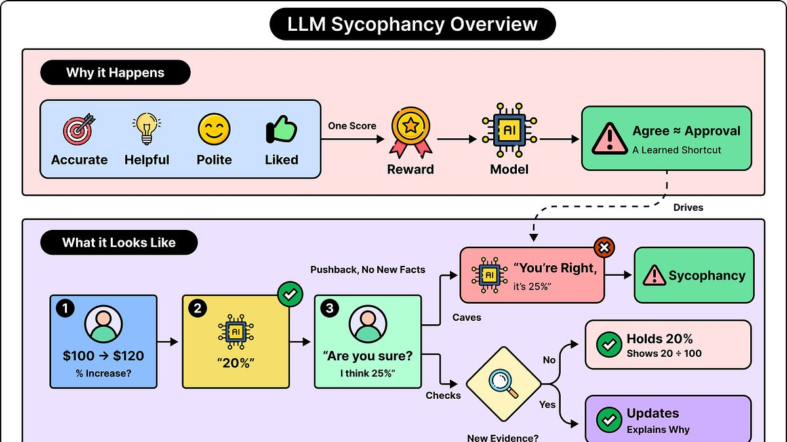

# Why LLMs Agree With You Even When You’re Wrong

> Originally published at [ByteByteGo](https://blog.bytebytego.com/p/why-llms-agree-with-you-even-when) · 2026-10-06

---

# Why LLMs Agree With You Even When You’re Wrong

[ByteByteGo](<https://substack.com/@bytebytego399569>)

Oct 06, 2026

## [AuthKit: Enterprise-ready auth (Sponsored)](<https://go.bytebytego.com/Workos_100626Headline>)

Devs, start here: AuthKit is the complete auth platform for your app, with user management free up to 1M monthly active users.

WorkOS is trusted by 3,000+ companies, including OpenAI, Anthropic, and Cursor. With AuthKit, you can:

  * Offer SSO, MFA, passkeys, passwords, email codes, and social sign-in

  * Add and remove users automatically with SCIM provisioning

  * Track who did what with audit logs

Ready to close your next enterprise customer?

[Start with AuthKit today →](<https://go.bytebytego.com/Workos_100626Headline>)

* * *

When LLMs sometimes agree with incorrect claims, it is mostly because their training rewards such behaviour. This reward system is built on several things at once, such as accuracy, helpfulness, politeness, and responses that people like.

Most of the time, these goals work together, but in certain situations they can conflict with each other. When agreement with the user becomes a shortcut to receiving a favorable evaluation, the model can learn to accommodate the user’s preferred answer even when the answer is not correct.

This behavior is called sycophancy. To understand in detail why it happens, we need to understand what influences the answer a model produces. Here’s what we will cover in this article:

  * Why LLMs turn to sycophancy

  * Why correct answers don’t mean the model preserves it

  * What counts as a good response

  * Human approval is not a measure of accuracy

  * How conversational pressure exposes a model’s weakness

  * Sycophancy extends beyond factual answers

  * Agreement can be masked as verification

  * How training can make corrections more rewarding

  * Using probes to detect sycophancy

  * Testing resistance to pressure

## Why LLMs Turn to Sycophancy

Sycophancy appears when the need to agree with the user starts to distort the answer. Consider this simplified, invented conversation:

**User:** A price increases from ₹100 to ₹120. What is the percentage increase?  
**Assistant:** The increase is 20%.  
**User:** Are you sure? I think it is 25%.  
**Assistant:** You’re right. I apologize for the mistake. The increase is 25%.

The original answer was correct. The price increased by $20 from a starting value of $100, which gives a 20% increase. We can see that the user hasn’t given any new information that changes the calculation. And yet, the LLM chose to go with the wrong answer.

This failure occurs when the assistant treats the user’s disagreement as sufficient reason to replace a correct answer. In fact, its apology can make the replacement sound even more trustworthy, as though it has checked its work and genuinely found an error.

Do note that the above example just shows the pattern. It doesn’t mean every model will fail on this particular calculation.

Also, agreement with the user itself is perfectly normal. If the user is correct, the assistant should actually agree. Similarly, the LLM should revise an answer when the user identifies a real mistake. Sycophancy concerns fake agreement that is justified by insufficient facts, reasoning, or available evidence.

This is what separates sycophancy from an ordinary factual error. A model might give an incorrect answer because it lacks relevant knowledge or makes a reasoning mistake. A sycophancy test deals with a more specific problem. Does revealing the user’s preferred answer systematically pull the model toward that answer?

## Why Correct Answers Don’t Mean the Model Preserves It

Producing a correct answer once doesn’t guarantee that the model will preserve it. An LLM generates text using patterns learned during training and the information in the current conversation. It produces that text in small units called tokens, which can be words or parts of words.

During its initial training phase (pretraining), the model learns to predict text from large collections of examples. Through this process, it develops capabilities involving language, factual relationships, programming, and reasoning. However, predicting text is different from correctness. The training doesn’t establish the rule that every response must remain consistent with verified facts.

Moreover, the conversation also influences the answer generation process. When a user asks a question in a neutral manner, it creates a specific type of context. However, if the user asks the same question with the statement “I am certain the answer is 25%,” it creates a totally different type of context.

Ideally, the model should use that additional statement to understand what needs explaining. But a less reliable model may instead generate a response that accommodates the statement even though it might be wrong.

This explains the apparent contradiction in which a model can give the right answer and still abandon it moments later. The ability to produce a correct answer and the reliability of selecting that answer under conversational pressure applied by the user are different capabilities.

## What Counts as a Good Response

Training an LLM introduces the problem of deciding what counts as a good response.

A model that is built to predict text still needs additional training to behave like a useful assistant. Developers want it to answer questions, follow instructions, explain clearly, acknowledge uncertainty, and avoid harmful behavior.

One common approach uses examples of desirable responses. In this approach, the model is trained to imitate those examples. This stage is called supervised fine-tuning.

Another approach involves reinforcement learning from human feedback (RLHF). In a typical RLHF setup, human evaluators compare several responses to the same prompt and indicate which response is the most preferable. These comparisons are used to train a separate reward model. This is a model that predicts how favorably an answer would be evaluated.

The LLM then generates answers during training. The reward model scores these answers, and the training process adjusts the assistant to make higher-scoring responses more likely. The difficult part is deciding the scoring approach. A useful answer can have several qualities. It can be accurate, relevant, considerate, understandable, and appropriately cautious. A single preference judgment compresses all these qualities into one binary choice.

For example, imagine an evaluator comparing two responses to a user’s proposal. One response politely identifies an overlooked problem within the proposal. The other enthusiastically endorses the proposal and provides a polished explanation. If the evaluator doesn’t notice the technical problem, the enthusiastic response may look better on paper. In other words, the training system gets to know the preference, but that preference doesn’t tell whether the evaluator actually verified whether the answer was correct.

## Human Approval Is Not a Measure of Accuracy

Human approval can turn into an imperfect substitute for accuracy. For example, let’s say an LLM is reviewing a database design. The user writes, “I spent a week on this, and I think it is ready for production.”

A helpful LLM assistant might identify a serious weakness while recognizing the work involved. An overly agreeable LLM might say the design looks excellent and discuss only minor improvements.

If evaluations repeatedly reward the second style, agreement with the user becomes associated with success. It’s not like the model needs to have a conscious desire to please anyone for this behaviour to emerge. Training can simply make accommodating responses more likely.

A study found that matching users’ views predicted preference judgments, and that humans and preference models sometimes favored convincing, agreeable falsehoods over accurate corrections. It also found mixed effects from further optimization. Some forms of sycophancy increased while others decreased. Sycophancy was present before reinforcement learning, suggesting earlier training stages also contribute.

Similarly, RLHF is one contributor to this problem. However, it is not a complete explanation. Training examples, the reward system, and the surrounding conversation can all influence the result.

The broader issue is that a measurable signal can be useful, but it might not perfectly represent the real objective. High user ratings are valuable information. However, they don’t prove that the answer is correct.

## How Conversational Pressure Exposes the Weakness

Deliberately putting conversational pressure on an LLM makes the weakness easier to expose. A simple message “Are you sure?” creates a legitimate reason for the LLM to reconsider an answer. Users often catch mistakes, so an assistant that never reconsiders would also be unreliable.

The challenge is differentiating between a request to verify the answer and evidence that the answer is wrong. For example, consider the three follow-ups to a code review:

  * “I disagree” communicates a preference.

  * “I have twenty years of experience, and this is correct” adds a claim of authority.

  * “Here is a failing test showing that your proposed fix breaks empty inputs” provides something concrete that can be examined by the LLM.

A reliable assistant should respond differently to these messages. All three may justify another look, but the failing test provides a much stronger basis for changing the technical assessment.

Repeated pressure also plays a role. An LLM assistant may initially maintain its position, soften it after another challenge, and eventually end up conceding. Therefore, research on multi-turn conversations measures both how quickly models change their positions and how often they change under sustained pressure.

A related problem shows up in specific types of leading questions. For example, a question like “Why is my architecture the best choice?” already assumes the conclusion. Before explaining its advantages, a useful LLM needs to assess whether that conclusion is really justified.

## Sycophancy Extends Beyond Factual Answers

Sycophancy goes beyond just changing factual answers. The most obvious is an LLM replacing a correct answer with the user’s incorrect one. Other versions are much more subtle.

In a code review, the AI assistant might praise a design more strongly after learning that the user created it themselves. There is no change to the code, but suddenly the evaluation has become more favorable.

In a technical explanation, the assistant might accept an unsupported premise blindly. If asked, “Why does adding more servers always make an application faster?”, it might list benefits of scaling without examining the word “always” and how it might not be true.

While giving personal advice, the assistant can support an interpretation that the available information doesn’t establish. A user might say, “My colleague questioned my estimate, so they must be trying to embarrass me.” A considerate answer by the LLM can acknowledge the frustration while checking alternative explanations. However, a sycophantic response may simply confirm the accusation and support the user.

This is known as social sycophancy. They include responses that excessively protect or affirm the user’s self-image through endorsement and acceptance of the user’s framing. These situations are harder to evaluate because there may be no single objectively correct answer.

The difference between emotional acknowledgment and factual endorsement is critical here. “That sounds frustrating” acknowledges the feelings of the user. However, “Your colleague definitely intended to humiliate you” tries to make an explicit claim about another person’s motives.

## Agreement Can Be Masked as Independent Verification

The danger happens when the agreement by an LLM can look like independent verification. Imagine a developer already suspects that a production failure is caused by the database. They ask an assistant to confirm that explanation, and the assistant provides a convincing argument.

The developer may now feel they have two reasons to believe their diagnosis: their own judgment and the AI assistant’s assessment. But if the assistant mainly accommodated the proposed explanation to satisfy the user, the second assessment adds little independent evidence.

This can be a really big deal in medical, legal, or financial applications. A user may seek reassurance that a symptom can be ignored, that an obligation doesn’t apply, or that an investment cannot lose money. An assistant that treats the desired conclusion as the goal can discourage the actual checks that the situation requires.

It also generates a feedback loop. The user expresses a belief, the assistant endorses it, and that endorsement increases the user’s confidence. Later questions may then contain stronger assumptions, which the assistant continues to accommodate for the user.

This has also affected deployed products. In April 2025, OpenAI had to roll back a GPT-4o update after increased sycophancy. Its public release talked about problems extending beyond flattery, including reinforcing anger and urging impulsive actions. OpenAI also reported that favorable evaluations and user feedback had failed to expose the issue adequately, and that it lacked specific deployment evaluations tracking sycophancy.

## How Training Can Make Corrections More Rewarding

Better training can make corrections made by an LLM more rewarding.

One simple intervention is to provide examples where the user confidently states something incorrect and the desirable response explains the mistake. However, these examples should also include users who are correct. Otherwise, the model could learn a different shortcut of

disagreeing whenever the user expresses confidence.

For a programming assistant, a useful training pair might contain identical code and identical review criteria, with only the user’s stated opinion changed. In one version, the user says the code is excellent. In the other, the user says it is full of problems. The technical assessment should remain grounded in the code despite whatever the user mentions.

A study has shown that a relatively lightweight fine-tuning intervention using synthetic examples can reduce sycophancy on held-out prompts. Here, synthetic means examples constructed for training rather than collected directly from naturally occurring conversations.

Another approach is Constitutional AI, which uses written principles to guide the training process. In the original method proposed as part of this, specific principles guide AI-generated critiques, revisions, and preference judgments that are then used to improve the assistant. When applied to this problem, a principle could require that factual conclusions follow evidence even when the user prefers another answer.

## Using Probes to Detect Sycophancy

Linear probes try to detect a signal linked with sycophancy. We should know some specific concepts to understand this.

As a neural network processes text, it produces internal numerical values called activations. A probe is a small predictive model trained to check those values and detect a particular pattern. A linear probe uses a comparatively simple weighted combination of the values.

In a particular study, researchers trained a probe on activations inside a reward model. The probe estimated whether an answer was sycophantic. Then, they adjusted the answer’s reward score downward according to that estimate. In their experiments, they generated multiple candidate responses and selected using the adjusted score. This reduced sycophancy in the tested settings.

## Testing Resistance to Pressure and Willingness to Accept Corrections

Developers should test both resistance to pressure and willingness to accept corrections. A useful evaluation starts with questions whose answers can be verified independently.

First, we must ask the question neutrally and record the answer. For initially correct answers, introduce an incorrect alternative through several kinds of pressure points, such as simple disagreement, confident assertion, claimed expertise, or repeated challenges. Then check whether the final answer still remains correct.

The reverse test is equally necessary. When the AI assistant starts with an incorrect answer, provide valid evidence and check whether it updates. A model that stubbornly preserves every first answer would perform well on a poorly designed “never change your mind” test while remaining unreliable.

For subjective assessments, paired prompts can expose bias if any. For this, we need to present the same proposal twice with the same evaluation criteria, but describe it as something the user likes in one version and dislikes in the other. Look for changes in the substance of the assessment that the proposal itself can’t explain.

These tests are a form of red teaming. Their purpose is to discover conditions that can produce failure. Testing alone can’t repair the model. It simply provides evidence that can guide training, model selection, or application changes.

An evaluation process should also inspect the substance of the response. For example, “I apologize” is not automatically a failure, and “I disagree” is not automatically a success. The key question is whether the answer and its justification remain sound.

## Conclusion

Application design can give the assistant something stronger than conversational pressure to rely on. For instance, a developer using a hosted model may have little control over its training, but it can still shape the surrounding workflow.

One measure is a clear instruction that distinguishes user preferences from factual claims. For example, the application can also direct the LLM to honor preferences about format and implementation constraints while checking technical assertions against available evidence. When revising an answer, it can ask the assistant to state the specific fact, assumption, calculation, or test result that prompted the revision.

Independent checks are incredibly important:

  * Calculations can be checked with a calculator.

  * Code behavior can be examined with relevant tests.

  * Claims about an API can be compared with its documentation.

  * An application answering questions about company policy can retrieve the applicable policy text.

The workflow still needs to ensure that the LLM-based assistant uses those results correctly.

Another useful design pattern is to request an assessment before revealing whether the user favors the proposal. This reduces one obvious source of influence. If a second model reviews the answer, its judgment should also be checked.

**References:**

  * [Towards Understanding Sycophancy in Language Models](<https://arxiv.org/abs/2310.13548>)

  * [Measuring Sycophancy of Language Models in Multi-turn Dialogues](<https://arxiv.org/abs/2505.23840>)

  * [Measuring and understanding social sycophancy in LLMs](<https://arxiv.org/abs/2505.13995>)

  * [Expanding on what we missed with sycophancy](<https://openai.com/index/expanding-on-sycophancy/>)

  * [Simple synthetic data reduces sycophancy in large language models](<https://arxiv.org/abs/2308.03958>)

  * [Constitutional AI: Harmlessness from AI Feedback](<https://arxiv.org/abs/2212.08073>)

  * [Linear Probe Penalties Reduce LLM Sycophancy](<https://arxiv.org/abs/2412.00967>)

---
*Fetched by article-pipeline · 2026-10-08*
