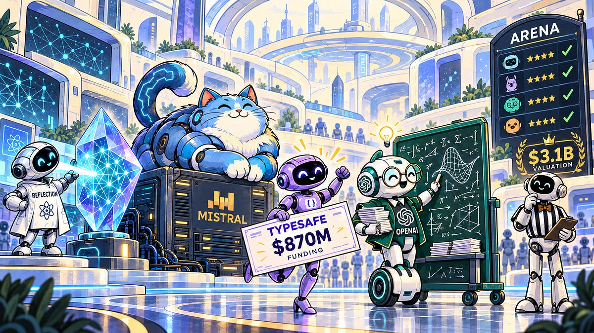

# The Sequence Radar - Issue 948: Last Week in AI: Billions in Funding, Hundreds of Papers, One Big Leap?

> Originally published at [TheSequence](https://thesequence.substack.com/p/the-sequence-radar-issue-948-last) · 2026-10-11

---

# The Sequence Radar - Issue 948: Last Week in AI: Billions in Funding, Hundreds of Papers, One Big Leap?

### Reflection and Mistral expand the model race, TypeSafe and Arena raise the stakes, and OpenAI puts mathematical discovery under scrutiny.

Oct 11, 2026

## Next Week in The Sequence:

  * We continue our series about recursive self improvement. 

  * The learning loop dives into Reflection’s new model, EmbeddingGemma2 and Mistral4. 

  * Our opinion section dives into the debate whether value in AI is accumulating on the infrastructure vs. the application layer. 

  * We will discuss another robotics stack. 

## Subscribe and don’t miss out:

TheSequence is a reader-supported publication. To receive new posts and support my work, consider becoming a free or paid subscriber.

TheSequence is a reader-supported publication. To receive new posts and support my work, consider becoming a free or paid subscriber.

## 📝 Editorial: Billions in Funding, Hundreds of Papers, One Big Leap?

AI’s weekly news cycle increasingly resembles two competitions running in parallel: researchers compete to improve intelligence, while investors compete to price its future. This week, Reflection and Mistral supplied new models, TypeSafe supplied another spectacular financing, and Arena supplied a reminder that someone must measure what all this intelligence does. Together, they suggest a market developing interesting ambitions beyond a better chatbot.

Reflection introduced Beam, a mixture-of-experts model with 501 billion parameters, of which 23 billion activate per token. Its technical story centers on reinforcement learning and inference efficiency: Reflection reports generating more than 100 million training rollouts and achieving competitive reasoning performance with substantially less estimated inference compute than some larger rivals. Those estimates are not measured deployment costs, and the weights remain promised for later this month. Still, the proposition matters: agents that execute lengthy workflows need intelligence with an operating budget.

Mistral offered a European counterpart with Large 4, nicknamed Le Chonk. The trillion-parameter multimodal model entered public API preview, with weights scheduled for release by month’s end. Mistral emphasizes coding, cybersecurity, finance, and law, alongside training on infrastructure it operates in Europe. My reading is that sovereignty is becoming a product feature. For an enterprise, choosing a model also means choosing who controls deployment, customization, and continued access. An impressive benchmark cannot answer those questions.

OpenAI added a more fundamental dimension: intelligence contributing to mathematical discovery. The company released more than 700 manuscripts from an unreleased model, reporting progress on open research problems and supplying Lean formalizations for a portion of the results. Verification remains unfinished, and several manuscripts have already been corrected or withdrawn. That distinction matters: generating a plausible proof and establishing mathematical knowledge are different achievements. Yet the possibility is extraordinary. AI could accelerate research enough that checking, interpreting, and connecting its results becomes a central bottleneck. Arena’s question—can we trust what the model did?—suddenly extends from enterprise workflows to the foundations of science.

TypeSafe’s $870 million Series A, led by Andreessen Horowitz at a $7.5 billion valuation, put a price on a different architectural bet. Its Jev model produces typed decisions with confidence estimates that software can consume directly. Consider the thousands of small judgments inside a business process: classify this request, select a tool, escalate this exception. These decisions offer a plausible market for specialized intelligence. The valuation assumes that market will be enormous. The engineering opportunity is compelling; the commercial outcome still needs proving.

Arena’s $200 million Series B at a $3.1 billion valuation rounded out the picture. Alongside the financing, it introduced an Alignment Index examining behaviors such as unauthorized actions and false claims of task completion. This is a consequential expansion of evaluation. A model can produce an excellent answer and still be an unreliable colleague. Once agents operate tools and modify business systems, measuring their behavior becomes part of the deployment stack. Investors are betting that the machinery for judging intelligence can become valuable infrastructure itself.

The tempting interpretation is that AI has discovered four more ways to absorb capital. A more useful interpretation is that the industry is separating intelligence into distinct economic problems: producing capability, delivering it efficiently, retaining control, and verifying behavior.

These problems reinforce one another. Cheaper inference makes more automation feasible. Greater autonomy makes evaluation more necessary. Open weights expand deployment options while shifting operational responsibility toward customers.

* * *

## 🔎 AI Research

### [Agent Lightning v1.0: A 3,500-Line Lightweight Agentic RL Framework for Training Agents with Real Harnesses](<https://www.microsoft.com/en-us/research/blog/agent-lightning-v1-0-a-3500-line-lightweight-agentic-rl-framework-for-training-agents-with-real-harnesses/>)

**AI Lab:** Microsoft Research Asia

**Summary:** This work introduces Harnessed Agentic RL, where the same agent harness used in deployment (such as OpenHands, Claude Code, or Codex) takes part directly in reinforcement learning through an OpenAI-compatible LLM proxy, so agents don’t need to be reimplemented inside the training framework. The open-source v1.0 fits a full RL control plane into about 3,500 lines, runs agents as Kubernetes jobs, and lifts Qwen3.5-9B from 41.8% to 56.4% Pass@1 on SWE-bench Verified with roughly 6,000 training samples.

### [Long-WAM: Scaling the Context of World-Action Models](<https://arxiv.org/abs/2610.10528>)

**AI Lab:** NVIDIA, MIT, HKU, UCSD

**Summary:** This paper presents Long-WAM, a framework for scaling the visual history that world-action models use for real-time robot control. Its key finding is that longer context only helps when the video foundation is pretrained autoregressively: on RoboCasa GR-1, going from no history to 19.2 seconds raises success from 63.3% to 78.7%, while a bidirectional start gains nothing. Streaming encoding and asynchronous execution keep each action chunk at 107.4 ms on an RTX 5090, and on real Unitree G1 and YAM robots it hits 95% on dynamic cup stacking where π0.5 and Fast-WAM failed all 20 trials.

### [Recurrent Looped Transformer](<https://arxiv.org/abs/2610.07591>)

**AI Lab:** Princeton University, University of Pennsylvania

**Summary:** This paper introduces the Recurrent Looped Transformer (RLT), which splits its layers into a parallel causal encoder and a recurrent decoder that feeds each token’s final state into the next, so computation grows with sequence length at a fixed per-token cost. Trained on at most 40 bits, it generalizes parity to 256 bits with 100% accuracy where a matched Transformer stays at chance, and it reaches 97% on S5 permutation tracking at 8x the training length versus under 1%. Ablations show the gains vanish without the recurrent feedback.

### [Structuring MoE Expert Selection for Agentic Reinforcement Learning](<https://arxiv.org/abs/2610.07332>)

**AI Lab:** Apple, Purdue University

**Summary:** This paper finds that off-the-shelf MoE routers already group experts by agentic operation, such as READ or UPDATE, but standard RL ignores that structure and lets routing drift. The authors add hierarchical routing control, aligning turn-level expert selection with operation labels and keeping token-level routing consistent, plus an entropy gate that switches it off when training destabilizes. It needs no architecture changes and improves success rates by more than 10 points on AppWorld and AutomationBench.

### [Frozen Models, Evolving Expertise: Model-Agnostic Learning from Deployment Experience for Multimodal Medical AI](<https://arxiv.org/abs/2610.09146>)

**AI Lab:** University of Maryland, College Park, NVIDIA

**Summary:** This paper proposes a model-agnostic framework that lets frozen LLMs and VLMs learn from deployment experience without changing weights, using a Skill for reasoning and tool use, a Knowledge Memory of verified facts, and a Multimodal Knowledge Base of visual cases. Updates are kept only if they help on new cases without hurting earlier ones. Across six benchmarks and four base models, it improves medical task performance by up to 34.2%, transfers to other models, and also works outside medicine.

### [A GPU-Parallel Framework for Heterogeneous Multi-Task Reinforcement Learning](<https://arxiv.org/abs/2606.03335>)

**AI Lab:** NVIDIA, HKUST (Guangzhou), Tsinghua University

**Summary:** This paper introduces Hebero, a GPU-parallel Isaac Lab benchmark for training one policy across 40 heterogeneous manipulation tasks, along with Demonstration-Guided Policy Optimization (DGPO). Its IW-ABC method uses per-task learning progress to relax behavior cloning and upweight lagging tasks in PPO. With 50 demonstrations per task it reaches 90.1% mean success from state inputs, 7.8 points above the best baseline, and 93.5% with visual inputs, and one simulated policy performs four tasks on a physical Piper robot.

* * *

## 🤖 AI Tech Releases

### Mistral Large 4 (le Chonk)

[Mistral](<https://mistral.ai/news/mistral-large-4/>) launched a preview of Mistral Large 4, a 1-trillion-parameter natively multimodal open-weight model with 49B active parameters, trained on 3,800 NVIDIA Grace Blackwell GPUs. The preview API is live now, and weights follow by the end of the month. Mistral reports strong coding and agentic results (61.7% on DeepSWE v1.1) and the top open-weight score outside China on the Artificial Analysis Cyber Index.

### Claude Haiku 5.5

[Anthropic](<https://www.anthropic.com/claude-haiku-5-5>) released Claude Haiku 5.5, its cheapest and fastest model, at $0.10 per million input tokens and $0.50 per million output tokens, 90% below Haiku 4.5. It’s the first Haiku with an adjustable effort setting and scores 72.4% on OSWorld 2.1 and 39.2% on Terminal-Bench 4.0, ahead of OpenAI’s GPT-6 Luna on both.

### Reflection AI Beam

[Reflection AI](<https://reflection.ai/blog/introducing-beam>) introduced Beam, its first open-weight model: a text-only mixture-of-experts with 501B total and 23B active parameters and up to 1M tokens of context. Reflection says it matches GLM-5.2 on reasoning with 3–4x less inference compute, which hasn’t been independently verified. It’s in early access now, with Apache 2.0 weights due later this month.

### EmbeddingGemma 2

[Google DeepMind](<https://blog.google/innovation-and-ai/technology/developers-tools/embeddinggemma-2/>) released EmbeddingGemma 2, an Apache 2.0 embedding model that maps text, code, images, video, and audio into one shared 768-dimensional space. At 740M parameters with modular vision and audio encoders, it’s built for on-device search and retrieval, and it’s available on [Hugging Face](<https://huggingface.co/google/embeddinggemma-2>).

* * *

## 📡 10 AI News You Need to Know About

  1. GPU cloud provider [Lambda](<https://www.wsj.com/tech/ai/ai-neocloud-lambda-is-raising-4-billion-in-final-round-before-planned-ipo-568182f9>) is raising up to $4 billion at a $14.5 billion pre-money valuation in what could be its last private round before a planned 2027 IPO, led by Coatue Management and Blackstone—after its backlog jumped from $15 billion in June to $50 billion in September, largely on a ~$35 billion Anthropic commitment, and days after Lambda raised an additional $1 billion in debt for data-center buildouts.

  2. [Sierra](<https://sierra.ai/blog/introducing-personal-agent-protocol>) and Meta, with partners Genesys, Instinct, Rocket, Shopify, Stripe, and Walmart, announced Personal Agent Protocol—an open standard for how consumer personal agents authenticate with and act on company websites, APIs, or company agents via OAuth sessions (guest or signed-in, read or write), with a v0.1 spec, design workshops, and reference implementation planned later this month.

  3. Chinese AI lab [DeepSeek](<https://www.cnbc.com/2026/10/06/deepseek-funding-round.html>) is nearing a second external funding round of at least ~80 billion yuan (~$12B)—and considering expanding it to as much as 100 billion yuan (~$15B), double its original target—at a ~500 billion yuan (~$75B) valuation ahead of a possible early-2027 Shanghai STAR Market IPO, with Tencent and CATL among the largest backers alongside Geely Auto, Monolith Management, and Loyal Valley Capital (after a ~50 billion yuan / ~$7.4B first round closed in June).

  4. Robot-data startup [Mecka AI](<https://www.mecka.ai/news/series-b>) raised a $60 million Series B led by Sequoia, with participation from Nvidia and Microsoft’s M12, after TechCrunch reported it was nearing a round at a $500 million valuation. The 2024-founded company aims to be a Scale AI or Mercor for robotics, paying people to record everyday tasks like making coffee or fixing cars while wearing body sensors and using smartphones to generate human-motion training data for humanoids and other robots.

  5. AI leaderboard [Arena](<https://arena.ai/blog/series-b>), which began in 2023 as a UC Berkeley research project, raised a $200 million Series B at a $3.1 billion valuation. Lightspeed and Khosla led the round, with participation from Salesforce Ventures, 01 Advisors, Dell Technologies Capital, Endeavor Catalyst, a16z, Felicis, and others. Arena’s valuation nearly doubled from $1.7 billion after its $150 million Series A in January, and it reached a $100 million annualized revenue run rate in June, up from $30 million. The company also launched an alignment leaderboard that ranks models on unauthorized actions, false attribution, and “deceptive completion,” or claiming to have finished tasks they didn’t complete. OpenAI models lead the preliminary rankings, with Claude Opus 5.5 sixth and Claude Fable ninth.

  6. [Manus](<https://techcrunch.com/2026/10/08/chinas-manus-raises-over-500m-in-first-funding-round-since-split-with-meta/>) parent Butterfly Effect raised more than $500 million in its first funding round since Chinese authorities forced Meta to unwind its $2 billion acquisition of the startup. Boyu Capital and IDG Capital led the round, with Tencent, HSG, and ZhenFund participating. Manus didn’t disclose its valuation, but it was reported last month to be in talks at $4 billion. It resumed independent operations in August, recently launched Manus 2.0 with a new harness, and introduced Cue, an app that gives personal agents their own email addresses, phone numbers, wallets, and computers.

  7. [Nvidia](<https://www.theinformation.com/articles/nvidia-invest-chip-rival-d-matrix-challengers-choose-partnership>) is planning to invest in inference-chip startup d-Matrix, The Information reported, citing three people with knowledge of the deal, as part of an effort to make Nvidia’s technology compatible with rival chip designs. No terms have been disclosed. The report follows d-Matrix’s September announcement that it will integrate its Raptor inference XPUs into Nvidia’s NVLink Fusion and MGX rack architecture, with the first systems expected in Q4 2027. d-Matrix closed a $275 million Series C at a $2 billion valuation in November 2025 and was reported in July to be seeking funding at a $5 billion valuation.

  8. [OpenAI](<https://openai.com/index/sharing-ai-progress-in-mathematics/>) published 722 AI-generated math manuscripts, grouped into 372 families of results across roughly 20 subfields, produced by an unreleased internal frontier model and posted to GitHub with advice from the Institute for Advanced Study’s Advisory Group on Mathematics and AI. The average result used about three hours of ChatGPT Pro-equivalent compute, and about 300 of the top-line results had Lean formalizations at last count. [A day later](<https://retractionwatch.com/2026/10/08/openai-withdraws-preprints-722-manuscripts-unsolved-math-problems/>), OpenAI withdrew three manuscripts over a sign error and revised 14 others. Mathematicians note that, with the model unreleased, outsiders can’t replicate the results.

  9. [TypeSafe AI](<https://typesafe.ai/blog/series-ai>), the startup behind the viral Jev model, raised about $870 million in a Series A at a $7.5 billion valuation. Andreessen Horowitz led the round, with participation from Sequoia Capital, existing investor DCVC, and angel investors, and a16z’s Martin Casado is joining the board. The round comes less than four weeks after TypeSafe left stealth in September with a $40 million seed at roughly a $200 million valuation. The company says Jev is used by about a third of the Fortune 500.

  10. [Nous Research](<https://nousresearch.com/a-note-on-our-fundraise>), maker of the open-source Hermes agent, raised a $90 million Series B at a $1.5 billion valuation led by Robot Ventures, with NVIDIA, Microsoft's M12, Samsung, Union Square Ventures, Menlo Ventures, and 1789 Capital participating. The company says Hermes has been cloned more than 24 million times and drives roughly 2.5% of global AI token usage, and the money will fund "Hermes for Businesses," customized enterprise agents that run multi-step workflows while keeping company data private. The WSJ reported Nous was at about $36 million in annualized revenue in mid-September and expects to pass $100 million by year-end.

---
*Fetched by article-pipeline · 2026-10-12*
