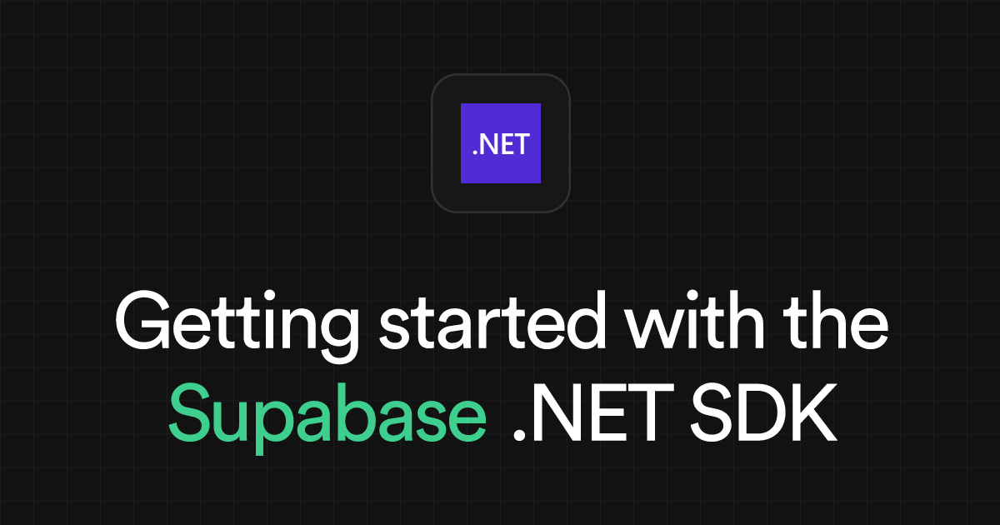

# Getting started with the Supabase .NET SDK

> Originally published at [Supabase Blog](https://supabase.com/blog/getting-started-with-the-supabase-dotnet-sdk) · 2026-10-26

---

The Supabase .NET SDK is a C# client for your Supabase project. It gives you Auth, Database, Storage, Realtime, and Edge Functions behind one API and handles the communication with the Supabase Platform.

Version `8.0.0` has been released, along with a new `Supabase.Extensions.DependencyInjection` package. This post covers how to set the client up, and then walk through basic operations.

## What changed in `v8.0.0`#

If you are coming from a previous major version, a few things moved. You do not need all the details to follow this tutorial, but they are worth knowing:

  * Serialization moved from Newtonsoft.Json to `System.Text.Json`. Custom converters and `[JsonProperty]` attributes need their `System.Text.Json` equivalents.
  * Every service client now accepts an injectable `HttpClient` and supports opt-in retry with backoff.
  * There is a new dependency injection package for ASP.NET Core, covered below.
  * Packages target .NET Standard 2.1. That drops .NET Framework, which tops out at .NET Standard 2.0, so you need .NET Core 3.0+ or .NET 5+.

If you want to see the full list of changes, check the [release notes](<https://github.com/supabase/supabase-csharp/releases/tag/v8.0.0>). The [migration guide](<https://github.com/supabase/supabase-csharp/blob/master/docs/migrations/v8.0.0.md>) lists every breaking change you may encounter and how to handle them.

## Install the package#

Add the meta-package to your project. It brings in all five service packages (Auth, Postgrest, Storage, Realtime, and Functions):

`  

_10

dotnet add package Supabase

  
`

If you only need one service, reference it on its own instead, for example `Supabase.Gotrue` for Auth or `Supabase.Postgrest` for the database.

## Define a model#

The SDK maps a table to a C# class. A model derives from `BaseModel` and uses attributes to link its properties to columns.

Here is a `todos` table that we will use in upcoming examples, with `id`, `task`, and `is_complete`:

`  

_15

using Supabase.Postgrest.Attributes;

_15

using Supabase.Postgrest.Models;

_15

_15

[Table("todos")]

_15

public class Todo : BaseModel

_15

{

_15

[PrimaryKey("id")]

_15

public int Id { get; set; }

_15

_15

[Column("task")]

_15

public string Task { get; set; }

_15

_15

[Column("is_complete")]

_15

public bool IsComplete { get; set; }

_15

}

  
`

## Set up the client#

### ASP.NET Core#

Install the dependency injection package:

`  

_10

dotnet add package Supabase.Extensions.DependencyInjection

  
`

Register the client in `Program.cs`:

`  

_14

using Supabase.Core.Http;

_14

using Supabase.Extensions.DependencyInjection;

_14

_14

var builder = WebApplication.CreateBuilder(args);

_14

builder.Services.AddSupabase(

_14

supabaseUrl: builder.Configuration["Supabase:Url"]!,

_14

supabaseKey: builder.Configuration["Supabase:Key"]!,

_14

configureOptions: options =>

_14

{

_14

options.AutoConnectRealtime = true;

_14

options.PostgrestRetry = new RetryOptions { MaxRetries = 3 };

_14

});

_14

_14

var app = builder.Build();

  
`

`AddSupabase` registers the `Supabase.Client` as a scoped service, so you can inject it wherever you need: a minimal API endpoint, a controller, or your own service.

`  

_13

using Supabase;

_13

_13

public class TodoService(Client supabase)

_13

{

_13

public async Task<List<Todo>> GetOpen()

_13

{

_13

var result = await supabase

_13

.From<Todo>()

_13

.Where(t => t.IsComplete == false)

_13

.Get();

_13

return result.Models;

_13

}

_13

}

  
`

It also registers each sub-client on its own (`IPostgrestClient`, `IGotrueClient<User, Session>`, `IStorageClient<Bucket, FileObject>`, `IFunctionsClient`, `IRealtimeClient<RealtimeSocket, RealtimeChannel>`), so a class that touches one service can depend on that alone.

We built this extension to make it easy for you to setup the client, rather than having to wire it up yourself. A `Supabase.Client` builds its own `HttpClient` when you construct it. If you register as scoped or transient, every resolution creates a fresh `HttpClient` (and a fresh socket), which will exhausts the connection pool under load. `AddSupabase` wires the client through `IHttpClientFactory` so the handler is pooled and reused. To keep this consistent, it replaces any `HttpClient` you pass through `configureOptions`; your proxy, retry, Realtime, and other options still apply.

### Other apps#

Outside ASP.NET Core, in Console apps, Desktop, Mobile, or Unity, construct the client yourself and initialize it once:

`  

_13

using Supabase;

_13

_13

var url = Environment.GetEnvironmentVariable("SUPABASE_URL")!;

_13

var key = Environment.GetEnvironmentVariable("SUPABASE_KEY")!;

_13

_13

var options = new SupabaseOptions

_13

{

_13

AutoRefreshToken = true,

_13

AutoConnectRealtime = true,

_13

};

_13

_13

var supabase = new Client(url, key, options);

_13

await supabase.InitializeAsync();

  
`

`InitializeAsync` restores a saved session and, with `AutoConnectRealtime` on, opens the Realtime connection. The default session handler does not store anything, so to restore a sign-in after a restart, set `SupabaseOptions.SessionHandler` to your own implementation that saves and loads the session. Create the client once and reuse it in the app. A new client per operation means a new `HttpClient` each time, which is the same problem the DI package solves on the server.

## Run the common operations#

The examples below use a `supabase` variable, which is a `Supabase.Client` instance.

### Query rows#

`From<T>()` opens a query on the table mapped by `T`. You can then filter using `Where` and then call `Get` to execute the query.

`Get` returns a `ModeledResponse<T>`, and you can find the rows in `Models`:

`  

_10

ModeledResponse<Todo> result = await supabase

_10

.From<Todo>()

_10

.Where(t => t.IsComplete == false)

_10

.Get();

_10

List<Todo> todos = result.Models;

  
`

### Insert#

`Insert` writes a single model or a list:

`  

_10

await supabase.From<Todo>().Insert(new Todo { Task = "Write the launch notes", IsComplete = false });

  
`

### Update and delete#

There are two ways to update an entity, and both are valid. It simply depends on whether you already have the row in hand.

If you already retrieved a model, change its properties and call `Update` on it. A row returned from `Get` carries its own identity, so it knows which record to write:

`  

_10

var result = await supabase.From<Todo>().Where(t => t.Id == 1).Get();

_10

var todo = result.Models.First();

_10

_10

todo.IsComplete = true;

_10

await todo.Update<Todo>();

_10

_10

await todo.Delete<Todo>();

  
`

If you don't have a model, you can use the query builder which saves you a `Get` query. Set the new values, filter the rows, and run it:

`  

_10

await supabase

_10

.From<Todo>()

_10

.Set(t => t.IsComplete, true)

_10

.Where(t => t.IsComplete == false)

_10

.Update();

_10

_10

await supabase

_10

.From<Todo>()

_10

.Where(t => t.IsComplete == true)

_10

.Delete();

  
`

> While this looks very familiar to how Entity Framework is built, it does not behave the same. There is no `DbContext`, no change tracker, and no `SaveChanges`. Changing a property on a model does nothing until you call `Update`, and each call is its own HTTP request.

### Authenticate a user#

Authentication lives on `supabase.Auth`. Sign a user up and in with email and password:

`  

_10

await supabase.Auth.SignUp("maria.garcia@example.com", "a-secure-password");

_10

_10

var session = await supabase.Auth.SignIn("maria.garcia@example.com", "a-secure-password");

  
`

With `AutoRefreshToken` enabled, the client refreshes the access token before it expires and attaches it to your database and Storage calls, so Row-Level-Security applies to the signed-in user. The same `supabase.Auth` surface covers OAuth, magic links, phone, and SSO.

### Upload a file#

`  

_10

await supabase.Storage

_10

.From("avatars")

_10

.Upload("./local/photo.png", "maria/photo.png");

  
`

## A note on keys#

Version `8.0.0` added the new publishable and secret API keys, alongside the existing anon and service keys.

Use a publishable or anon key in anything that ships to users. Keep secret and service keys on the server. A service key bypasses Row Level Security, so it does not belong in a client app. When you need that level of access, use a separate client for it.

## Next steps#

You now have a client set up and can run queries, auth, and Storage from .NET. From here:

  * Browse the [C# reference](<https://supabase.com/docs/reference/csharp/introduction>) for the full API.
  * Read the [DependencyInjection package README](<https://github.com/supabase/supabase-csharp/tree/master/packages/extensions/DependencyInjection>) for the ASP.NET Core details.
  * Check the [SDK repository](<https://github.com/supabase/supabase-csharp>) for examples and the changelog.

---
*Fetched by article-pipeline · 2026-10-13*
