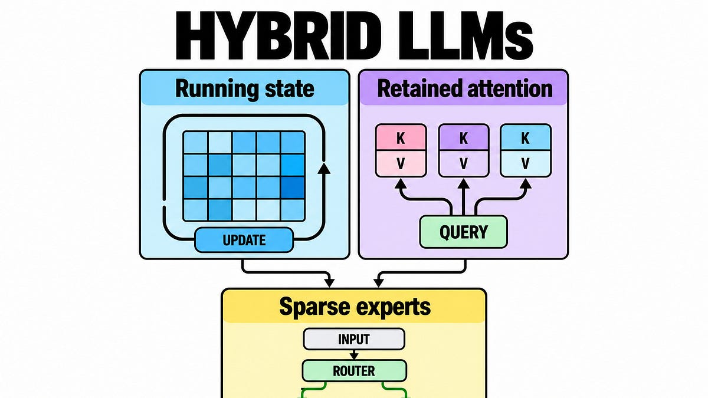

# How Hybrid LLMs Combine Memory, Attention, and Experts

> Originally published at [The AI Edge](https://newsletter.theaiedge.io/p/how-hybrid-llms-combine-memory-attention-and) · 2026-10-16

---

# How Hybrid LLMs Combine Memory, Attention, and Experts

### Follow Mamba-2, Gated DeltaNet and KDA from state updates to the costs that active parameter counts miss.

[Damien Benveniste](<https://substack.com/@damienbenveniste>)

Oct 16, 2026

∙ Paid

A hybrid LLM processes a sequence with more than one kind of memory. Some layers update a compact running state as tokens arrive. Other layers retain representations of individual positions and consult them through attention. The model can also use a mixture of experts, selecting a few feedforward networks for each token instead of evaluating one large dense network everywhere.

Released architectures from Qwen, Moonshot AI and NVIDIA now combine these mechanisms, making the meaning of “model size” depend on both how history is stored and which parameters actually execute.

Why combine them? **They separate three resources: memory of the sequence, access to individual positions, and capacity to transform a token.** Improving one resource does not automatically improve the others.

A hybrid combines access to individual positions with a compact state that is updated as the sequence advances.

The recurrent sequence mixers belong to a recognizable family, but their writes differ:

  * **Mamba-2** selectively fades a running state and adds new information.

  * **Gated DeltaNet** also checks what its memory predicts, then writes a correction.

  * **Kimi Delta Attention** , or **KDA** , adds finer control over which state coordinates fade.

Retained attention gives these compact memories a complementary path through position-indexed history. Mixture of experts, or **MoE** , changes a different component: the feedforward computation applied to each token representation.

That distinction already lets you read a hybrid architecture more accurately. In Qwen3-Next, a hybrid language model with a 3:1 mixer design, three recurrent mixers are followed by an attention mixer along the model's depth. Every token runs through that configured sequence. The model does not wait three generated tokens before using attention, and it does not decide at runtime whether a particular token deserves an attention layer.

The expert router does make a per-token choice. Mixer placement is fixed; expert selection depends on the current representation. Calling both “conditional computation” without this qualification hides how the model actually runs.

We will follow those two design decisions from the original decoder block to the memory updates, then put them back together. The payoff is practical: given another hybrid model, you should be able to explain what grows with context, what remains fixed, and why its active parameter count cannot tell you its serving cost.

**Contents**

  * Two jobs inside a Transformer

  * Mamba-2 keeps a running state

  * Delta memory corrects what it stores

  * Why hybrids retain attention

  * Sparse experts change the other half

  * When the combination is better

## Continue reading this post for free, courtesy of Damien Benveniste.

[Or purchase a paid subscription.](<https://newsletter.theaiedge.io/subscribe?simple=true&next=https%3A%2F%2Fnewsletter.theaiedge.io%2Fp%2Fhow-hybrid-llms-combine-memory-attention-and&utm_source=paywall&utm_medium=web&utm_content=220062822&just_signed_up=falsesimple=true&utm_source=paywall&utm_medium=email&utm_content=220062822&next=https://newsletter.theaiedge.io/p/how-hybrid-llms-combine-memory-attention-and>)

---
*Fetched by article-pipeline · 2026-10-18*
