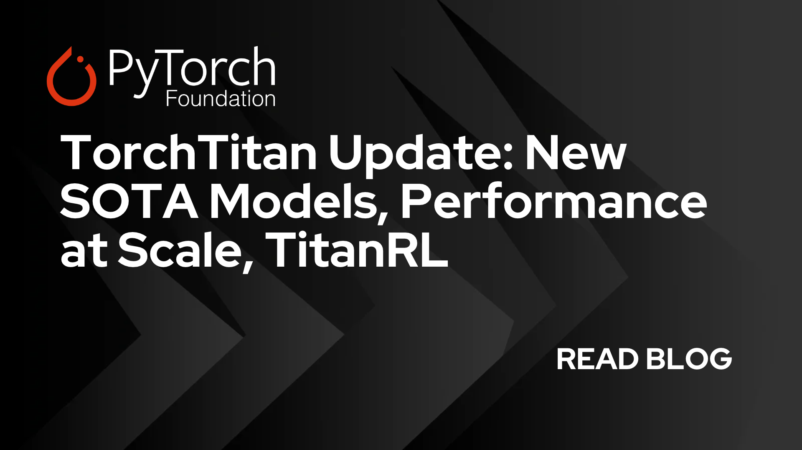

# TorchTitan Update: New SOTA Models, Performance at Scale, TitanRL

> Originally published at [PyTorch Blog](https://pytorch.org/blog/torchtitan-update-new-sota-models-performance-at-scale-titanrl/) · 2026-10-21

---

### Featured projects

  * 

[TorchTitan](<https://github.com/pytorch/torchtitan>) is a PyTorch-native platform for rapid experimentation and large-scale pre- and post-training of generative AI models. It is designed as a minimal, clean-room implementation of PyTorch-native techniques, with flexible extension points for users’ needs. This has enabled TorchTitan to find widespread adoption across research and production in academia and industry.

The TorchTitan team landed massive improvements in the past year, without losing its minimal, extensible ethos. Enhancements include support for SOTA models, dramatic improvements of out-the-box performance at scale, RL support and new communication features.

TorchTitan is for everyone – easy to use, providing SOTA performance and allowing users to start small and scale up seamlessly. We will present all these new improvements in the following sections, and we look forward to your feedback!

## New model support

SOTA model support is critical for the success of training frameworks, and TorchTitan aims to always provide the latest advancements when it comes to open-weights architecture. [TorchTitan added PyTorch-native support](<https://github.com/pytorch/torchtitan/tree/main/torchtitan/models>) for [Muse Spark Open](<https://github.com/pytorch/torchtitan/pull/5420>), [Muse Glimmer](<https://github.com/pytorch/torchtitan/pull/4106>), [Qwen3-VL](<https://github.com/pytorch/torchtitan/pull/2409>) and [Qwen3.5](<https://github.com/pytorch/torchtitan/pull/3371>), [Kimi K2.7](<https://github.com/pytorch/torchtitan/pull/3532>), [Kimi K3](<https://github.com/pytorch/torchtitan/pull/4025>), and [DeepSeek-V4](<https://github.com/pytorch/torchtitan/pull/3634>). These were full training-stack integrations with support across TorchTitan’s [5D parallelism stack](<https://github.com/pytorch/torchtitan/blob/main/torchtitan/models/qwen3_5/README.md#supported-parallelisms>). This work also introduced a composable configuration system built around typed Python recipes, model-config transforms, and targeted component overrides. Users can change parallelization strategies, model components, or hardware-specific kernels without maintaining separate model forks. The same interfaces integrate optimized kernels from Attention Gym, including Gated DeltaNet, Kimi Delta Attention, and sparse-attention kernels, as well as opt-in Helion kernels such as fused RoPE, while remaining compatible with torch.compile.

Each frontier model expands TorchTitan’s reusable toolkit, from multimodal data pipelines, sample packing, shared vision components, and Hugging Face checkpoint interoperability to composable 5D parallelism, declarative sharding, optimized Attention Gym and Helion kernels, and rigorous numerical validation. Developers can build on this foundation to bring newly released architectures to validated, scalable training faster, entirely in native PyTorch.

## TitanRL

TorchTitan now does reinforcement learning! Many RL stacks keep separate training and inference implementations of the model. Architecture changes have to stay aligned across both, and when a run goes sideways it is hard to tell whether the culprit is your reward, your algorithm, or the two copies quietly disagreeing. [TitanRL](<https://github.com/pytorch/torchtitan/tree/main/torchtitan/rl>) keeps the same model from pretraining, post-training to inside vLLM, so you can do your work in one codebase.

### 

### Agentic RL at scale

TitanRL supports what you need to train agentic workloads. Rollouts run asynchronously – training and generation each scale with multiple forms of parallelism.

We tested it on several workloads, as seen below, demonstrating that it can perform stable training on MoEs and dense models, for hundreds of steps, on tasks that require long context, code execution, compaction, harness, self-play, etc.

_Figure 1: Train/Validation on SWE-Rebench easy, model Qwen3.5-35B-A3B base, 64K context, 40 GB300_

_Figure 2: Train on Tmax 15k, Eval on terminal bench 2.1, model Qwen3.5-35B-A3B base, 128K context, 20 GB300_

### Correctness and debugging

TitanRL comes with strong correctness guarantees! Say you just enabled a new algorithm or kernel, launched a run, and the rewards differ from your baseline. Is that your change, or noise? Batch-invariant mode takes one source of noise off the table: in supported on-policy configurations, the trainer and generator produce bitwise identical log probabilities, so the gap between them is exactly zero at every step. A [recent study](<https://yichuan-w.github.io/blog/GDN-train-inference-mismatch-asyncRL/>) with the TorchTitan team uses it to examine numerical mismatch in math and terminal-agent RL. This helps users focus on their research rather than infrastructure.

## Out-the-box Performance improvements

TorchTitan shipped massive performance improvements for MoE models in the past year – around three focus areas: faster kernels for higher computer utilization, maximizing communication compute overlap, and fine grained control of memory.

**local_compile** brings the benefits of native `torch.compile` without committing to full-graph or full-block tracing, allowing users to selectively optimize key regions while preserving numerics without maintaining custom kernels.

For memory management, **torch_remat** offers a modern activation checkpointing API with fine-grained control over recomputed regions, avoiding CPU overhead and custom op wrapper requirements.

For distributed compute and scaling, [**Dist-MoE**](<https://github.com/meta-pytorch/dist_moe>) provides fused communication-compute kernels for NVIDIA SM100+ GPUs with activation packing for dynamic tensors to remain fully CUDA-graphable. Meanwhile, a fully revamped **pipeline parallel** package provides CUDA-graphable, deterministic execution with user control knobs to maximize overlap when composing FSDP and pipeline parallelism.

Finally, **TorchTitan overrides** enable clean integration of specialized model-specific kernels—such as fused MLA, fused SwiGLU, and fused Complex RoPE – without sacrificing the simplicity and maintainability of the code.

### DSV3 671B Results

By [composing](<https://github.com/pytorch/torchtitan/blob/main/torchtitan_recipes/models/deepseek_v3.py>) all of the above performance features we evaluated the performance and numerics of Deepseek V3 671b+MTP1 module on the MLPerf training benchmark on our internal GB300 cluster scaling only the PP, DP and EP axes. The quantization scheme used is MXFP8.

#### Results

Run | GPUs | PP / VPP / DP / EP | LBS / microbatches | TPS/GPU | Global TPS | TFLOPs/GPU | Peak HBM  
---|---|---|---|---|---|---|---  
PP2-256 | 256 | 2 / 8 / 128 / 64 | 120 / 120 | **5,324.21** | **1,362,998** | **1,553.89** | 243.86 GiB  
PP2-512 | 512 | 2 / 8 / 256 / 64 | 60 / 60 | **5,262.68** | **2,694,493** | **1,535.93** | 224.65 GiB  
PP4-256 | 256 | 4 / 4 / 64 / 64 | 240 / 240 | 5,178.22 | 1,325,624 | 1,511.28 | 238.08 GiB  
PP4-512 | 512 | 4 / 4 / 128 / 64 | 120 / 120 | 5,087.99 | 2,605,049 | 1,484.95 | **221.14 GiB**  
PP8-512 | 512 | 8 / 2 / 64 / 64 | 240 / 240 | 4,780.79 | 2,447,763 | 1,395.29 | 233.96 GiB  
  
### Muse Spark Open

For our MuseSpark 1.2 OSS release we [showcase](<https://github.com/pytorch/torchtitan/blob/main/torchtitan_recipes/models/muse_spark.py>) our high precision long context training efficiency demonstrating our TP, EP and CP scaling.

#### Results

Routing | GPUs | Context | Parallelism | TPS/GPU | Global TPS | TFLOPS/GPU | MFU | Peak HBM  
---|---|---|---|---|---|---|---|---  
Learned | 256 | 96K | PP1/DP16/TP4/CP4/EP64 | 1,500.61 | 384,156 | 646.03 | 25.84% | 253.66 GiB  
Forced balanced | 256 | 96K | PP1/DP16/TP4/CP4/EP64 | 1,839.52 | 470,918 | 791.95 | 31.68% | 253.66 GiB  
Learned | 512 | 192K | PP1/DP16/TP4/CP8/EP64 | 1,335.86 | 683,961 | 781.66 | 31.27% | 235.64 GiB  
Forced balanced | 512 | 192K | PP1/DP16/TP4/CP8/EP64 | 1,588.22 | 813,168 | 929.33 | 37.17% | 235.65 GiB  
  
## Ecosystem integrations

One of TorchTitan’s strengths is its simplicity and reusability. As a result, several projects in the ecosystem chose to integrate and offer TorchTitan as a trainer. In particular:

  * TorchTitan has been integrated to veRL as a training backend ([roadmap](<https://github.com/verl-project/verl/issues/5306>), [code](<https://github.com/verl-project/verl/tree/main/verl/workers/engine/torchtitan>))
  * TorchTitan has also been added to Miles ([readme](<https://github.com/radixark/miles/blob/main/docs/user-guide/training-backend.md#torchtitan>), [post](<https://x.com/radixark/status/2108596085472268681?s=20>))
  * TorchTitan is the default training backend for [Meshy](<https://github.com/OpenBMB/Meshy/tree/main>), and inspires the core implementation of [Areal’s](<https://github.com/areal-project/AReaL/tree/main>) training engine [Archon](<https://github.com/areal-project/AReaL/blob/main/docs/en/tutorial/archon.md>)

## FlexShard

TorchTitan leverages FSDP2 for row-wise or column-wise sharding model state (parameters, gradients, and optimizer). However, newer features such as distributed Muon optimizer and blockwise quantization of parameters warrant or benefit from more esoteric sharding policies that are not possible with FSDP2. To address this, TorchTitan now integrates with [FlexShard](<https://github.com/meta-pytorch/flex_shard>) – a new data parallelism library for sharding model and optimizer state. FlexShard offers a bucket-centric API where each bucket of parameters can be sharded according to a customized `Placement` policy and has an optimized runtime that overlaps bucketed communication with computation. FlexShard offers similar placements as FSDP1 and FSDP2, but additionally offers new placements such as `Owned` where one rank owns an entire parameter, and `BlockShard` that allows 2D tile-aligned sharding.

FlexShard has enabled TorchTitan to support the distributed Muon optimizer in an efficient way where parameters optimized using Muon are sharded using `Owned` and `BlockShard` placements – eliminating the need for All Gather collectives before performing the optimizer update. On DeepSeekV3 at 256 H100s, this improves the Optimizer time duration by up to 79% compared to an equivalent FSDP-only implementation.

FlexShard also enabled TorchTitan to support blockwise-quantized parameter AllGathers: where FP8-quantized parameters are gathered by the collective, reducing communication volume by ~50%. With FSDP2, since the sharding boundaries may not necessarily be aligned with the blockwise quantization boundaries – we were forced to either gather the parameters in BF16 – increasing communication volume, or perform the FP8 all-gathers but with additional collectives for the quantization scaling factors. FlexShard’s `BlockShard` placement enables TorchTitan to get the best of both worlds – gather the quantized parameters without any additional communication for scaling factors, as the sharding strategy is by-definition aligned with the quantization scheme: on LLama3 405B at 256 H100s, this improves end-to-end training step time by up to 20%.

## GraphTrainer

[GraphTrainer](<https://github.com/pytorch/torchtitan/tree/main/torchtitan/experiments/graph_trainer>) is the **graph-mode training offering in TorchTitan** , providing an alternative execution model built around an explicit training graph.

TorchTitan supports both graph-based and eager-based training paths with bitwise-matching numerical results. The graph-based trainer enables advanced graph-level optimizations that are complicated to express in eager execution, including cross-module fusions, explicit graph-level debugging, and tailored support for heterogeneous AI hardware accelerators.

## Distributed infrastructure

TorchTitan serves as an important validation stage for new communications features as they ship in PyTorch. Large-scale training stresses every part of the communication stack (initialization, collectives, failure handling and memory registration), which makes TorchTitan a demanding testing ground.

**A new NCCL backend,[validated on TorchTitan](<https://github.com/pytorch/pytorch/pull/192281>):** In [PyTorch 2.14](<https://pytorch.org/blog/pytorch-2-14-release-blog/>), the NCCL implementation from torchcomms was ported into c10d as a new, opt-in NCCL backend. This allows us to enable new features much faster. It is designed as a drop-in replacement for the existing one and registers under the standard `"nccl"` backend name. Compared with the existing backend, it adds:

  * One-sided RMA windows
  * In-place process-group reconfiguration for fault tolerance
  * Eager communicator initialization (in PyTorch 2.15)
  * Raw access to NCCL shrink/grow and suspend/resume APIs

**Symmetric memory:** Symmetric memory continues to be an important performance lever for TorchTitan. TorchTitan’s MoE layers can now run on Dist-MoE, a newly open-sourced distributed Mixture-of-Experts library, with ready-to-use DeepSeek V3 recipes for NVIDIA Blackwell GPUs. Dist-MoE moves tokens between experts over symmetric memory and fuses that communication with expert compute. FSDP in TorchTitan can also allocate its communication buffers from a symmetric memory pool. This lets NCCL use its symmetric-memory kernel implementations, including copy-engine all-gather when NCCL’s zero-CTA policy is enabled.

## Checkpointing

TorchTitan has integrated support for a new distributed checkpoint library, [torch_checkpointing](<https://github.com/meta-pytorch/torch_checkpointing>). This new library removes per-save synchronization in the default `torch.distributed.checkpointing` (DCPv1) saves. We do one collective (on the default process group) before the first save to share metadata; after the first save, we do no collectives.

As pretraining grows past 16k ranks, the previous approach of using GLOO collectives to achieve synchronizations scales poorly with the number of nodes. torch_checkpointing’s approach of only running a lightweight barrier per save wins out at these scales.

We also improved upon other things within DCPv1, such as saving the whole checkpoint item (e.g. model, optimizer, etc.) in `torch.save` at once rather than calling `torch.save` on each individual tensor, and making custom components pluggable (e.g. writing a custom storage backend optimized for your infra).

At a scale of 512 H100 GPUs running DSv3 671B with checkpoint interval 50, we measured the following improvements:

Trainer blocking times | Average | P99  
---|---|---  
DCPv1 | 841.2 ms | 941.46 ms  
torch_checkpointing | 34.1 ms | 36.6 ms  
Checkpoint write times | Average | P99  
---|---|---  
DCPv1 | 384.4 s | 403.1 s  
torch_checkpointing | 13.1 s | 13.2 s  
Non-resharding load times | Average | P99  
---|---|---  
DCPv1 | 194.7 s | 198.2 s  
torch_checkpointing | 79 s | 82.3 s  
  
These improvements reduce blocking times and checkpoint write times and unlock more frequent checkpoints without risking TFLOP drops for users who adopt torch_checkpointing in their Titan recipes.

## To get started

Clone [github.com/pytorch/torchtitan](<https://github.com/pytorch/torchtitan>), and follow the instructions listed [here](<https://github.com/pytorch/torchtitan/#quick-start>). If you have any kind of feedback, we would love to hear about it!

---
*Fetched by article-pipeline · 2026-10-22*
