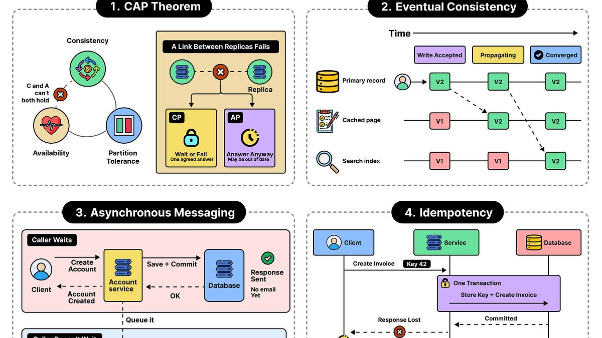

# Why Distributed Systems Prefer Independence over Coordination

> Originally published at [ByteByteGo](https://blog.bytebytego.com/p/why-distributed-systems-prefer-independence) · 2026-10-22

---

# Why Distributed Systems Prefer Independence over Coordination

[ByteByteGo](<https://substack.com/@bytebytego399569>)

Oct 22, 2026

∙ Paid

In a distributed system, you have components running in separate processes or machines. These components could be application services, database replicas, or even background workers.

Since in distributed systems, we divide the system into so many components, it’s pretty common that one component may need to talk to another component to get something done. It may also have to wait for the other component’s response. You can think of coordination as this talking between components. For example, you may have one service waiting for another service to approve a request. Or a database waits for acknowledgment from its replicas. Or a worker waits for a lock.

In this article, we’ll look at why coordination is a challenge for distributed systems. Here’s what we will cover.

  * Why coordination becomes a challenge

  * How coordination increases in a system

  * How to reduce coordination

  * Strategies to handle coordination

## Why Coordination Becomes a Challenge

+

## A free month of ByteByteGo Newsletter, courtesy of Proton Pass

We’re covering a full month of ByteByteGo Newsletter. Proton Pass is a password manager built with safety & transparency: end-to-end encrypted, open source, hosted in Switzerland, beyond the US CLOUD Act. Go to [proton.me/pass](<https://substack.com/sponsorship-campaigns/d1309b6d-bbd4-45ab-9278-78a771931fdc/link?pub_id=817132&medium=web&post_id=221352388&url=https%3A%2F%2Fproton.me%2Fpass&placement_id=180f688b-7447-4207-88e1-3826a61b9362>).

Already a paid subscriber? [Switch accounts](<https://substack.com/sign-in?redirect=%2Fp%2Fwhy-distributed-systems-prefer-independence&for_pub=bytebytego&change_user=false>)

---
*Fetched by article-pipeline · 2026-10-23*
