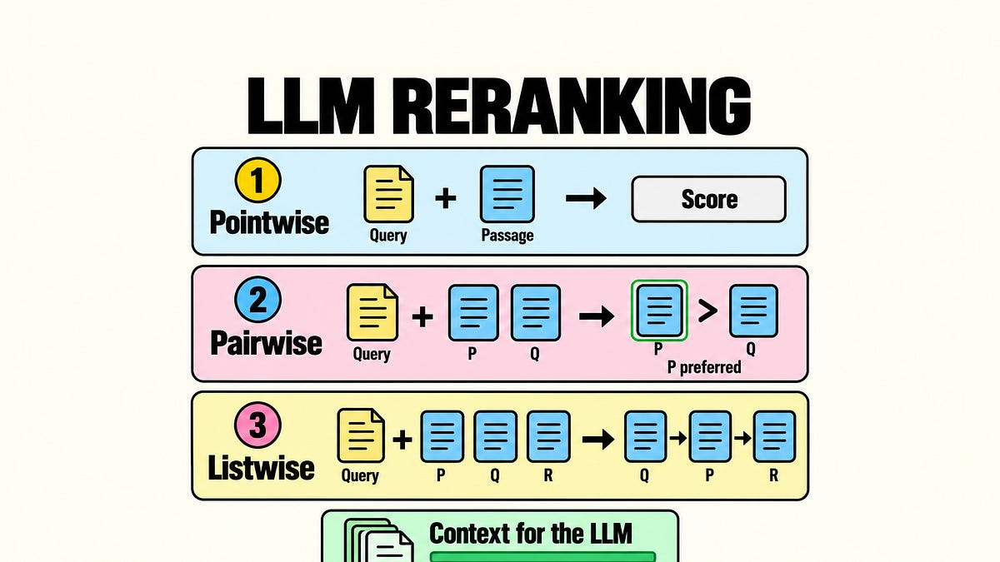

# How LLM Rerankers Order Retrieved Passages

> Originally published at [The AI Edge](https://newsletter.theaiedge.io/p/how-llm-rerankers-order-retrieved-passages) · 2026-10-26

---

# How LLM Rerankers Order Retrieved Passages

### Follow pointwise scores, pairwise preferences, and listwise windows from model judgment to useful context.

[Damien Benveniste](<https://substack.com/@damienbenveniste>)

Oct 26, 2026

∙ Paid

A reranker takes a question and a shortlist of retrieved passages, reads them again, and changes their order before a large language model (LLM) receives its context. The first search finds candidates across a large collection. Reranking spends more computation deciding which of those candidates deserve the limited space in the answering model's prompt.

Cohere's release of [Rerank 5](<https://cohere.com/blog/rerank-5>) for retrieval-based answers and agents makes this a concrete application choice: a pipeline can spend additional computation deciding which evidence reaches the answering model.

How does that extra computation produce a better order? The main distinction is **what the model judges together** :

  * **Pointwise:** read the question with one passage, produce a score, then sort the scores.

  * **Pairwise:** read the question with two passages, choose the better one, then assemble those preferences into an order.

  * **Listwise:** read the question with a group of passages and return their order, sometimes one overlapping group at a time.

The unit of judgment determines what the application must do with the model output.

These methods buy different kinds of judgment. Independent scores can be computed in parallel. Comparisons let the model weigh competing evidence directly, but the application must decide how to reconcile those judgments. A listwise answer orders several candidates at once, at the cost of a longer input and a more demanding output.

The names describe the ranking procedure. The underlying model architecture and training objective are separate choices. We will separate those dimensions, follow the numbers and comparisons into an actual ordering, and see where the methods can work together.

**Contents**

  * What a reranker changes

  * Pointwise: score each passage

  * Pairwise: compare two passages

  * Listwise: order a group

  * Choose the work your query needs

There is one useful boundary to establish immediately. A reranker cannot promote a passage that never entered its shortlist. If the answer is present but buried, reordering may help. If the necessary evidence is absent, the pipeline needs another search or a different way to retrieve it. This distinction tells you where to investigate a bad answer before choosing a more expensive ranking model.

## Continue reading this post for free, courtesy of Damien Benveniste.

[Or purchase a paid subscription.](<https://newsletter.theaiedge.io/subscribe?simple=true&next=https%3A%2F%2Fnewsletter.theaiedge.io%2Fp%2Fhow-llm-rerankers-order-retrieved-passages&utm_source=paywall&utm_medium=web&utm_content=221940794&just_signed_up=falsesimple=true&utm_source=paywall&utm_medium=email&utm_content=221940794&next=https://newsletter.theaiedge.io/p/how-llm-rerankers-order-retrieved-passages>)

---
*Fetched by article-pipeline · 2026-10-27*
