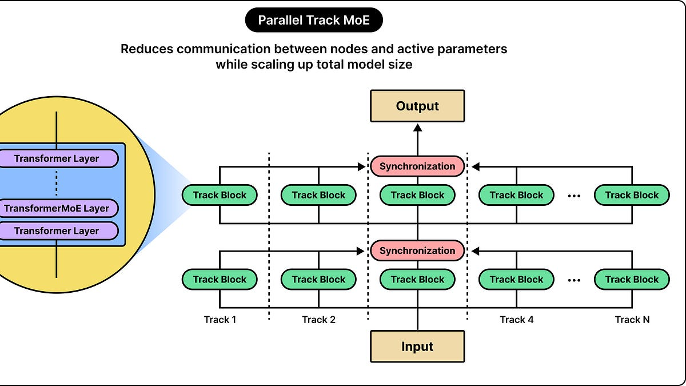

# How Apple Fits an LLM on Your iPhone

> Originally published at [ByteByteGo](https://blog.bytebytego.com/p/how-apple-fits-an-llm-on-your-iphone) · 2026-10-27

---

# How Apple Fits an LLM on Your iPhone

[ByteByteGo](<https://substack.com/@bytebytego399569>)

Oct 27, 2026

## [[Webinar] How to stop rewriting your agent’s code (Sponsored)](<https://go.bytebytego.com/unblocked_102726>)

Right now, you’re your agent’s context engine. You write the rules files, maintain the skills, and paste in the Slack thread it missed.

But hand-curated context goes stale. And when there are conflicting answers, your agent can’t tell which is right. You pay for it in higher token bills and longer reviews.

Join us live on Oct 28 (FREE) to see:

  * The 8-levels of AI maturity and where teams get stuck

  * How a context engine curates context and resolves conflicts before your agent writes a line of code

  * Live demo: token savings in the same coding task, and use cases beyond code gen

Bonus: 2 open source tools you can use today.

[Register now](<https://go.bytebytego.com/unblocked_102726>)

* * *

A large language model (LLM) is a neural network. You can use it to process and generate language. How the model behaves is dependent on the numerical values you teach it during training. These numerical values are known as parameters.

Apple fits a 3-billion-parameter model on your iPhone. What this means is that the model has roughly 3 billion numerical values that it needs to work properly. These values influence how the model makes sense of its input and how it produces output.

How is Apple able to fit such a model on an iPhone without any adverse impact on the device?

In this article, we’ll try to answer this question. Here’s what we will cover:

  * The problems of running an LLM on a phone

  * How Apple makes the weights cheaper to store

  * How Apple made repeated calculations faster

  * How adapters help features share the foundation

  * How Apple optimizes the hardware to run the models

  * How does the system decide when to use the cloud

**Source:**[Apple Engineering Blog](<https://apple.github.io/coremltools/docs-guides/source/opt-palettization-overview.html>)

 _Disclaimer: This post is based on publicly shared details from various sources. References at the end. Please comment if you notice any inaccuracies._

## The Problems of Running an LLM on a Phone

Running an LLM is also called inference. In this stage, the LLM uses its parameters to process a request.

Before processing some text, the LLM has to divide it into tokens. You can think of a token as a word, part of a word, or even punctuation. The model takes these tokens and generates more tokens as part of the response. Within the model, these tokens pass through a bunch of processing layers.

The first problem is about storing the parameters.

At 16-bit precision, the 3 billion parameters we talked about earlier can occupy almost 6GB. But that’s not all. You need space for the input prompt, calculations, and temporary results that the model needs. Lastly, you also need to run the OS and other apps using the same memory. As you can see, storage is a big decision.

The second problem is about moving the weights quickly from memory to the processor. During text generation, the processor has to repeatedly fetch numerical data from memory. Even if you have a powerful processor, it might spend a lot of time just waiting for that data to be fetched from memory.

The Apple engineering team also had to deal with the challenges regarding memory capacity and memory bandwidth while trying to make their LLM run on the iPhone. On top of this, a mobile phone also has to take care of battery consumption, overheating, and other apps trying to use the same resources. You don’t want the LLM to make the rest of the device unresponsive.

## How Apple Makes the Weights Cheaper to Store

The most direct way of reducing the size of the model is to use fewer bits to store each weight. This technique is known as quantization.

You can think of quantization as a way to represent numerical values using a smaller set of possibilities. Sure, you lose some numerical detail in the process. But the model can still perform its tasks at a pretty good level. The main trade-off is to select a representation approach that sits at the sweet spot for memory savings and quality. See the diagram below.

The Apple engineering team uses a technique known as palettization. In this technique, you group similar weight values. A small lookup table stores representative values, and individual weights store short references to that table. For example, you can have a 2-bit reference select from four entries in a lookup table.

**Source:**[Apple Engineering Blog](<https://apple.github.io/coremltools/docs-guides/source/opt-palettization-overview.html>)

In the earlier model version, the Apple engineering team combined 2-bit and 4-bit representations. It has an average of 3.7 bits per weight. This meant that the 3 billion weights could be stored in approximately 1.39 GB. A pretty good optimization.

They mixed different precisions because different parts of a model can easily handle different amounts of numerical error. You need to spend more bits on sensitive components so that quality doesn’t go down. Other components can be compressed more.

The later model Apple released makes the compression even more aggressive. The main decoder weights use 2 bits per weight. The embedding table uses 4 bits per weight. To make this compression work, Apple uses quantization-aware training. In this approach, you simulate the kind of restrictions that quantization will impose. Then, you adjust the model’s weights with those restrictions in place so that it can learn to work under them.

## How Apple Made Repeated Calculations Faster

The weight storage is only one part of the overall memory problem. After you have successfully compressed the model, the model still needs memory to process a request.

Let’s say you have a model that has already read a paragraph of text and generated the beginning of a response. When the model tries to predict the next token, it needs to use information from earlier tokens. However, if you have to recalculate every intermediate result, it would be a big waste of computational resources.

A KV cache (key-value cache) stores these intermediate results. You can think of this cache as a way to reuse calculations that have already been done. However, the KV cache has a trade-off. As you can see, the cache takes up memory. The more text you have in a request, the more information you need to store in the cache. Even if you have a model whose weights fit comfortably within the memory, it can still face memory issues when processing a document with lots of text.

This means you have two targets to optimize. First, you can compress weights to reduce the space required by the model. Second, you can try to reduce the size of the KV cache.

Apple performs the cache optimization through a technique known as cross-layer KV sharing. In this technique, you need to divide the model into two blocks with a 5:3 depth ratio. Layers in the second block reuse keys and values produced by the final layer of the first block. By using this approach, Apple has brought down the KV-cache memory usage by 37.5%.

## How Adapters Help Features Share the Foundation

You can use compression to reduce the size and cost of one model. But often, you may need many copies of that model with slightly different capabilities.

A simple approach would be to create one model for summarization. One for rewriting. Another for extracting information. And so on. But all these models would have a great deal of overlapping language capability. You are basically duplicating all of that capability.

An adapter can help you get rid of this duplication. You can think of an adapter as a small collection of parameters that changes how a base model works for a specific task. For example, let’s say you have a feature that writes concise notification summaries. Another rewrites longer passages into a different style. Both of these features can share the same base LLM. No need for duplication.

This technique is known as LoRA (Low-Rank Adaptation). While training an adapter, you fix the base model’s weights. Only the adapter weights are modified. This is why it becomes cheaper to specialize a model as compared to distributing a separate new model.

Apple applies adapters to various features such as attention matrices, attention-output projections, and feed-forward layers. Its rank-16 adapters use 16-bit values and occupy approx tens of MBs. They can load, cache, or swap these adapters as needed.

## How Apple Optimizes the Hardware Running the Model

Even if the model is small, you need an efficient hardware implementation to run the model at the best of its ability.

Apple iPhones have several kinds of processors to take care of this. You have the CPU that handles all the general-purpose work. Then, you have the GPU that can deal with many numerical operations in parallel. The Apple Neural Engine (ANE) can run machine-learning workloads efficiently.

However, you can’t just use an accelerator and think that the model will run efficiently. You still need to select the right data layouts and split large arrays into manageable pieces. Also, you need to minimize memory copies. These techniques have an impact on speed as well as memory use.

## How Does the System Decide When to Use the Cloud

Even after making all these optimizations, the model has limits.

In the case of Apple, its on-device model is quite capable of tasks like summarization, extraction, and classification. However, Apple Intelligence checks whether a request can be processed on the device. However, for more complex work, it can send the request to Private Cloud Compute (PCC).

PCC gives you a protected environment within which only authorized software can process the data. It also restricts any external parties from seeing the data.

Apple uses an encrypted network connection to protect information as it travels to the cloud. Your device encrypts the request for validated PCC nodes. Any infrastructure that is outside this boundary doesn’t have the keys to decrypt the request and read its contents. The data can be read only when it crosses into the authorized boundary. The goal is to make sure that even Apple’s staff and admin systems cannot access what’s inside this request.

When the request finally reaches the cloud, a separate server model takes care of the request. Apple uses mixture-of-experts computation and parallel processing tracks. This lets a large model choose the best computational components to distribute work.

**Source:**[Apple Engineering Blog](<https://apple.github.io/coremltools/docs-guides/source/opt-palettization-overview.html>)

## Conclusion

Apple has been making a lot of new changes to its model.

In 2026, they launched the AFM 3 Core. It’s a new generation of its 3-billion-parameter model. Also, AFM 3 Core Advanced. It’s a sparse model with 20 billion total parameters. But it activates only 1 to 4 billion parameters at a time, based on the capabilities of the Apple Silicon systems.

In Core Advanced, the full model is stored on flash storage. Only expert weights are loaded into RAM. It selects weights based on the prompt. No need to change experts from the flash drive for every token. Apple has also expanded the cloud architecture. You can now run PCC workloads on NVIDIA GPUs in Google Cloud.

The main design principle that Apple follows is that the model’s capability should be based on the resources that are available at runtime. All of the techniques we’ve looked at come together to give the best experience to the users.

**References:**

  * [Apple ML Research: Introducing Foundation Models](<https://machinelearning.apple.com/research/introducing-apple-foundation-models>)

  * [Apple ML Research: 2025 Updates](<https://machinelearning.apple.com/research/apple-foundation-models-2025-updates>)

  * [Apple Security Research: Private Cloud Compute](<https://security.apple.com/blog/private-cloud-compute/>)

---
*Fetched by article-pipeline · 2026-10-28*
