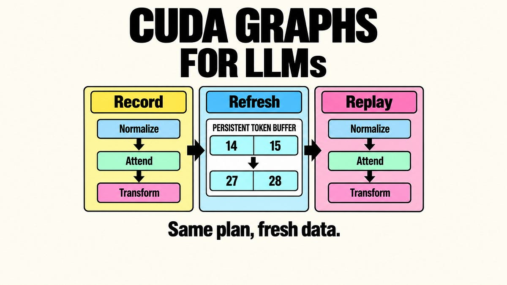

# How CUDA Graphs Speed Up LLM Inference

> Originally published at [The AI Edge](https://newsletter.theaiedge.io/p/how-cuda-graphs-speed-up-llm-inference) · 2026-10-30

---

# How CUDA Graphs Speed Up LLM Inference

### Replay GPU operations with fresh tokens, growing caches, and changing batches.

[Damien Benveniste](<https://substack.com/@damienbenveniste>)

Oct 30, 2026

∙ Paid

**CUDA Graphs can speed up repeated GPU work by preparing its execution plan once and replaying it with new data.** They are a feature of NVIDIA’s CUDA platform. In LLM inference, that work can be the sequence of operations used to generate the next token. Replay launches those operations again; it does not return an earlier answer or avoid computing the new token.

Serving engines such as [vLLM](<https://docs.vllm.ai/en/latest/design/cuda_graphs/>) expose full and piecewise graph modes, making replay coverage a practical choice about latency and GPU memory.

How can a reusable plan handle an LLM whose tokens, context lengths, and active requests keep changing?

The useful distinction is between **the description of the work** and **the data that work reads**. A captured operation can keep the same input address while the values stored at that address change. The GPU then follows the prepared dependencies and computes a fresh result.

Replay reuses the operation description. It still computes from the values present when it runs.

A fixed execution plan does not require a fixed answer. An operation that doubles the numbers in an input buffer produces a different output after those numbers change, even though the operation and its input address are unchanged. Replacing the buffer itself is a different matter: the prepared operation may still point to the original storage.

LLM serving builds on that distinction. New tokens, positions, and cache locations can become updated data inside persistent buffers. Changes to the amount or arrangement of work may instead require another prepared graph, a smaller captured region, or ordinary execution.

We will follow that boundary from GPU launches to growing token histories, then examine when the cost of keeping several graph variants ready outweighs the launch savings.

**Table of contents**

  * Where a decoding step spends time

  * Capture a plan, replay fresh work

  * Keep addresses stable while values change

  * Fit changing LLM state into a replay

  * Choose the right graph for the batch

  * Decide whether replay pays

## Continue reading this post for free, courtesy of Damien Benveniste.

[Or purchase a paid subscription.](<https://newsletter.theaiedge.io/subscribe?simple=true&next=https%3A%2F%2Fnewsletter.theaiedge.io%2Fp%2Fhow-cuda-graphs-speed-up-llm-inference&utm_source=paywall&utm_medium=web&utm_content=222530257&just_signed_up=falsesimple=true&utm_source=paywall&utm_medium=email&utm_content=222530257&next=https://newsletter.theaiedge.io/p/how-cuda-graphs-speed-up-llm-inference>)

---
*Fetched by article-pipeline · 2026-10-31*
