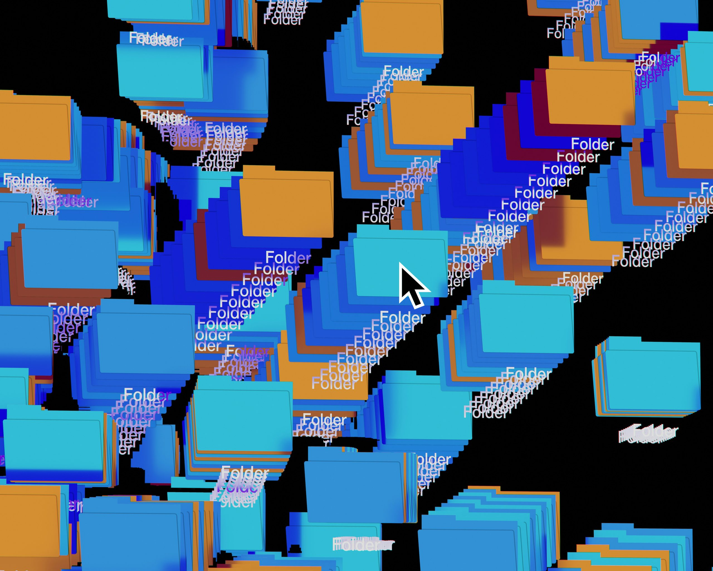

# The context problem: How Docusign built agents that understand the business behind contracts

> Originally published at [The New Stack](https://thenewstack.io/docusign-contract-ai-agents/) · 2026-10-31

---

NEW! Try Stackie AI 

ARCHITECTURE 

[ Cloud Native Ecosystem ](<https://thenewstack.io/cloud-native/>) [ Containers ](<https://thenewstack.io/containers/>) [ Databases ](<https://thenewstack.io/databases/>) [ Edge Computing ](<https://thenewstack.io/edge-computing/>) [ Infrastructure as Code ](<https://thenewstack.io/infrastructure-as-code/>) [ Linux ](<https://thenewstack.io/linux/>) [ Microservices ](<https://thenewstack.io/microservices/>) [ Open Source ](<https://thenewstack.io/open-source/>) [ Networking ](<https://thenewstack.io/networking/>) [ Storage ](<https://thenewstack.io/storage/>)

ENGINEERING 

[ AI ](<https://thenewstack.io/ai/>) [ AI Engineering ](<https://thenewstack.io/ai-engineering/>) [ API Management ](<https://thenewstack.io/api-management/>) [ Backend development ](<https://thenewstack.io/backend-development/>) [ Data ](<https://thenewstack.io/data/>) [ Frontend Development ](<https://thenewstack.io/frontend-development/>) [ Large Language Models ](<https://thenewstack.io/llm/>) [ Security ](<https://thenewstack.io/security/>) [ Software Development ](<https://thenewstack.io/software-development/>) [ WebAssembly ](<https://thenewstack.io/webassembly/>)

OPERATIONS 

[ AI Operations ](<https://thenewstack.io/ai-operations/>) [ CI/CD ](<https://thenewstack.io/ci-cd/>) [ Cloud Services ](<https://thenewstack.io/cloud-services/>) [ DevOps ](<https://thenewstack.io/devops/>) [ Kubernetes ](<https://thenewstack.io/kubernetes/>) [ Observability ](<https://thenewstack.io/observability/>) [ Operations ](<https://thenewstack.io/operations/>) [ Platform Engineering ](<https://thenewstack.io/platform-engineering/>)

PROGRAMMING 

[ C++ ](<https://thenewstack.io/c/>) [ Developer tools ](<https://thenewstack.io/developer-tools/>) [ Go ](<https://thenewstack.io/go/>) [ Java ](<https://thenewstack.io/java/>) [ JavaScript ](<https://thenewstack.io/javascript/>) [ Programming Languages ](<https://thenewstack.io/programming-languages/>) [ Python ](<https://thenewstack.io/python/>) [ Rust ](<https://thenewstack.io/rust/>) [ TypeScript ](<https://thenewstack.io/typescript/>)

CHANNELS 

[ Podcasts ](<https://thenewstack.io/podcasts/>) [ Ebooks ](<https://thenewstack.io/ebooks/>) [ Events ](<https://thenewstack.io/events/>) [ Webinars ](<https://thenewstack.io/webinars/>) [ Newsletter ](<https://thenewstack.io/newsletter/>) [ TNS RSS Feeds ](</rss-feeds/>)

THE NEW STACK 

[ About / Contact ](<https://thenewstack.io/about-and-contact-info/>) [ Sponsors ](<https://thenewstack.io/sponsors/>) [ Advertise With Us ](<https://thenewstack.io/sponsorship/>) [ Contributions ](<https://thenewstack.io/contributions/>)

[PODCASTS](</podcasts/>) [EBOOKS](</ebooks/>) [EVENTS](</events/>) [WEBINARS](</webinars/>) [NEWSLETTER](</newsletter/>) [CONTRIBUTE](</contributions/>)

ARCHITECTURE  ENGINEERING  OPERATIONS  PROGRAMMING 

[ Cloud Native Ecosystem ](<https://thenewstack.io/cloud-native/>) [ Containers ](<https://thenewstack.io/containers/>) [ Databases ](<https://thenewstack.io/databases/>) [ Edge Computing ](<https://thenewstack.io/edge-computing/>) [ Infrastructure as Code ](<https://thenewstack.io/infrastructure-as-code/>) [ Linux ](<https://thenewstack.io/linux/>) [ Microservices ](<https://thenewstack.io/microservices/>) [ Open Source ](<https://thenewstack.io/open-source/>) [ Networking ](<https://thenewstack.io/networking/>) [ Storage ](<https://thenewstack.io/storage/>)

[ Shielding the patch gap: The exploit doesn't wait for Patch Tuesday  Oct 31st 2026 10:00am, by  Jeremy Colvin  ](</shielding-the-patch-gap/>)

[ Kubernetes just formed a workload conformance group. Here’s why it matters for AI teams.  Oct 30th 2026 1:29pm, by  Bill Doerrfeld  ](</kubernetes-workload-conformance-ai/>)

[ Why Kubernetes platforms keep rebuilding a layer they could share  Oct 29th 2026 9:00am, by  Adam Crowder  ](</kubernetes-resource-composition-layer/>)

[ The hidden failure paths that affect Kubernetes control plane availability  Oct 27th 2026 10:00am, by  Sri Saran Balaji Vellore Rajakumar  ](</kubernetes-control-plane-failures/>)

[ The next 10 years of KubeVirt  Oct 26th 2026 10:00am, by  Vladik Romanovsky  ](</next-ten-years-kubevirt/>)

[ When “isolated” doesn’t mean isolated: How to sandbox AI agents  Oct 27th 2026 9:00am, by  Michael Levan  ](</how-to-sandbox-agents/>)

[ One pod, one node: The architecture behind serverless Kubernetes on AWS  Oct 27th 2026 8:00am, by  Sri Saran Balaji Vellore Rajakumar  ](</serverless-kubernetes-aws-fargate/>)

[ The distroless security gap: Why bottom-up containers are the next evolution in OCI images  Oct 19th 2026 9:00am, by  Lily Rivers-Klee  ](</distroless-container-security-gap/>)

[ Amazon ECS now auto-repairs failing GPUs and instances. Here's why it matters for SREs.  Oct 9th 2026 9:00am, by  Anirudh Aithal  ](</amazon-ecs-auto-repair/>)

[ K3s vs. K8s: When lightweight Kubernetes distros win (and when they don't)  Oct 2nd 2026 9:00am, by  Peter Smails  ](</k3s-vs-k8s-comparison/>)

[ What five P99 CONF talks reveal about database trade-offs  Oct 30th 2026 9:00am, by  Doug Sillars  ](</p99-conf-database-tradeoffs/>)

[ Your database decision could come back to haunt you  Oct 14th 2026 11:00am, by  Meredith Shubel  ](</ai-prototypes-database-replatforming/>)

[ You can outgrow vanilla Postgres without abandoning Postgres  Oct 8th 2026 12:23pm, by  Kimberly Fessel  ](</postgres-at-scale-why-it-struggles/>)

[ Redis by proxy: Percona targets the last major hurdle to Valkey adoption  Oct 8th 2026 2:54am, by  Paul Sawers  ](</valkey-proxy-redis-percona/>)

[ Use Graph RAG when relationships are part of the evidence  Oct 1st 2026 9:30am, by  Jeremy Daly  ](</when-to-use-graph-rag/>)

[ Anthropic’s red team ran AI on 15 cheap TV boxes. Then the math got unsettling.  Oct 13th 2026 12:40pm, by  Amanda Caswell  ](</self-replicating-ai-worms/>)

[ Kubernetes on cgroup v1 is dead. Here’s what comes next.  Oct 9th 2026 4:15pm, by  Bill Doerrfeld  ](</kubernetes-node-swap-ai/>)

[ Your phone's vector index might be bigger than the AI model running it  Oct 6th 2026 2:53pm, by  Amanda Caswell  ](</google-embeddinggemma-multimodal-search/>)

[ K3s vs. K8s: When lightweight Kubernetes distros win (and when they don't)  Oct 2nd 2026 9:00am, by  Peter Smails  ](</k3s-vs-k8s-comparison/>)

[ SpaceX designed an orbital Vera Rubin. Radiation comes next.  Aug 31st 2026 2:55pm, by  Steven J. Vaughan-Nichols  ](</spacex-nvidia-orbital-ai/>)

[ The API tax: Why AI agents stall without infrastructure context  Oct 8th 2026 9:30am, by  Oleg Danilyuk  ](</autonomous-cloud-context-layer/>)

[ Shai-Hulud: Whoever controls your package registry controls your pipeline  Aug 31st 2026 12:00pm, by  Zeen Rachidi  ](</shai-hulud-pipeline-security/>)

[ DNS is infrastructure. It’s time to manage it that way.  Jul 30th 2026 11:00am, by  Venus Kohli  ](</dns-domain-management-automation/>)

[ Why Terraform is green when your cloud is broken  Apr 28th 2026 9:00am, by  Joe Karlsson  ](</terraform-state-infrastructure-drift/>)

[ The one Slack message that proved our elite engineering team was flying blind  Apr 26th 2026 11:00am, by  Joe Karlsson  ](</multi-cloud-blind-spots/>)

[ A few engineers asked IT for Linux. Then it spread to 200 machines.  Oct 23rd 2026 10:00am, by  David Eastman  ](</linux-developer-device-management/>)

[ His scanner wouldn’t work on Linux — so he let Claude study the Windows driver  Oct 17th 2026 10:30am, by  Amanda Caswell  ](</claude-code-linux-driver/>)

[ Linus Torvalds let Claude Code fix the Linux page cache. Then reviewers found a race.  Oct 14th 2026 6:59pm, by  Amanda Caswell  ](</torvalds-claude-code-kernel/>)

[ OpenAI's ChatGPT/Codex desktop app is now on Linux  Aug 11th 2026 1:53pm, by  Frederic Lardinois  ](</openais-chatgpt-desktop-linux/>)

[ Linux creator Linus Torvalds tells AI haters to walk away from Linux, or go fork it  Jul 16th 2026 11:15am, by  Adrian Bridgwater  ](</torvalds-linux-ai-stance/>)

[ Building scalable, agent-friendly APIs for AI applications  Oct 8th 2026 7:00am, by  Nacho Martínez  ](</building-agent-friendly-apis/>)

[ Your merge gate was a compromise. Coding agents are making it a liability.  Jul 11th 2026 1:00pm, by  Arjun Iyer  ](</merge-gate-coding-agents/>)

[ Tetrate launches open source marketplace to simplify Envoy adoption  Mar 11th 2026 10:52am, by  Adrian Bridgwater  ](</tetrate-built-on-envoy/>)

[ OpenTelemetry roadmap: Sampling rates and collector improvements ahead  Feb 24th 2026 11:00am, by  B. Cameron Gain  ](</opentelemetry-roadmap-sampling-rates-and-collector-improvements-ahead/>)

[ Merging To Test Is Killing Your Microservices Velocity  Dec 16th 2025 7:00am, by  Arjun Iyer  ](</merging-to-test-is-killing-your-microservices-velocity/>)

[ Five years after the fork, OpenSearch is slowly stepping out of AWS’s shadow  Oct 31st 2026 12:02pm, by  Paul Sawers  ](</opensearch-foundation-aws-elasticsearch/>)

[ Mistral’s Large 4 open weights arrive with a 1-point coding lead over GLM-5.3: "There’s nothing you can’t do with this model that you can do with competitors."  Oct 29th 2026 10:49am, by  Meredith Shubel  ](</mistral-chonk-coding-model/>)

[ Nvidia launches a promptable transcription model  Oct 28th 2026 11:00am, by  Frederic Lardinois  ](</nvidia-nemotron-promptable-transcription/>)

[ “The panic hasn’t turned into patching”: What security researchers really think about the PHP2Shell response  Oct 27th 2026 4:54pm, by  Steven J. Vaughan-Nichols  ](</php2shell-unpatched-php-servers/>)

[ The next 10 years of KubeVirt  Oct 26th 2026 10:00am, by  Vladik Romanovsky  ](</next-ten-years-kubevirt/>)

[ Why your KubeVirt VMs can’t move between clusters — and how EVPN fixes it  Aug 8th 2026 10:00am, by  Miguel Duarte Barroso  ](</kubevirt-evpn-vm-migration/>)

[ DNS is infrastructure. It’s time to manage it that way.  Jul 30th 2026 11:00am, by  Venus Kohli  ](</dns-domain-management-automation/>)

[ From intent to enforcement: Lessons from operating Kubernetes controllers at scale  Jul 17th 2026 8:00am, by  Sri Saran Balaji Vellore Rajakumar and Jayanth Varavani  ](</kubernetes-controllers-at-scale/>)

[ What happens when your VPN meets 200 AI agents  Jul 14th 2026 2:53pm, by  Alex Wilhelm  ](</unified-access-ai-agents/>)

[ Cloudflare wants to build the economic layer of the AI web  Jul 1st 2026 4:10pm, by  Amanda Caswell  ](</cloudflare-ai-web-economics/>)

[ What five P99 CONF talks reveal about database trade-offs  Oct 30th 2026 9:00am, by  Doug Sillars  ](</p99-conf-database-tradeoffs/>)

[ AI data lakes are driving new storage demands  Oct 8th 2026 10:00am, by  Mrinal Kochar  ](</ai-data-lakes-storage/>)

[ Kubernetes 1.36 restores a lost guarantee for database backups  Sep 15th 2026 9:00am, by  Shubham Pampattiwar  ](</kubernetes-volume-group-snapshots/>)

[ When AI agent traces become application data  Aug 26th 2026 9:00am, by  Manveer Chawla  ](</agent-traces-application-data/>)

[ Why Postgres wants NVMe on the hot path, and S3 everywhere else  Apr 17th 2026 9:00am, by  Alasdair Brown  ](</postgres-nvme-s3-storage/>)

[ AI ](<https://thenewstack.io/ai/>) [ AI Engineering ](<https://thenewstack.io/ai-engineering/>) [ API Management ](<https://thenewstack.io/api-management/>) [ Backend development ](<https://thenewstack.io/backend-development/>) [ Data ](<https://thenewstack.io/data/>) [ Frontend Development ](<https://thenewstack.io/frontend-development/>) [ Large Language Models ](<https://thenewstack.io/llm/>) [ Security ](<https://thenewstack.io/security/>) [ Software Development ](<https://thenewstack.io/software-development/>) [ WebAssembly ](<https://thenewstack.io/webassembly/>)

[ Five years after the fork, OpenSearch is slowly stepping out of AWS’s shadow ](</opensearch-foundation-aws-elasticsearch/>)

Oct 31st 2026 12:02pm, by  [Paul Sawers](<https://thenewstack.io/author/paul-sawers/> "Posts by Paul Sawers")

[ What worries Entire co-founder Thomas Dohmke about the future of tech? ](</we-are-developers-tech-predictions/>)

Oct 30th 2026 3:37pm, by  [Nick Lucchesi](<https://thenewstack.io/author/nick-lucchesi/> "Posts by Nick Lucchesi")

[ GPT-6.1 Terra vs. GPT-6 Astra: One sacrifices accuracy for lower cost and higher speed at high effort ](</gpt-6-1-terra-vs-gpt-6-astra/>)

Oct 30th 2026 10:59am, by  [Jessica Wachtel](<https://thenewstack.io/author/jessica-wachtel/> "Posts by Jessica Wachtel")

[ Why MCP servers should tell agents what to do next ](</aws-mcp-agent-observability/>)

Oct 29th 2026 11:55am, by  [Matthew Burns](<https://thenewstack.io/author/matthew-burns/> "Posts by Matthew Burns")

[ “I don't think the world needs a new GitHub”: What GitHub's leaders really think about their new rivals ](</github-agentic-infrastructure-rebuild/>)

Oct 29th 2026 9:30am, by  [Frederic Lardinois](<https://thenewstack.io/author/frederic-lardinois/> "Posts by Frederic Lardinois")

[ The context problem: How Docusign built agents that understand the business behind contracts ](</docusign-contract-ai-agents/>)

Oct 31st 2026 12:13pm, by  [Carly Page](<https://thenewstack.io/author/carly-page/> "Posts by Carly Page")

[ AWS's Hydro team wants the compiler to catch coding agents' mistakes ](</ai-agents-compiler-guardrails/>)

Oct 29th 2026 5:53pm, by  [Matthew Burns](<https://thenewstack.io/author/matthew-burns/> "Posts by Matthew Burns")

[ AI agents need to be replaceable – without losing your work ](</durable-ai-agent-operations/>)

Oct 28th 2026 9:00am, by  [Manveer Chawla](<https://thenewstack.io/author/manveer-chawla/> "Posts by Manveer Chawla")

[ Nebius cut rollout collection time by 66.9% — here’s what changed ](</nebius-agentic-rl-training-bottlenecks/>)

Oct 27th 2026 11:38am, by  [Mark Chillingworth](<https://thenewstack.io/author/mark-chillingworth/> "Posts by Mark Chillingworth")

[ Ex-GitHub CEO launches a GitHub rival that reinvents the pull request ](</entire-trails-agentic-code-review/>)

Oct 26th 2026 1:00pm, by  [Frederic Lardinois](<https://thenewstack.io/author/frederic-lardinois/> "Posts by Frederic Lardinois")

[ Vercel sets a deadline for vendors to move beyond long-lived keys ](</vercel-oidc-static-credentials/>)

Oct 23rd 2026 4:04pm, by  [Amanda Caswell](<https://thenewstack.io/author/amanda-caswell/> "Posts by Amanda Caswell")

[ AWS, Upstage and Ollama agree on a decision-model API. OpenAI hasn’t signed on. ](</decision-models-system-one/>)

Oct 9th 2026 8:00am, by  [Janakiram MSV](<https://thenewstack.io/author/janakiram/> "Posts by Janakiram MSV")

[ Building scalable, agent-friendly APIs for AI applications ](</building-agent-friendly-apis/>)

Oct 8th 2026 7:00am, by  [Nacho Martínez](<https://thenewstack.io/author/nacho-martinez/> "Posts by Nacho Martínez")

[ AI agents speed up development — data access slows them down ](</unified-api-layer-agents/>)

Oct 1st 2026 7:00am, by  [Doug Sillars](<https://thenewstack.io/author/doug-sillars/> "Posts by Doug Sillars")

[ MCP gets AI agents into your APIs. It doesn't decide what they should see. ](</mcp-ai-agents-api/>)

Sep 29th 2026 9:06am, by  [Matt DeBergalis](<https://thenewstack.io/author/matt-debergalis1/> "Posts by Matt DeBergalis")

[ AI agents need to be replaceable – without losing your work ](</durable-ai-agent-operations/>)

Oct 28th 2026 9:00am, by  [Manveer Chawla](<https://thenewstack.io/author/manveer-chawla/> "Posts by Manveer Chawla")

[ Here are the engineering lessons we learned when live-streaming sports to 32 million people ](</live-streaming-engineering-lessons/>)

Oct 17th 2026 12:00pm, by  [Cynthia Dunlop](<https://thenewstack.io/author/cynthiadunlop/> "Posts by Cynthia Dunlop")

[ You can outgrow vanilla Postgres without abandoning Postgres ](</postgres-at-scale-why-it-struggles/>)

Oct 8th 2026 12:23pm, by  [Kimberly Fessel](<https://thenewstack.io/author/kimberly-fessel/> "Posts by Kimberly Fessel")

[ Personalization is a ranking problem — architecture makes it work ](</vespa-realtime-personalization-ranking/>)

Jul 23rd 2026 12:00pm, by  [Jenny Morris](<https://thenewstack.io/author/jenny-morris/> "Posts by Jenny Morris")

[ Can prompt caching tame RAG costs without sacrificing accuracy? ](</production-rag-architecture-fixes/>)

Jul 23rd 2026 9:00am, by  [Emmanuel Akita](<https://thenewstack.io/author/emmanuel-akita/> "Posts by Emmanuel Akita")

[ Five years after the fork, OpenSearch is slowly stepping out of AWS’s shadow ](</opensearch-foundation-aws-elasticsearch/>)

Oct 31st 2026 12:02pm, by  [Paul Sawers](<https://thenewstack.io/author/paul-sawers/> "Posts by Paul Sawers")

[ What five P99 CONF talks reveal about database trade-offs ](</p99-conf-database-tradeoffs/>)

Oct 30th 2026 9:00am, by  [Doug Sillars](<https://thenewstack.io/author/doug-sillars/> "Posts by Doug Sillars")

[ Only 34% trust synthetic data's referential integrity — and it’s holding adoption back ](</synthetic-data-referential-integrity/>)

Oct 16th 2026 11:00am, by  [Mayank Ahluwalia](<https://thenewstack.io/author/mayank-ahluwalia/> "Posts by Mayank Ahluwalia")

[ Claude can now build your dashboards ](</claude-dashboards-data-motion/>)

Oct 8th 2026 3:00pm, by  [Frederic Lardinois](<https://thenewstack.io/author/frederic-lardinois/> "Posts by Frederic Lardinois")

[ You can outgrow vanilla Postgres without abandoning Postgres ](</postgres-at-scale-why-it-struggles/>)

Oct 8th 2026 12:23pm, by  [Kimberly Fessel](<https://thenewstack.io/author/kimberly-fessel/> "Posts by Kimberly Fessel")

[ Runway wants to generate software as you use it. Solaris is its first step. ](</runway-solaris-generated-interfaces/>)

Sep 1st 2026 3:44pm, by  [Meredith Shubel](<https://thenewstack.io/author/mshubel/> "Posts by Meredith Shubel")

[ Astro's GitHub issue backlog is heading to zero for the first time in 5 years. Now Cloudflare is open-sourcing the tool that did it. ](</cloudflare-astro-triage-bot/>)

Aug 4th 2026 9:00am, by  [Paul Sawers](<https://thenewstack.io/author/paul-sawers/> "Posts by Paul Sawers")

[ Your social login buttons run on third-party cookies. FedCM doesn't. ](</fedcm-federated-login-standard/>)

Jul 2nd 2026 10:00am, by  [Jeff Hickman](<https://thenewstack.io/author/jeff-hickman/> "Posts by Jeff Hickman")

[ Anthropic overhauled Claude Design to fix the handoff. A designer and an engineer disagree on whether it worked. ](</anthropic-claude-design-overhaul/>)

Jun 19th 2026 9:35am, by  [Meredith Shubel](<https://thenewstack.io/author/mshubel/> "Posts by Meredith Shubel")

[ Google wants to make the web agent-ready ](</google-agent-ready-web/>)

May 19th 2026 1:45pm, by  [Frederic Lardinois](<https://thenewstack.io/author/frederic-lardinois/> "Posts by Frederic Lardinois")

[ The context problem: How Docusign built agents that understand the business behind contracts ](</docusign-contract-ai-agents/>)

Oct 31st 2026 12:13pm, by  [Carly Page](<https://thenewstack.io/author/carly-page/> "Posts by Carly Page")

[ GPT-6.1 Terra vs. Claude Opus 5.5: Cheaper and faster in three tests at max effort ](</gpt-6-1-terra-vs-claude-opus-5-5/>)

Oct 31st 2026 10:00am, by  [Jessica Wachtel](<https://thenewstack.io/author/jessica-wachtel/> "Posts by Jessica Wachtel")

[ GPT-6.1 Terra vs. GPT-6 Astra: One sacrifices accuracy for lower cost and higher speed at high effort ](</gpt-6-1-terra-vs-gpt-6-astra/>)

Oct 30th 2026 10:59am, by  [Jessica Wachtel](<https://thenewstack.io/author/jessica-wachtel/> "Posts by Jessica Wachtel")

[ “I don’t use Astra every day”: OpenAI developer lead tells TNS why ](</openai-devday-models-agents/>)

Oct 27th 2026 10:23am, by  [Jennifer Riggins](<https://thenewstack.io/author/jennifer-riggins/> "Posts by Jennifer Riggins")

[ MiniMax M3.1 Flash vs. MiniMax M3: One is cheaper, but not faster or better ](</minimax-flash-agent-tests/>)

Oct 26th 2026 9:30am, by  [Jessica Wachtel](<https://thenewstack.io/author/jessica-wachtel/> "Posts by Jessica Wachtel")

[ Shielding the patch gap: The exploit doesn't wait for Patch Tuesday ](</shielding-the-patch-gap/>)

Oct 31st 2026 10:00am, by  [Jeremy Colvin](<https://thenewstack.io/author/jeremycolvin/> "Posts by Jeremy Colvin")

[ The 5 essential layers of AI agent sandboxing on Kubernetes ](</ai-agent-sandboxing-kubernetes/>)

Oct 29th 2026 8:00am, by  [Mickey Boxell](<https://thenewstack.io/author/mickey-boxell/> "Posts by Mickey Boxell") and [Kay Singh](<https://thenewstack.io/author/kay-singh/> "Posts by Kay Singh")

[ “Urgency is an inherently subjective call”: Anthropic tells TNS how it grades Claude Duet ](</claude-duet-agent-judgment/>)

Oct 29th 2026 7:00am, by  [Amanda Caswell](<https://thenewstack.io/author/amanda-caswell/> "Posts by Amanda Caswell")

[ What happens when the agent is long gone, but its access key lives on? ](</governing-ai-agent-credentials/>)

Oct 28th 2026 10:00am, by  [Zeen Rachidi](<https://thenewstack.io/author/zeen-rachidi/> "Posts by Zeen Rachidi")

[ From human clicks to agentic velocity: What OpenAI’s 1.2 billion scale means for your auth ](</openai-agentic-identity-scale/>)

Oct 28th 2026 8:00am, by  [Damon Tepe](<https://thenewstack.io/author/damon-tepe/> "Posts by Damon Tepe")

[ What worries Entire co-founder Thomas Dohmke about the future of tech? ](</we-are-developers-tech-predictions/>)

Oct 30th 2026 3:37pm, by  [Nick Lucchesi](<https://thenewstack.io/author/nick-lucchesi/> "Posts by Nick Lucchesi")

[ GitHub debuts Copilot Fusion, a new model selection & orchestration system that beats Claude Code for half the API cost ](</github-copilot-fusion/>)

Oct 28th 2026 12:19pm, by  [Meredith Shubel](<https://thenewstack.io/author/mshubel/> "Posts by Meredith Shubel")

[ OpenAI’s COBOL migration score has made a striking leap ](</penai-cobol-migration-benchmark/>)

Oct 22nd 2026 11:34am, by  [Meredith Shubel](<https://thenewstack.io/author/mshubel/> "Posts by Meredith Shubel")

[ AI sped up coding. Sonar instills confidence with verification. ](</ai-coding-verification-loops/>)

Oct 21st 2026 9:00am, by  [Megan Carnegie](<https://thenewstack.io/author/megan-carnegie/> "Posts by Megan Carnegie")

[ Scripted tests can't keep up with AI-written code. Datadog is betting agents can. ](</datadog-propolis-agentic-testing/>)

Oct 20th 2026 12:49pm, by  [Alex Wilhelm](<https://thenewstack.io/author/alex-wilhelm/> "Posts by Alex Wilhelm")

[ Edge-forward: Akamai eyes sweet spot between centralized & decentralized AI inference ](</akamai-edge-ai-inference/>)

Apr 1st 2026 7:00am, by  [Adrian Bridgwater](<https://thenewstack.io/author/adrian-bridgwater/> "Posts by Adrian Bridgwater")

[ WebAssembly is now outperforming containers at the edge ](</webassembly-component-model-future/>)

Mar 29th 2026 9:00am, by  [B. Cameron Gain](<https://thenewstack.io/author/bruce-gain/> "Posts by B. Cameron Gain")

[ WebAssembly could solve AI agents' most dangerous security gap ](</webassembly-sandboxing-ai-agents/>)

Mar 24th 2026 9:01am, by  [B. Cameron Gain](<https://thenewstack.io/author/bruce-gain/> "Posts by B. Cameron Gain")

[ How WebAssembly plugins simplify Kubernetes extensibility ](</how-webassembly-plugins-simplify-kubernetes-extensibility/>)

Mar 3rd 2026 2:00pm, by  [B. Cameron Gain](<https://thenewstack.io/author/bruce-gain/> "Posts by B. Cameron Gain")

[ WebAssembly is everywhere. Here's how it works ](</webassembly-is-everywhere-heres-how-it-works/>)

Feb 25th 2026 11:00am, by  [Jessica Wachtel](<https://thenewstack.io/author/jessica-wachtel/> "Posts by Jessica Wachtel")

[ AI Operations ](<https://thenewstack.io/ai-operations/>) [ CI/CD ](<https://thenewstack.io/ci-cd/>) [ Cloud Services ](<https://thenewstack.io/cloud-services/>) [ DevOps ](<https://thenewstack.io/devops/>) [ Kubernetes ](<https://thenewstack.io/kubernetes/>) [ Observability ](<https://thenewstack.io/observability/>) [ Operations ](<https://thenewstack.io/operations/>) [ Platform Engineering ](<https://thenewstack.io/platform-engineering/>)

[ Busy GPUs can hide slow AI inference on Kubernetes ](</ai-inference-kubernetes-observability/>)

Oct 30th 2026 3:56pm, by  Chris J. Preimesberger 

[ The AI observability race will be won on interoperability ](</ai-observability-through-interoperability/>)

Oct 26th 2026 8:00am, by  Greg Leffler 

[ Who on-calls an AI? This is the unresolved crisis of agent ownership ](</production-ai-agent-ownership/>)

Oct 22nd 2026 11:00am, by  Oladimeji Sowole 

[ From feral to fiduciary: making AI agents serve your interests ](</ai-agent-trust-score/>)

Oct 21st 2026 10:00am, by  Vin Sharma 

[ Your Kubernetes dashboard is green. Your users are seeing red. ](</kubernetes-hidden-latency-telemetry/>)

Oct 20th 2026 3:02pm, by  Chris J. Preimesberger 

[ Vercel sets a deadline for vendors to move beyond long-lived keys ](</vercel-oidc-static-credentials/>)

Oct 23rd 2026 4:04pm, by  Amanda Caswell 

[ Scripted tests can't keep up with AI-written code. Datadog is betting agents can. ](</datadog-propolis-agentic-testing/>)

Oct 20th 2026 12:49pm, by  Alex Wilhelm 

[ Hackers hijacked 1,900 GitHub accounts. Then they went after 30,000 repos. ](</ghostaction-github-actions-attack/>)

Oct 15th 2026 5:13pm, by  Amanda Caswell 

[ Anthropic built its own git replacement for AI-scale coding. But you can’t have it. ](</anthropic-scion-git-replacement/>)

Oct 15th 2026 10:12am, by  Meredith Shubel 

[ 66% of billion-dollar companies leave critical bugs unpatched — the part the AI bug-hunting hype leaves out ](</chainguard-mythos-security-harness/>)

Oct 14th 2026 1:00am, by  Amanda Caswell 

[ Amazon CEO predicts 6 to 8 AI models will be ‘good enough’ for almost everything ](</jassy-bedrock-multimodel-prediction/>)

Oct 31st 2026 10:30am, by  Amanda Caswell 

[ AWS Elastic Beanstalk for regulated workloads: Built for the next decade, not just the first deploy ](</elastic-beanstalk-regulated-workloads/>)

Oct 29th 2026 10:00am, by  Sabari Sawant and Swapnil Panchal 

[ Amazon ECS now auto-repairs failing GPUs and instances. Here's why it matters for SREs. ](</amazon-ecs-auto-repair/>)

Oct 9th 2026 9:00am, by  Anirudh Aithal 

[ How to reassign resource ownership before someone's last day ](</reassign-cloud-resource-ownership/>)

Sep 29th 2026 10:00am, by  Zeen Rachidi 

[ The cloud reduced operational complexity. But many teams need someone to own it completely. ](</elastic-beanstalk-operational-ownership/>)

Sep 22nd 2026 10:00am, by  Sabari Sawant and Janakiram MSV 

[ Most AI incident tools still leave a key decision to humans ](</ai-sre-agent-autonomy-phases/>)

Oct 20th 2026 7:13am, by  Charles Humble 

[ Amazon ECS now auto-repairs failing GPUs and instances. Here's why it matters for SREs. ](</amazon-ecs-auto-repair/>)

Oct 9th 2026 9:00am, by  Anirudh Aithal 

[ Harness bought Augment’s coding agents to show them what happens after the merge ](</harness-augment-cosmos-acquisition/>)

Oct 8th 2026 5:38pm, by  Amanda Caswell 

[ AI changed how you respond to incidents. Your tabletops haven't caught up. ](</ai-incident-response-tabletops/>)

Oct 8th 2026 9:00am, by  Andy Gombar 

[ OpenSSH 10.6 deliberately breaks two features in the name of security ](</openssh-breaks-compression-usernames/>)

Oct 7th 2026 5:27pm, by  Amanda Caswell 

[ Busy GPUs can hide slow AI inference on Kubernetes ](</ai-inference-kubernetes-observability/>)

Oct 30th 2026 3:56pm, by  Chris J. Preimesberger 

[ Kubernetes just formed a workload conformance group. Here’s why it matters for AI teams. ](</kubernetes-workload-conformance-ai/>)

Oct 30th 2026 1:29pm, by  Bill Doerrfeld 

[ Why Kubernetes platforms keep rebuilding a layer they could share ](</kubernetes-resource-composition-layer/>)

Oct 29th 2026 9:00am, by  Adam Crowder 

[ The 5 essential layers of AI agent sandboxing on Kubernetes ](</ai-agent-sandboxing-kubernetes/>)

Oct 29th 2026 8:00am, by  Mickey Boxell and Kay Singh 

[ The hidden failure paths that affect Kubernetes control plane availability ](</kubernetes-control-plane-failures/>)

Oct 27th 2026 10:00am, by  Sri Saran Balaji Vellore Rajakumar 

[ Busy GPUs can hide slow AI inference on Kubernetes ](</ai-inference-kubernetes-observability/>)

Oct 30th 2026 3:56pm, by  Chris J. Preimesberger 

[ Why MCP servers should tell agents what to do next ](</aws-mcp-agent-observability/>)

Oct 29th 2026 11:55am, by  Matthew Burns 

[ The sandbox wasn't enough: Why AI agent governance requires runtime observability ](</ai-agent-runtime-observability/>)

Oct 26th 2026 9:00am, by  Manveer Chawla 

[ The AI observability race will be won on interoperability ](</ai-observability-through-interoperability/>)

Oct 26th 2026 8:00am, by  Greg Leffler 

[ AI jobs are waiting while GPUs sit idle. Kubernetes has a new plan. ](</kubernetes-agentic-ai-inference/>)

Oct 23rd 2026 3:08pm, by  Nick Lucchesi and Bill Doerrfeld 

[ “Urgency is an inherently subjective call”: Anthropic tells TNS how it grades Claude Duet ](</claude-duet-agent-judgment/>)

Oct 29th 2026 7:00am, by  Amanda Caswell 

[ MiniMax just halved its token prices. Your AI agent bill may not follow. ](</minimax-flash-agent-costs/>)

Oct 19th 2026 6:00pm, by  Amanda Caswell 

[ Redis by proxy: Percona targets the last major hurdle to Valkey adoption ](</valkey-proxy-redis-percona/>)

Oct 8th 2026 2:54am, by  Paul Sawers 

[ A live Kubernetes cluster can still have an ownership gap ](</kubernetes-operations-ownership-governance/>)

Oct 1st 2026 11:30am, by  Chris J. Preimesberger 

[ The cloud reduced operational complexity. But many teams need someone to own it completely. ](</elastic-beanstalk-operational-ownership/>)

Sep 22nd 2026 10:00am, by  Sabari Sawant and Janakiram MSV 

[ AWS Elastic Beanstalk for regulated workloads: Built for the next decade, not just the first deploy ](</elastic-beanstalk-regulated-workloads/>)

Oct 29th 2026 10:00am, by  Sabari Sawant and Swapnil Panchal 

[ Why Kubernetes platforms keep rebuilding a layer they could share ](</kubernetes-resource-composition-layer/>)

Oct 29th 2026 9:00am, by  Adam Crowder 

[ What happens when the agent is long gone, but its access key lives on? ](</governing-ai-agent-credentials/>)

Oct 28th 2026 10:00am, by  Zeen Rachidi 

[ The hidden failure paths that affect Kubernetes control plane availability ](</kubernetes-control-plane-failures/>)

Oct 27th 2026 10:00am, by  Sri Saran Balaji Vellore Rajakumar 

[ Building an agentic software factory? Start with the sensor. ](</agentic-software-factory-sensor/>)

Oct 24th 2026 10:00am, by  Arjun Iyer 

[ C++ ](<https://thenewstack.io/c/>) [ Developer tools ](<https://thenewstack.io/developer-tools/>) [ Go ](<https://thenewstack.io/go/>) [ Java ](<https://thenewstack.io/java/>) [ JavaScript ](<https://thenewstack.io/javascript/>) [ Programming Languages ](<https://thenewstack.io/programming-languages/>) [ Python ](<https://thenewstack.io/python/>) [ Rust ](<https://thenewstack.io/rust/>) [ TypeScript ](<https://thenewstack.io/typescript/>)

[ Open source USearch library jumpstarts ScyllaDB vector search ](</open-source-usearch-library-jumpstarts-scylladb-vector-search/>)

Feb 5th 2026 12:00pm, by  Jelani Harper 

[ AWS WAF vs. Google Cloud Armor: A Multicloud Security Showdown ](</aws-waf-vs-google-cloud-armor-a-multicloud-security-showdown/>)

Nov 25th 2025 10:00am, by  Advait Patel 

[ Goodbye Dashboards: Agents Deliver Answers, Not Just Reports ](</goodbye-dashboards-agents-deliver-answers-not-just-reports/>)

Nov 23rd 2025 9:00am, by  Ketan Karkhanis 

[ Rust vs. C++: a Modern Take on Performance and Safety ](</rust-vs-c-a-modern-take-on-performance-and-safety/>)

Oct 22nd 2025 2:00pm, by  Zziwa Raymond Ian 

[ Building a Real-Time System Monitor in Rust Terminal ](</building-a-real-time-system-monitor-in-rust-terminal/>)

Oct 15th 2025 7:05am, by  Tinega Onchari 

[ Developers ask AI which tool to use. Here's how we track the answer. ](</tracking-ai-tool-recommendations/>)

Oct 31st 2026 11:00am, by  Luke Stahl 

[ Anthropic just removed one of Claude’s biggest usage limits — but not for everyone ](</claude-ultra-session-limit/>)

Oct 30th 2026 4:14pm, by  Amanda Caswell 

[ Microsoft’s new Copilot harness makes agents easy — until you want to switch ](</microsoft-copilot-harness-foundry/>)

Oct 29th 2026 4:54pm, by  Amanda Caswell 

[ “I don't think the world needs a new GitHub”: What GitHub's leaders really think about their new rivals ](</github-agentic-infrastructure-rebuild/>)

Oct 29th 2026 9:30am, by  Frederic Lardinois 

[ GitHub debuts Copilot Fusion, a new model selection & orchestration system that beats Claude Code for half the API cost ](</github-copilot-fusion/>)

Oct 28th 2026 12:19pm, by  Meredith Shubel 

[ Code that passes every test can still break the next AI agent that touches it ](</go-language-ai-agents/>)

Aug 12th 2026 1:00pm, by  Amanda Caswell 

[ Microsoft joins Google in backing Go for AI agents — OpenAI and Anthropic lag ](</microsoft-agent-framework-go/>)

Jul 11th 2026 10:00am, by  Paul Sawers 

[ Go Experts: 'I Don't Want to Maintain AI-Generated Code' ](</go-experts-i-dont-want-to-maintain-ai-generated-code/>)

Sep 28th 2025 6:00am, by  David Cassel 

[ How To Run Kubernetes Commands in Go: Steps and Best Practices ](</how-to-run-kubernetes-commands-in-go-steps-and-best-practices/>)

Jun 27th 2025 8:00am, by  Sunny Yadav 

[ Prepare Your Mac for Go Development ](</prepare-your-mac-for-go-development/>)

Apr 12th 2025 7:00am, by  Damon M. Garn 

[ How a forgotten node can put Oracle Java back in production ](</azul-ai-assistant-java-risk/>)

Sep 24th 2026 1:50pm, by  Adrian Bridgwater 

[ Azul wants to find your unpatched JVMs before AI does ](</azul-java-security-jvm-mythos/>)

Jun 24th 2026 4:53pm, by  Darryl K. Taft 

[ Chainguard targets Java's unpatched vulnerability backlog with drop-in remediated libraries ](</chainguard-java-libraries-spring-boot-cves/>)

Jun 24th 2026 4:48pm, by  Darryl K. Taft 

[ Transform your AI coding agent into a deterministic Java Spring expert ](</deterministic-ai-spring-upgrades/>)

Jun 11th 2026 9:00am, by  Raquel Pau 

[ Spring is 23 years old. AI just made it a security emergency. ](</broadcom-spring-java-cve-security-ai/>)

Jun 9th 2026 2:48pm, by  Darryl K. Taft 

[ Employees are vibe-coding their own apps. Cloudflare open-sources Void to give IT a handle on them ](</cloudflare-voidzero-void-vibe-coding/>)

Oct 16th 2026 8:16am, by  Paul Sawers 

[ Cloudflare acquires Node.js creator’s startup that copied its serverless playbook ](</cloudflare-acquires-deno-ryan-dahl/>)

Oct 9th 2026 2:52pm, by  Paul Sawers 

[ Cloudflare aqui-hires VoidZero: Did a piece of the open web just stabilize, or become more brittle? ](</cloudflare-voidzero-acquisition-vite/>)

Jun 5th 2026 3:01pm, by  Adrian Bridgwater 

[ "Real maturity problems": Not every developer is thrilled with Bun after Anthropic acquisition ](</bun-developers-complaints-anthropic/>)

May 5th 2026 1:03pm, by  Adrian Bridgwater 

[ TypeScript 6.0 RC arrives as a bridge to a faster future ](</typescript-6-0-rc-arrives-as-a-bridge-to-a-faster-future/>)

Mar 14th 2026 9:00am, by  Darryl K. Taft 

[ GitHub and Anthropic used their own agents for major Rust rewrites -- but with very different playbooks ](</github-copilot-anthropic-rust-migration/>)

Sep 17th 2026 2:06pm, by  Paul Sawers 

[ JetBrains kills Kotlin Notebook months after Microsoft's Polyglot exit. But Jupyter is doing just fine. ](</kotlin-notebook-jupyter-python-retreat/>)

Jun 29th 2026 1:59pm, by  Paul Sawers 

[ Trust in Rust: Foundation debuts official training to tackle steep learning curve ](</rust-foundation-training-certification/>)

Jun 25th 2026 12:30pm, by  Darryl K. Taft 

[ Who will maintain the web when PHP's veterans retire? ](</php-web-skills-hiring-age/>)

Apr 16th 2026 2:53pm, by  Darryl K. Taft 

[ Will AI force code to evolve or make it extinct? ](</ai-programming-languages-future/>)

Mar 22nd 2026 6:00am, by  David Cassel 

[ Google paid $90,000 for this bug, then waited two months to fix it ](</google-devsite-rce-bounty/>)

Oct 12th 2026 4:47pm, by  Amanda Caswell 

[ Stop AI code sprawl before it destroys your software design ](</stop-ai-code-sprawl/>)

Sep 10th 2026 8:30am, by  Emmanuel Akita 

[ Why basic RAG fails at multi-hop reasoning (and how GraphRAG fixes it) ](</graphrag-multi-hop-reasoning-python/>)

Aug 27th 2026 10:00am, by  Emmanuel Akita 

[ Nvidia's NOOA makes an agent one Python class ](</nvidia-nooa-agent-framework/>)

Aug 4th 2026 10:02am, by  Meredith Shubel 

[ Spark 4.2 has a feature that could retire your vector database ](</spark-4-2-ai-workloads/>)

Jul 19th 2026 12:00pm, by  Amanda Caswell 

[ AWS's Hydro team wants the compiler to catch coding agents' mistakes ](</ai-agents-compiler-guardrails/>)

Oct 29th 2026 5:53pm, by  Matthew Burns 

[ Respan spent two years building on LiteLLM. One upgrade made it start over. ](</respan-rust-ai-gateway/>)

Oct 20th 2026 6:13pm, by  Amanda Caswell 

[ “We are not forking TypeScript”: Cloudflare spearheads Rust port written by agents, for agents ](</cloudflare-rust-typescript-tsrs/>)

Oct 20th 2026 5:36pm, by  Paul Sawers 

[ GitHub and Anthropic used their own agents for major Rust rewrites -- but with very different playbooks ](</github-copilot-anthropic-rust-migration/>)

Sep 17th 2026 2:06pm, by  Paul Sawers 

[ How AWS Lambda logs every flow across thousands of microVMs per host with eBPF and Rust ](</aws-lambda-ebpf-rust/>)

Sep 11th 2026 8:00am, by  Prashant Kumar Singh, Kshitij Gupta and Shivendra Srivastava 

[ “We are not forking TypeScript”: Cloudflare spearheads Rust port written by agents, for agents ](</cloudflare-rust-typescript-tsrs/>)

Oct 20th 2026 5:36pm, by  Paul Sawers 

[ From clobbered drafts to real-time sync ](</real-time-sync-engine/>)

Apr 14th 2026 10:00am, by  David Moore 

[ TypeScript 6.0 RC arrives as a bridge to a faster future ](</typescript-6-0-rc-arrives-as-a-bridge-to-a-faster-future/>)

Mar 14th 2026 9:00am, by  Darryl K. Taft 

[ Mastra empowers web devs to build AI agents in TypeScript ](</mastra-empowers-web-devs-to-build-ai-agents-in-typescript/>)

Jan 28th 2026 11:00am, by  Loraine Lawson 

[ Inferno Vet Creates Frontend Framework Built With AI in Mind ](</inferno-vet-creates-frontend-framework-built-with-ai-in-mind/>)

Dec 10th 2025 11:00am, by  Loraine Lawson

---
*Fetched by article-pipeline · 2026-11-01*
