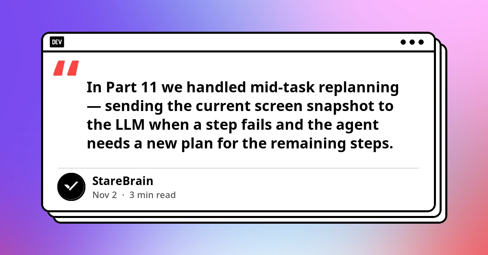

# Building an Android AI Agent, Part 12: AgentContext — Knowing What the User Is Doing Before They Ask

> Originally published at [Dev.to](https://dev.to/starebrain/building-an-android-ai-agent-part-12-agentcontext-knowing-what-the-user-is-doing-before-they-ask-4m25) · 2026-11-02

---

#  Building an Android AI Agent, Part 12: AgentContext — Knowing What the User Is Doing Before They Ask 

In Part 11 we handled mid-task replanning — sending the current screen snapshot to the LLM when a step fails and the agent needs a new plan for the remaining steps.

That covers recovery. This part covers anticipation.

When a user opens StareBrain mid-task, the agent shouldn't need to ask "what are you trying to do?" It should already have a working model of the current context: which app is active, what the user was doing before the interrupt, and what they were likely about to do next.

That working model is AgentContext.

##  What AgentContext holds 
[code] 
    data class AgentContext(
        val activePackage: String?,
        val previousPackage: String?,
        val activeScreenSnapshot: ScreenSnapshot?,
        val recentAppSwitches: List<AppSwitch>,
        val pendingTask: AgentTask?,
        val lastUserIntent: String?,
        val confidenceLevel: ContextConfidence,
        val capturedAt: Long = System.currentTimeMillis()
    )
    
    data class AppSwitch(
        val fromPackage: String?,
        val toPackage: String?,
        val timestamp: Long
    )
    
    enum class ContextConfidence { HIGH, MEDIUM, LOW }
    
[/code]

`recentAppSwitches` is the key field. A sequence of app switches is a behavioral signal — someone who went from their email app to their calendar app to a task manager in quick succession is probably scheduling a meeting. That pattern is readable before the user says anything.

`confidenceLevel` determines how the agent surfaces its inference. HIGH auto-fills context into the next step. MEDIUM suggests and waits for confirmation. LOW asks explicitly.

##  Building the context from accessibility events 
[code] 
    class AgentContextBuilder(
        private val maxSwitches: Int = 10
    ) {
        private val switches = ArrayDeque<AppSwitch>(maxSwitches)
        private var activePackage: String? = null
        private var activeSnapshot: ScreenSnapshot? = null
    
        fun onAppSwitch(fromPackage: String?, toPackage: String?) {
            if (switches.size >= maxSwitches) switches.removeFirst()
            switches.addLast(
                AppSwitch(
                    fromPackage = fromPackage,
                    toPackage = toPackage,
                    timestamp = System.currentTimeMillis()
                )
            )
            activePackage = toPackage
        }
    
        fun onScreenUpdate(snapshot: ScreenSnapshot) {
            activeSnapshot = snapshot
        }
    
        fun build(
            pendingTask: AgentTask? = null,
            lastUserIntent: String? = null
        ): AgentContext {
            return AgentContext(
                activePackage = activePackage,
                previousPackage = switches.lastOrNull()?.fromPackage,
                activeScreenSnapshot = activeSnapshot,
                recentAppSwitches = switches.toList(),
                pendingTask = pendingTask,
                lastUserIntent = lastUserIntent,
                confidenceLevel = inferConfidence()
            )
        }
    
        private fun inferConfidence(): ContextConfidence {
            val recentCount = switches.count {
                System.currentTimeMillis() - it.timestamp < 60_000
            }
            return when {
                recentCount >= 3 -> ContextConfidence.HIGH   // active pattern
                recentCount >= 1 -> ContextConfidence.MEDIUM // some signal
                else -> ContextConfidence.LOW                // cold start
            }
        }
    }
    
[/code]

Three or more app switches in the last 60 seconds is a HIGH confidence signal — the user is actively doing something, and the pattern is readable. One switch is MEDIUM. A cold start with no recent activity is LOW.

##  Serializing context for the LLM 
[code] 
    fun AgentContext.toPrompt(): String = buildString {
        appendLine("Current app: ${activePackage ?: "unknown"}")
        if (previousPackage != null) {
            appendLine("Previous app: $previousPackage")
        }
        if (recentAppSwitches.isNotEmpty()) {
            appendLine("Recent app switches:")
            recentAppSwitches.takeLast(5).forEach { switch ->
                appendLine("  ${switch.fromPackage} → ${switch.toPackage}")
            }
        }
        activeScreenSnapshot?.let {
            appendLine("Current screen:")
            appendLine(it.toPromptSummary())
        }
        lastUserIntent?.let {
            appendLine("Last known intent: $it")
        }
        appendLine("Context confidence: $confidenceLevel")
    }
    
[/code]

The last 5 app switches are enough. More than that adds noise without improving the inference. The LLM uses this to generate a step list that's already oriented toward the likely task rather than starting from a blank slate.

##  Using confidence level at the surface 
[code] 
    fun buildInitialPrompt(context: AgentContext, userInstruction: String?): String {
        return when (context.confidenceLevel) {
            ContextConfidence.HIGH -> {
                // Auto-fill context, proceed directly
                "${context.toPrompt()}\n\nUser instruction: ${userInstruction ?: "continue current task"}"
            }
            ContextConfidence.MEDIUM -> {
                // Suggest and confirm
                "${context.toPrompt()}\n\nUser instruction: ${userInstruction ?: "unknown — suggest most likely next step and ask for confirmation"}"
            }
            ContextConfidence.LOW -> {
                // Ask explicitly
                userInstruction?.let {
                    "${context.toPrompt()}\n\nUser instruction: $it"
                } ?: "No context available. Ask the user what they'd like to do."
            }
        }
    }
    
[/code]

The LOW case with no user instruction is the only moment the agent asks an open question. Every other path has enough signal to generate at least a suggested first step.

##  Privacy consideration 

AgentContext observes everything the accessibility service can see. That's a lot. The context is never persisted beyond the current session — it lives in memory and is rebuilt on each service start. The `capturedAt` timestamp enforces a staleness check: context older than 5 minutes is treated as LOW confidence regardless of the switch count, because the user's situation may have changed completely.  

[code] 
    fun AgentContext.isStale(thresholdMs: Long = 5 * 60 * 1000): Boolean {
        return System.currentTimeMillis() - capturedAt > thresholdMs
    }
    
[/code]

##  What's next 

Part 13: wiring AgentContext into the full request pipeline — from accessibility event to LLM call to task execution, end to end.

For further actions, you may consider blocking this person and/or [reporting abuse](</report-abuse>)

---
*Fetched by article-pipeline · 2026-11-02*
