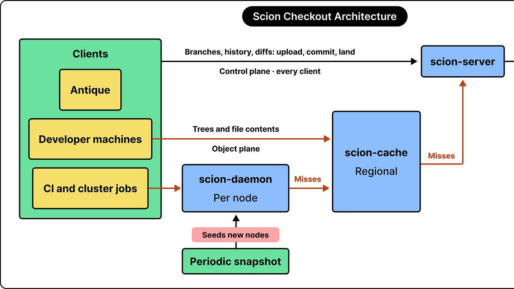

# How Anthropic Redesigned Source Control

> Originally published at [ByteByteGo](https://blog.bytebytego.com/p/how-anthropic-redesigned-source-control) · 2026-11-04

---

# How Anthropic Redesigned Source Control

[ByteByteGo](<https://substack.com/@bytebytego399569>)

Nov 04, 2026

## [A Pile of MCP Connectors Is Not a Context Engine (Sponsored)](<https://go.bytebytego.com/unblocked_110426>)

Your team connected Slack, Jira and GitHub over MCP, and engineers still spend their time steering agents to the right answer. This article looks at why: connectors fetch from one tool at a time, so every agent stitches the pieces together itself, trusts the first doc that looks right, and adds a search to your token bill each time.

Read what changes when a context engine sits on top of your connectors: the same coding task finished 83% faster at 48% lower cost.

[Read the blog post](<https://go.bytebytego.com/unblocked_110426>)

* * *

Anthropic has recently reached a point where coding isn’t the bottleneck for them. Claude is able to do a lot of heavy lifting. It can iterate on research loops. Or optimize complex programs. Or even build new services from scratch.

However, the main problem Anthropic faces is that the infrastructure they have around writing code is not able to keep up with the amount of code being generated by its agents. Activities like downloading repositories, preparing workspaces, and recording changes are becoming major bottlenecks.

To solve this problem, the Anthropic engineering team built Scion. You can think of Scion as a source control system that has been designed around a huge repository and clients that are almost always online. In this article, we’ll look at the architecture behind Scion. Here’s what we will cover:

  * How source control works

  * Anthropic’s problem with source control

  * Why Git couldn’t solve the problem

  * How Scion works

  * How changes are handled in Scion

  * How Scion caches data

  * How Anthropic scales Scion

 _Disclaimer: This post is based on publicly shared details from various sources. References at the end. Please comment if you notice any inaccuracies._

## How Source Control Works

As you will already know, a software project is made up of files that change continuously. Developers add features. They correct mistakes and update dependencies. They also sometimes need to recover an earlier version. A source control system records all these changes and lets multiple developers work on the same codebase.

Let’s look at a few key terms related to source control.

A repository contains the project’s versioned information. Next, you have a commit that denotes a specific version along with other details such as the author, a description, and a history of the earlier commits.

A branch is used to demarcate a line of development. For example, your main branch signifies the line of code into which you integrate all the reviewed and approved changes. Different developers can work on different branches and combine their code through a merge process.

The files present on a developer’s machine are known as the working copy. A checkout process prepares those files for a specific version.

Lastly, you also have automated systems that rely on source control. Continuous integration (CI) runs processes such as compilation, testing, and other checks when code changes. Each job may need a workspace that contains the appropriate version of the code. Coding agents and research jobs need similar environments.

## Anthropic’s Problem with Source Control

Anthropic stores a large amount of its code in a monorepo. You can think of a monorepo as a shared repository that contains multiple projects and components. This way, code that is related can share a common history. But it also means that many separate activities might depend on the same source control infrastructure.

But a large repository is only a part of the story. Anthropic’s problem is much deeper. They report that merged changes have grown from roughly 2500 per day in May 2026 to more than 30000 per day by September. Meanwhile, the size of its main branch’s history is close to 100 GB. Even a compressed working copy goes beyond 25 GB.

**Source:**[Anthropic Research](<https://www.anthropic.com/research/redesigning-source-control>)

The CI system is doing approximately 25 million checkouts per day. This number is before counting developer environments, agent sandboxes, and research jobs. To be clear, you shouldn’t think of these checkouts as individual code changes. A single change can spawn many jobs. And each job prepares an environment for doing its work. Ultimately, your infrastructure workload can get much larger than the number of changes being merged.

**Source:**[Anthropic Research](<https://www.anthropic.com/research/redesigning-source-control>)

For example, a naive approach to transfer a compressed working copy for every CI checkout can generate more than 600 PB of traffic per day. Therefore, the practical problem Anthropic faces has two sides. One is that the system must be able to accept new changes quickly. Second, it must be able to distribute the code to a huge number of consumers. If you improve only one aspect, the other can become a bottleneck.

## Why Git Couldn’t Solve the Problem

The local independence of Git becomes quite expensive in this type of workload. As you might know, Git is designed in a way that an ordinary full clone of the codebase can be used as a self-contained repository.

When the necessary data is locally available, you can use Git to inspect history, compare versions, and create commits without the need to contact a central service. This is a great strength of Git.

However, Anthropic’s workload is such that this independence is not valuable. Most of the clients are automated jobs and agents that already depend on network services. At the same time, if you give those clients a good chunk of repository data, it leads to repeated transfer, storage, and maintenance costs.

To be clear, Git also has ways to reduce those costs. Anthropic used a bunch of these strategies. For example, they use features like shallow clones, sparse checkouts, partial clones, internal mirrors, and repository seeds. Each of these techniques can handle different parts of the problem. For example, a feature like sparse checkout helps deal with files that are part of the workspace.

The first architecture Anthropic built was around the use of Git. You had jobs start from seeds, obtain additional data through caches, and use layers of repository mirrors. At its peak, the Anthropic engineering team was operating several hundred internal mirrors to distribute traffic. But they had to keep all these mirrors in sync with each other as the repository data changed. Seeds also became outdated as the rate of merging increased. Operations that needed historical data became a lot harder to manage because clients held only partial repository data.

The Anthropic team realized that its workflow already had one authoritative shared repository while the infrastructure supported a lot of independence at the client level. With Scion, they changed this responsibility allocation approach.

## How Scion Works

Scion makes the server responsible for repository operations. It assumes that clients can reach a source control service when they need data.

In this setup, the server answers historical data queries, calculates diffs, and creates commits. It also performs merges and rebases. The client (known as scn) maintains a limited cache and prepares files on disk. It watches for local filesystem changes and provides an interface for developers and jobs to deal with the service.

This setup is known as the client-server asymmetry. You can think of it as the client and server having different capabilities and responsibilities. For example, let’s say you have a tool that needs to find out the change behind a particular line of code. This operation is commonly known as blame. In Scion’s operating model, the tool asks the service for the answer to its question. It doesn’t need to assemble enough local history to calculate the answer.

The same principle applies when you’ve to create changes. In Git, you have a commit that’s created locally and later shared through a push. In Scion, you create a commit using a server operation. There’s no separate push step.

You might think that such a centralized service uses a single server that contains everything. But that’s not the case. Anthropic distributes the data and scales the service across machines. There’s no fully materialized repository on any single individual server. The tradeoff is that you have a strong dependence on service availability and connectivity.

## How Changes are Handled by Scion

Changesets provide a small, durable record of each change. Once you create a commit on the server, you need to ensure that they are accepted efficiently.

Scion’s basic unit for managing this is a changeset. You can think of this changeset as a durable record of a change. You can easily construct other useful representations of the repository from this changeset.

To understand its structure, two terms are important. First is a blob that stores the contents of the file. Second is a tree that describes the contents of the directory. It connects names to files and subdirectories. In Git, a commit points to a root tree that represents the project at that version.

**Source:**[Anthropic Research](<https://www.anthropic.com/research/redesigning-source-control>)

A Scion changeset records the files that changed relative to its first parent. This happens together with a reference to their contents. For example, let’s say you have a change that updates a file named “docs/guide[dot]md”, deletes “src/legacy[dot]rs, and modifies “tools/build[dot]sh”. The changeset keeps a record of those file changes and their relevant references. It also keeps the parent information and author details. Here, “changed files” doesn’t mean a sequence of line-by-line patches.

A merge can also have multiple parents. The first parent gives you the baseline against which Scion records its file changes.

Changeset metadata is stored in Spanner, which is a distributed database. Compressed file contents are kept in cloud object storage. The root tree is derived by the server rather than being stored directly inside the changeset.

This way, you can record a change based on the changed data and affected structures. No need to process the whole repository.

## How Scion Caches Data

Using immutable objects makes it easy to use shared caching.

Scion recognizes its source control objects by their contents. This technique is known as content-addressing. In this approach, you have a hash function that calculates an identifier from the contents of an object. The system can then find that object later using this identifier. If there’s a change in the content, the new object gets a different ID value.

This way, your stored objects are immutable. A specific ID continues to refer to the same data. For example, let’s say you have a cache that contains a particular version of “parser[dot].rs”. If you have another job that asks for the same object, the cache can return it without asking another server if the contents have been modified. If there’s a new version of the file, it means the object is different.

There are two consequences of this. One is that you can use identical content. Cached historical objects don’t need freshness checks merely because development is happening somewhere else in the repository.

Git uses content addressing. But the way Scion differs is in how extensively its service and architecture are organized around asking for and caching these objects.

Information still changes in the system. For example, let’s say the name “main” moves as changes are integrated. The immutable object that represents a specific version and the mutable name that identifies the latest version require you to treat things differently.

## How Anthropic Scales Scion

Scion scales by combining shared source control APIs with a hierarchy of caches. Its design is such that answering questions is separate from delivering the files needed for a working directory.

The first point is that repository operations move into a shared service. Many tools need information such as which changes affected a file, who modified a line, and so on. If you’ve to maintain a local repository to answer such questions, it creates a lot of downloading and maintenance work.

Scion exposes these operations through APIs. You can have clients ask the servers directly. The servers can compute derived data when needed and save those results to Spanner. With this, any jobs that only need these answers don’t have to prepare a local repository.

Second, you have immutable objects that make caching pretty simple. As we saw earlier, Scion identifies objects using hashes based on their contents. An existing ID always refers to the same data.

Third, clients only request the objects they need. Scion represents directory structure through trees and file contents through blobs. The client identifies what is missing. So the server receives explicit object requests rather than having to think about a customized transfer.

Fourth, by sharing caches, they reduce the need for repeated downloads and computation. On a compute node, jobs talk to “scion-daemon”. You can think of it as a background process that shares cached objects across jobs.

Any missing objects come from “scion-cache”. This is the regional caching layer that’s shared across many nodes. If that layer also misses, you can get the data from authoritative Scion servers that read from Spanner or cloud storage.

Lastly, you also have strict cache boundaries that help contain failures. All three layers support the same object-request interface. Otherwise, a regional cache that fails could cause its consumers to overwhelm the authoritative servers.

## Conclusion

The Anthropic engineering team learnt a lot of important lessons while building and running Scion.

**Source:**[Anthropic Research](<https://www.anthropic.com/research/redesigning-source-control>)

First was that rapid development is very possible with a small team. For reference, it was just a team of seven people that built both Scion and Antique (which is their code review tool).

The second takeaway was that developers are still valuable, but their scope of work is changing. All of the developers working on this system would rate Claude as better at writing code than they are. But the developers were critical in providing invaluable understanding of the high-level inter-system components and considering the trade-offs in the design decisions. A lot of the developer work revolved around stopping Claude from taking a certain path.

Third, they were able to make things more optimized and also deliver high-quality stuff. Due to Claude’s ability to write a ton of code much faster than human developers, Scion is among the most well-tested and well-defended codebases they’ve ever created.

Fourth, they were able to achieve a new level of operational excellence. The team uses Claude Tag heavily so that they can monitor each component of the system.

**References:**

  * [Redesigning source control at Anthropic](<https://www.anthropic.com/research/redesigning-source-control>)

  * [Git Reference](<https://git-scm.com/docs>)

---
*Fetched by article-pipeline · 2026-11-05*
