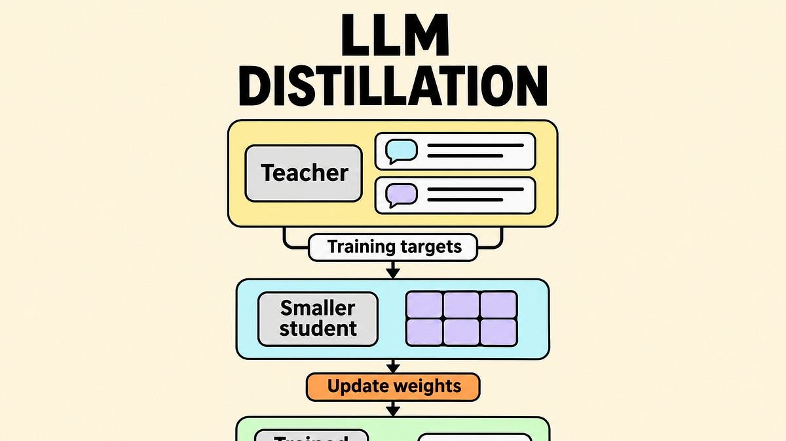

# How LLM Distillation Trains Smaller Models

> Originally published at [The AI Edge](https://newsletter.theaiedge.io/p/how-llm-distillation-trains-smaller-models) · 2026-11-06

---

# How LLM Distillation Trains Smaller Models

### From teacher-written answers to probability targets and feedback on the student’s own output.

[Damien Benveniste](<https://substack.com/@damienbenveniste>)

Nov 06, 2026

∙ Paid

**LLM distillation trains one language model using the behavior of another.** The teacher supplies answers or probabilities for possible next tokens. Training compares those targets with the student's predictions and changes the student's weights. When training ends, the student can generate answers on its own.

Ahead of AI's recent [reasoning-model course](<https://magazine.sebastianraschka.com/p/building-reasoning-models>) teaches distillation as a route to smaller reasoning models, making the transfer of useful behavior into a cheaper model a concrete training choice.

How does that transfer happen? Through three decisions: **what the teacher supplies, where the student practices, and which differences the training loss penalizes.** Those decisions determine what the student has an opportunity to learn. They do not guarantee that it acquires everything the teacher can do.

Distillation moves the teacher’s influence into the student’s learned parameters.

A useful distinction comes before any equations. Distillation changes a model during training. It does not normally keep a larger model beside it to check every answer during deployment. In speculative decoding, a small model proposes tokens and a larger model verifies them. After distillation, the smaller model's own predictions determine its output. Removing the teacher from that loop creates the potential saving, and also makes the student's independent quality the relevant test.

Nor does distillation automatically make a model smaller. We choose a student architecture, usually start from an already pretrained checkpoint, and train it to reproduce selected behavior. A smaller student might learn a specialized task well while losing some of the teacher's breadth. Distillation can also use a student of the same size; here we will focus on transferring behavior into a smaller model.

We will follow the training signal from recorded answers to probability targets, then change who produces the prefixes used for training. That will let us explain why a teacher can provide useful feedback on student mistakes without becoming a correctness oracle.

**Contents**

  * What moves from teacher to student

  * Learn from a teacher's answers

  * Learn from a teacher's probabilities

  * Train where the student actually goes

  * Choose what the student should match

  * Check what transferred

## Continue reading this post for free, courtesy of Damien Benveniste.

[Or purchase a paid subscription.](<https://newsletter.theaiedge.io/subscribe?simple=true&next=https%3A%2F%2Fnewsletter.theaiedge.io%2Fp%2Fhow-llm-distillation-trains-smaller-models&utm_source=paywall&utm_medium=web&utm_content=223524424&just_signed_up=falsesimple=true&utm_source=paywall&utm_medium=email&utm_content=223524424&next=https://newsletter.theaiedge.io/p/how-llm-distillation-trains-smaller-models>)

---
*Fetched by article-pipeline · 2026-11-09*
