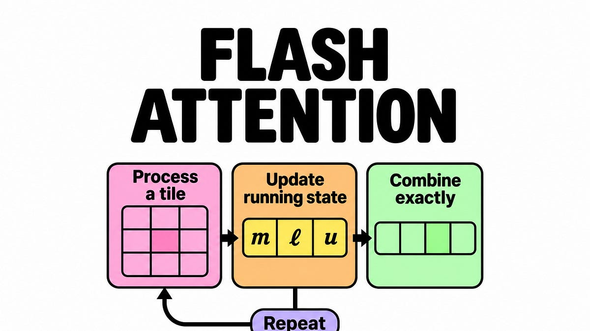

# How FlashAttention Speeds Up LLM Attention

> Originally published at [The AI Edge](https://newsletter.theaiedge.io/p/how-flashattention-speeds-up-llm-attention) · 2026-11-13

---

# How FlashAttention Speeds Up LLM Attention

### Follow the running sum that saves GPU memory, then see how training and decoding change the work.

[Damien Benveniste](<https://substack.com/@damienbenveniste>)

Nov 13, 2026

∙ Paid

**FlashAttention computes attention in small pieces and combines them without storing the full matrix of attention scores.** It runs inside a Transformer's attention layer, where each token compares its query with keys from other allowed positions and mixes their values. The change is in how that calculation uses GPU memory. It still evaluates the attention connections specified by the model.

PyTorch exposes FlashAttention through its [scaled-dot-product-attention interface](<https://docs.pytorch.org/docs/2.14/generated/torch.nn.functional.scaled_dot_product_attention.html>), making the distinction between an attention formula and its execution a practical choice for running LLMs.

How can the result stay the same when the implementation never keeps the whole matrix?

The answer is that each query needs a **normalized weighted sum**. FlashAttention maintains a small running state for that sum, updates it as more keys arrive, and discards the temporary scores. The difficult part is keeping contributions from different pieces on the same numerical scale.

Preserving every allowed connection does not require preserving every intermediate score.

This gives us a useful distinction immediately. Sparse attention changes which positions participate in the calculation. FlashAttention can preserve every allowed connection while changing how long its intermediate results live. An attention matrix can describe the computation without becoming a large array that the GPU must write out and read back.

We will build that distinction from the attention calculation itself, derive the running update, then follow it into GPU execution, training, and token generation. You will be able to explain both the memory saving and the conditions that limit the speedup.

**Table of contents**

  * What attention computes

  * Why the matrix is expensive

  * Normalize attention in pieces

  * Keep the work on the GPU chip

  * Recompute probabilities for training

  * Understand the speedup's limits

## Continue reading this post for free, courtesy of Damien Benveniste.

[Or purchase a paid subscription.](<https://newsletter.theaiedge.io/subscribe?simple=true&next=https%3A%2F%2Fnewsletter.theaiedge.io%2Fp%2Fhow-flashattention-speeds-up-llm-attention&utm_source=paywall&utm_medium=web&utm_content=224487903&just_signed_up=falsesimple=true&utm_source=paywall&utm_medium=email&utm_content=224487903&next=https://newsletter.theaiedge.io/p/how-flashattention-speeds-up-llm-attention>)

---
*Fetched by article-pipeline · 2026-11-14*
