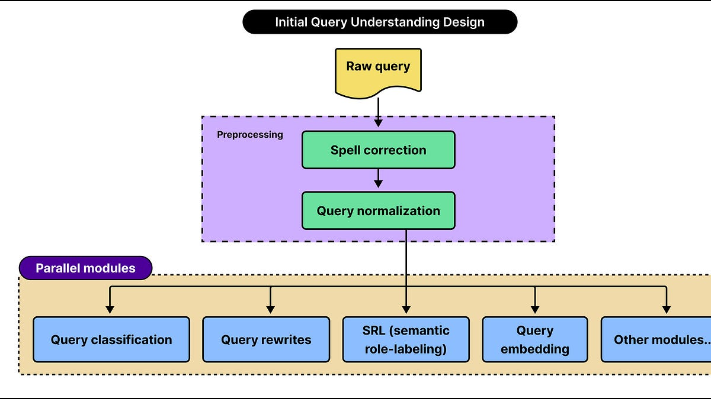

# How Instacart Uses LLMs to Make People Buy More

> Originally published at [ByteByteGo](https://blog.bytebytego.com/p/how-instacart-uses-llms-to-make-people) · 2026-11-16

---

# How Instacart Uses LLMs to Make People Buy More

[ByteByteGo](<https://substack.com/@bytebytego399569>)

Nov 16, 2026

## [Your AI agents shouldn’t have all your permissions (Sponsored)](<https://go.bytebytego.com/workos_111626headline>)

Most agents run with the full access of whoever triggered them. [WorkOS Airlock](<https://go.bytebytego.com/workos_111626airlock>) is the authorization layer for agentic software. You write policies, and Airlock checks every agent call at runtime, then allows it, denies it or sends it to a person for approval.

Agents never see credentials. A risky action, like a refund over your limit, goes to a teammate to approve in Slack. Airlock works with coding agents, custom harnesses and any API or MCP server.

[Learn more →](<https://go.bytebytego.com/workos_111626cta>)

* * *

When people search for a product on an e-commerce platform, they rarely ask for it using the exact words that are present in the product catalog. For example, users might ask for something like “bread no gluten” or “x-large zip lock”.

A good search system is one that is able to look at these phrases and link them to the actual products the user might be interested in. This first step to do so is called query understanding (QU). The job of QU is to take the words the user has typed in a search box and find out useful information about the user’s shopping intentions.

In this article, we’ll look at how Instacart used LLMs to build a product search that could accurately understand a user’s shopping intention. Here’s what we’ll cover:

  * The problem with Instacart’s initial approach

  * How a general LLM becomes useful for Instacart

  * How Instacart made sense of the query category

  * How Instacart made sure that something is always suggested to the user

  * Extracting details from the query

  * How to make the query understanding process much faster

 _Disclaimer: This post is based on publicly shared details from various sources. References at the end. Please comment if you notice any inaccuracies._

## The Problem With Instacart’s Initial Approach

You can separate product search into 3 broad activities:

  * First, you have QU, which is meant to understand the user’s request.

  * Second is retrieval, where you find a set of relevant products.

  * Third, you have the ranking phase in which you decide the order in which each product is shown to the user.

As you can see, information created during the QU phase is the one that guides both retrieval and ranking. For example, let’s say you have a search query that says “bread no gluten”. It refers to bread with a gluten-free attribute. This search phrase gives a very important piece of information to the search setup if you don’t treat the phrase as three unrelated words.

At Instacart, the QU phase can produce three types of information. First is the product categories, in which you decide which sections of the catalog are important for answering the query. Second is alternative queries, which deal with other search phrases that might help find suitable products. Third is structured tags. This deals with the parts of the query that might help learn more about the product, its brand, or specific attributes.

Instacart already had machine learning systems that helped it understand queries. The problem was how to get it to work consistently for the enormous variety of things that people search for.

One way to solve this problem is to analyze search behaviour. But this behaviour provides imperfect training data. A supervised machine learning model learns from examples that are paired with desired answers. For classifying queries, you might connect a search phrase to the correct product category.

However, as you might have already noticed, it’s quite difficult to collect all these labels. Instacart can look at searches, clicks, and final purchases. But those actions don’t directly reveal whether the system understood the query in a correct manner. For example, you might have a user who searches for bread but ends up buying bananas. Now, this purchase doesn’t mean that “bread” should be classified as a query about fruits. Of course, behaviour can give some nice evidence, but a relation between a query and a purchase decision can be quite noisy.

You can use human reviewers to provide cleaner labels. But this also needs time and money. Also, rare queries have very little history. For example, the user might make a very specific query such as “2% reduced-fat ultra-pasteurized chocolate milk”. If you have a system that learns mostly from historical clicks and purchases, it might not have enough examples to deal with such phrases.

These uncommon searches are part of the long tail. While each such query may account for little traffic, together they might represent a large collection of customer requirements.

Broad queries also create a different type of problem. For example, let’s say you have a search phrase such as “healthy food”. It can point to so many categories, and the system has to handle ambiguity rather than force the query into a single narrow interpretation.

With separate models, you also end up with a lot of maintenance work. Instacart had to maintain different systems for different tasks. For example, they had a category classifier that used a FastText model. The query rewrite system mined patterns from user sessions. Each system needed its own data processing, training, and deployment requirements. This increased maintenance work. And even then, they made inconsistent interpretations of the same query.

Therefore, the Instacart engineering team wanted something that could improve their QU and also provide a more consistent foundation for taking care of the other responsibilities.

## How a General LLM Becomes Useful for Instacart

A large language model (LLM) starts off with a broad knowledge of language and the general world. This makes it pretty good at making sense of queries it might have never seen before in the historical data.

For example, an LLM might already know that something like “Italian parsley” and “flat parsley” refer to the same thing, and “curly parsley” can act as a substitute. This is all part of the model’s general awareness that it got during training, and it doesn’t need to learn these things from a bunch of examples.

Of course, general knowledge doesn’t automatically make the LLM knowledgeable about Instacart’s product catalog and the behaviour of their customers. To bridge this gap, the Instacart engineering team used the following techniques:

First, you provide all the relevant information in the prompt to the LLM. This approach is known as context engineering. RAG is the primary method that is used over here. The system pulls in information such as the catalog records and historical patterns and puts that information along with the query.

To be clear, RAG here means that you try to give the model all the useful business information before asking the model to make a prediction.

Second, the system validates the model’s output. Instacart has implemented post-processing guardrails to check how suitable the output is and how compatible it is with their product catalog. You can have a model generate a plausible answer, but it still doesn’t fit the actual data of the business. Therefore, validation is a separate part of the system.

In the third technique, they fine-tune smaller models on their own examples. Fine-tuning means additional training that can change the parameters of the model. Instead of giving all the domain guidance using the prompt every single time, the team teaches the model to work on a particular task with high-quality examples.

## How Instacart Knows What the Query Is About

Instacart has organized its catalog using a hierarchy of categories. For example, you have the following path:

Meat → Beef → Beef Ribs → Short Ribs

Each step in this category path makes things more specific. If the search system knows the entire path, it can easily identify the relevant part of the catalog.

The earlier version of the classifier treated these categories more like a flat collection of labels. For example, in the case of “buttermilk”, it might predict “Dairy” and “Milk” separately, where each label came up with a confidence score. While those predictions were also useful, they didn’t express the full relationship.

With the new approach, you combine historical evidence with LLM interpretation and also check the relevance of the product.

In this approach, the system first finds the leading categories that are associated with purchases following the query. These categories form the initial set of candidates. The advantage is that this gives the model a starting point linked with Instacart’s own data. Since typical purchase behaviour can be quite erratic, you need to assess the candidates even more.

In the next step, you ask the LLM to assess the candidates. The LLM re-ranks the candidate categories using the query and the Instacart context that was given to it. For example, “buttermilk” might map to Dairy followed by Milk and then Buttermilk. On the other hand, something like “vegan roast” might map to Meat followed by Meat Alternatives.

As you can see, this is how language understanding and knowledge of the world help understand a query whose wording doesn’t directly match a category name.

Next, they check whether the prediction is relevant. After the LLM makes a prediction, a guardrail compares the meaning of the original query with the predicted category path. This part is done using embeddings, which are numerical representations of text. If the query and the category path get a similarity score that falls below a specific threshold, the system throws away that pairing.

To summarize, the three stages have different responsibilities. Historical data is meant to propose candidates. The LLM’s job is to interpret them. And at the end, the guardrail filters irrelevant results.

## How Instacart Makes The Queries Stronger

Even if you have a system that understands a query well enough, the original words that make up the query may retrieve very few useful results. This is where query rewriting helps.

Query rewriting generates alternative phrases that can help the search process find more candidates.

The older search system at Instacart did this using patterns found in user sessions. But it covered only about 50% of the search traffic. The Instacart engineering team initially tried asking an LLM to generate rewrites using a general prompt. But this didn’t work as expected because just asking the LLM to rewrite the query doesn’t tell the LLM what kind of alternative would be useful.

For example, let’s say you have the query “1% milk”. Rewriting might change the query to “one percent milk”. While the meaning stays the same, it does very little to help the user find an alternative product.

To make things more effective, Instacart separated rewriting into three tasks:

  * First, they use synonym rewrites that try to express the same request using different wording. “One percent milk” illustrates this relationship.

  * Next, you have broader rewrites that attempt to get rid of some specificity. For example, “milk” can be a broader rewrite of “1% milk”

  * Last, you have substitute rewrites that suggest a different product that might be a good alternative. For example, something like “2% milk” can act as a potential substitute.

You might think that these differences are pretty minute, but they change the search approach in different ways. When you broaden a query, you make the constraints less rigid. Making the suggestion of a substitute product changes the requested product. A synonym keeps the intended meaning intact.

Each type of rewrite gets a dedicated prompt with specific instructions and examples. They also give it reasoning guidance. Instacart then applies a bunch of post-processing checks and semantic filters.

This approach increased rewrite coverage to over 95%, with more than 90% precision across all three types.

## Extracting Search Tags from the Query

The third task is semantic role labeling (SRL). SRL deals with taking out structured concepts such as the product, brand, and other features from a user’s shopping query.

For example, let’s say you have a query that says “2% chocolate milk”. It contains a product “milk”. It also talks about the fat content and flavor. If you represent these concepts explicitly, they become easier to use in the search process.

Instacart uses these tags for retrieval, ranking, advertising, and filters. The main challenge is to find the accurate tags without making every search slow and costly.

One way to do so is by processing frequent queries in advance. Search traffic has an uneven distribution. You might have a relatively small collection of frequent queries that take up a big share of the traffic. These are known as head queries. Beyond them, you can have a much larger collection of uncommon or previously unseen queries.

For these types of common queries, Instacart can generate tags ahead of time and save the results in a cache. Subsequent searches can use those tags immediately.

However, you cannot have the system precompute tags for every possible phrase. New combinations keep coming up, so caching needs a companion process that can deal with queries with no pre-existing result.

To handle this, Instacart used an offline teacher pipeline and a smaller model that runs at the time of live searches. The job of this offline teacher is to create high-quality examples. Here, “offline” means that this work takes place outside the live request flow that the user is waiting for. Due to this, the pipeline has more freedom to use a powerful model and richer context information.

For a common query, it can find relevant information from internal systems, provide that information to the LLM, generate tags, and validate the tags against the catalog. For example, consider the search phrase “verdant machine”. Without business context, an LLM might think of this phrase as talking about machinery. However, Instacart’s internal evidence connects this query with a smoothie brand called MuchPure and with other smoothie juice categories.

The output validation serves two purposes. It helps populate the cache for common queries. Also, it becomes part of a training dataset for the smaller model.

This is why the large-model pipeline is called a teacher. The outputs generated by this model become examples from which another model learns.

When a live query comes in, the system checks whether tags are already cached. If they are, it returns them. If they are missing, the query goes to the smaller, fine-tuned model.

The student has already been trained on examples generated by the teacher pipeline. It learns how queries should map to structured tags, including patterns present in Instacart’s domain context.

## Teaching the Smaller Model

For its real-time SRL system, Instacart fine-tuned Llama-3 8B. This is a model with approximately 8 billion parameters.

For reference, parameters are the numerical values a model learns during training. Although 8 billion is still a pretty big number, this model is a lot smaller than the larger frontier model used by the teacher pipeline.

Instacart trained it using LoRA (Low-Rank Adaptation). In LoRA, you make a model learn a relatively small set of additional parameters while keeping the original model weights fixed during fine-tuning. This brings down the amount of training work you need to adapt the model.

The training examples all depend on the offline pipeline.

This process is a form of knowledge distillation. In this, you have a smaller model learning from outputs generated by a more capable teacher model. Based on their analysis, they found that the student generated fewer incorrect tags. But it also missed slightly more correct tags.

## How Instacart Made the Model Fast For Live Search

For a high-traffic website like Instacart, you want the search system to respond quickly enough so that users don’t face long delays.

The Instacart engineering team targeted model-serving latency in the low 100s of milliseconds. Its initial setup took nearly 700 milliseconds on an A100 GPU.

**Source:**[Instacart Tech Blog](<https://tech.instacart.com/building-the-intent-engine-how-instacart-is-revamping-query-understanding-with-llms-3ac8051ae7ac>)

Several changes made this possible.

One of them was merging the LoRA adapter into the base model. After training, the LoRA adjustments can be combined with the base model’s weights. This prevents the need to keep the adapter as a separate computation during inference. According to the Instacart engineering team, this adapter merge brought down latency by about 30%. After they combined this with an upgrade to H100 GPUs, they were able to achieve the 300-millisecond target.

Therefore, the total improvement came from both a change in how the model was served and faster hardware.

The team also tested FP8 quantization, which uses lower-precision numerical representations for model computation. This brought down the latency by another 10%, but recall declined slightly. Instacart chose to deploy the unquantized model because they wanted to give more priority to higher-quality results.

You can think of this as an engineering trade-off. Though a faster model was available, the team made this choice.

They also reduced how often live inference is needed. Caching had a large effect on the overall cost. According to their estimate, only 2% of queries required real-time model inference.

Therefore, the smaller model handled a limited amount of traffic, while cached tags served the common cases. Instacart also used GPU autoscaling to run fewer GPUs during quieter periods.

## Conclusion

Instacart made an evaluation of the real-time SRL system through A/B testing. For the tail queries discussed we talked about earlier, it reported a 6% reduction in average scroll depth. You can interpret this as users finding the right items more quickly.

The system was also dealing with millions of cold-start queries each week. These were the queries for which the system didn’t have query-specific history or a precomputed answer. There was also a 50% reduction in user complaints related to poor search results for tail queries, with only a marginal latency increase.

As you can see, these stats connect the problems to the solutions. Better classification, rewrites, and tags help shoppers find relevant products more easily. As part of further developments, Instacart aims to understand a shopper’s broader journey. The current design lays a strong foundation for that direction.

**References:**

  * [Building the Intent Engine](<https://tech.instacart.com/building-the-intent-engine-how-instacart-is-revamping-query-understanding-with-llms-3ac8051ae7ac>)

---
*Fetched by article-pipeline · 2026-11-17*
