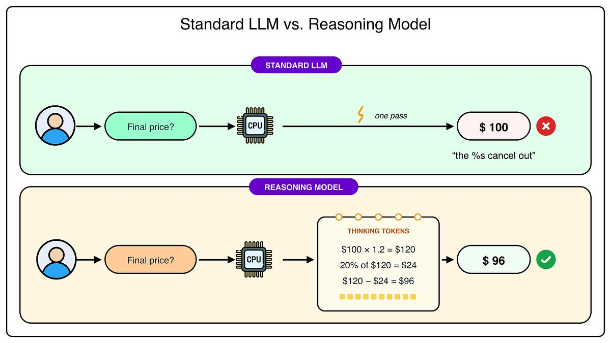

# Why Thinking More Can Make an LLM Dumb

> Originally published at [ByteByteGo](https://blog.bytebytego.com/p/why-thinking-more-can-make-an-llm) · 2026-11-17

---

# Why Thinking More Can Make an LLM Dumb

[ByteByteGo](<https://substack.com/@bytebytego399569>)

Nov 17, 2026

## [How much of your week is spent answering questions? (Sponsored)](<https://go.bytebytego.com/unblocked_111726>)

New hires, support, PMs, and your coding agents all need to know how the product works and why it works that way. Today, you’re the one pointing them in the right direction.

Unblocked works out what’s current and relevant across your code, PRs, tickets, Slack, and production data, so:

  * Everyone gets cited answers in Slack without pulling in an engineer

  * When the answer turns into a fix, a cloud agent drafts the PR

  * Your agents generate code that follows past decisions, no steering needed

[See how it works](<https://go.bytebytego.com/unblocked_111726>)

* * *

When you ask someone to double-check an answer, you usually expect that you’ll get a better answer.

For example, when we look at an invoice the second time, we might find out that an item was counted twice. However, the opposite experience is also quite common. You might revisit a straightforward question on an exam and convince yourself that there’s a catch. In this case, you might end up changing an answer that was correct the very first time.

A reasoning language model can do both. It might use extra time to catch a mistake, or it can also use that time to develop a wrong interpretation. Both scenarios come from a basic feature of language models. Once a model writes down an idea, you can build on that idea a few steps later. But whether it improves the answer or gets things wrong depends on the original question.

In this article, we’ll try to understand why thinking longer can make an LLM dumber. Here’s what we’ll cover:

  * How a language model builds on its answers

  * What happens before a reasoning model sends a reply

  * The advantage of extra time on a question

  * How to teach a model to use extra steps

  * When the model has already done enough

  * How an extra step turns a right answer into a wrong one

 _Disclaimer: This post is based on publicly shared details from various sources. References at the end. Please comment if you notice any inaccuracies._

## How a Language Model Builds on its Own Words

An LLM generates text in small pieces called tokens. You can think of a token as a word, part of a word, or a symbol. When the model selects its next token, it takes the original question into consideration along with the text it has already generated. This means that whatever the model writes near the start of an answer can have a big impact on the calculations it does multiple sentences later.

Let’s say you have a shop that raises the price of a $100 item by 20% and then reduces the new price by 20%. What’s the final price? Without too much thinking, you might be tempted to say $100. This is because the percentage values look the same, and the words “raises” and “reduces” seem to cancel each other out.

But as you might’ve guessed, such an answer would be incorrect. The final price is $96. And the best way to get to this answer in a systematic manner is to write down the intermediate answer. Or the answer to the first calculation, which should be $120. This makes it easy to calculate the price after a 20% reduction.

An LLM can also benefit from the same sequence of checking the intermediate results. Once it has found out that the new price is $120, it can easily calculate the price after the discount. You can see that the question has been broken into smaller ones and carried the result of the first answer into the second. Such a sequence of steps is also known as a chain of thought. In this example, the most useful part of the chain is a single number that makes it easy to handle the next calculation.

## What Happens Before a Reasoning Model Replies?

An ordinary LLM can provide a fully worked solution when you ask it to explain a calculation step by step. However, reasoning models such as OpenAI’s o1 were specifically trained to generate intermediate work before generating a final answer. Even if you ask for just the final price, a reasoning model can work through the price change before returning the final answer.

Most LLMs use a type of neural network called a Transformer. One of the abilities of the Transformer-based model is to connect the text that it is currently generating with relevant parts of the text that was generated earlier. This basic design approach can handle both a quick reply and a longer calculation. With their model, DeepSeek also showed how further training could teach an existing Transformer-based model to use this ability of intermediate results much more effectively.

You can think of the intermediate results working as a sort of scratchpad. Let’s say you give a model 3 different calendars of people and ask for the earliest half-hour when everyone is free. The final answer might be “Tuesday at 11.” But before generating that answer, the model is going to compare the calendars, find out that an earlier slot works for only two people, and then move on to the next available slot. The answer might take just a few words. But the work that happens behind the scenes is much more than that.

The tokens that are used for this work are often called reasoning tokens or thinking tokens. Many model providers keep the raw reasoning of their models private and might just display a summary so that the user might think of the work that was done in the background as mainly a pause of some sort. Sometimes a reasoning trace of a model might look like a conversation between two people because one sentence proposes an idea and a later one objects to it. A single model might be generating both sentences.

## The Advantage of Extra Time on a Difficult Question

There are two main times when you can spend computing power on a model.

First is at the time of training, when the model adjusts its internal settings based on examples or feedback. These changes can have a big impact on how the model answers future questions.

Second is at the time of inference. At that time, the trained model uses the settings made at the time of training to answer the question in front of it. If you spend more computing power on that individual request, it is called inference-time scaling. Also known as test-time scaling.

Let’s say you have a piece of code that’s supposed to process every item in a list. It numbers the items starting from one and keeps running while the current position is less than the total number of items in the list. Now, imagine that a user complains that the last item always goes missing. A model might immediately think that the stopping condition of the loop might have a problem. That’s a pretty reasonable guess, and there is a simple way to test it.

With three items, the loop goes to positions one and two. When it goes to position three, the condition checks whether 3 is less than 3. The answer is false, and so the loop stops before processing the third item. Simply the act of following the code through a small example can turn a possible suspicion into a final explanation. It also shows that making the loop run when the two numbers are equal would fix this bug.

This is one way to spend extra time. Within a single attempt, you can have each step build on what the previous step found out. Another approach is to come up with several separate solutions and compare their final answers. However, separate attempts can help more each attempt can make different mistakes. In contrast, a longer individual attempt is much more beneficial when you let the model follow a promising idea long enough to verify it.

## How To Teach A Model to Use Extra Steps

How can a model learn that checking its work can pay off?

For reference, DeepSeek explored this with their R1-Zero model. The team started with a pretrained model that had already learned patterns of language, code, and mathematics. This was followed by the use of reinforcement learning. The model attempted problems, received scores for its responses, and gradually adjusted what kind of responses it was likely to generate.

Some problems benefit from this approach because you can check their answers automatically. For example, in the case of a math question with a known result, a program can easily compare the model’s answers with an answer key. For a coding problem, you can have tests that show what works and what doesn’t. A different solution might pass both cases. But the tests can differentiate between the two even if both come with convincing explanations.

DeepSeek used a training method called Group Relative Policy Optimization (GRPO).

The idea behind this method is that for a question, the model generates a group of attempts. Some might solve the problem directly. Some might fix an earlier mistake. Others might give the wrong answer. The training procedure can score each attempt and compare its score with those of the other attempts. Once that’s done, you can adjust the model to favor attempts that work better than their peers.

There are two jobs over here.

One is where you grade an actual attempt. The other is when you estimate what score an attempt might ordinarily get so that the training procedure has something to compare things to.

Some reinforcement learning methods also train a separate model, known as the critic model, to provide that estimate. GRPO gets its comparison from the group’s own scores. The R1-Zero model made use of these rules to grade correctness and to check whether the response followed the proper format. This allowed the system to recognize a successful attempt even when nobody had written out the particular route the model took to solve it.

During training, DeepSeek looked at an intermediate version of the R1-Zero model working on an equation that had square roots. The model squared both sides and began developing a more complicated expression. However, in the middle, it stopped that approach and came back to the original equation to reconsider what it had done. Partway through, it interrupted that approach, returned to the original equation, and reconsidered its steps. The team thought of this as an “aha moment.”

The interesting bit for them was where the decision to go back had come from. The team had given a problem, a place where the model could write the working solution, and a way to score the result. This had left the choice of strategy to the model. Yet at a particular point in the calculation, the model came up with a response that considered one of its own steps worth looking at again.

You can probably see why this behavior can be so useful over many practice problems.

An attempt that continues after making an early mistake might carry that mistake all the way to the answer. An attempt that reconsiders the questionable step has a good chance to recover and get a better score. The feedback applies to the attempt as a whole. Therefore, you can also have a lucky guess that also earns credits. However, across many different problems, such a strategy has more advantages.

This was DeepSeek’s experiment in going directly from a pretrained model to reinforcement learning. For the released DeepSeek-R1, the team also used examples. R1-Zero sometimes switched languages or produced solutions that were hard to follow. Therefore, the team began R1 with supervised fine-tuning, which meant training on examples of desired responses.

## When the Model Has Already Done Enough

The first form of overthinking is easy to overlook because the user still receives a correct answer.

However, in a study of reasoning models, researchers showed what can happen when one model was asked to calculate “2 + 3”. It arrived at five in its first solution, then continued until its response contained thirteen solutions to the same question. Nearly all of that text appeared after the calculation had already been done correctly.

Why would a model keep going even when it had the correct answer?

Think about how an attempt is scored. If you have two responses that use the required format and both end in 5, a checker dealing with correctness can give them the same score. You might have one response that stops after a short calculation. The other response might count objects, reverse the order of addition. Both arrive at the right answer. The score offers little guidance about which response made better use of the user’s time.

If you have a check that confirms an answer, it can still be valuable. Let’s say you calculate the total for an order and then compare the items that were counted with the original order form. Even if you confirm the total, that comparison could have shown that an item was missing. If you simply add the numbers from our own incomplete list a second time, you are much less likely to catch that particular error. What matters is whether the second pass tests something the first one could have missed.

This shows why knowing when to stop is a separate skill. A user with an answer key can look back and point to the first correct result. However, a model that answers a new question usually has to decide if another check is worth it before it knows how the answer will be judged. On a difficult problem, if the model stops at the first plausible result, it can be quite costly. But on an easy one, the habit of checking again can produce a long wait for an answer, which is unnecessary.

## How an Extra Step Turns a Right Answer Into a Wrong One

The “2 +3” example shows the impact of wasted effort. However, you can also run into a different problem when the extra reasoning brings in an incorrect assumption. For example, let’s say you have a question about the train departure time printed on the timetable. A train is scheduled to leave at 9:00, but it usually leaves 10 minutes late.

The timetable gives the time as 9:00. Let’s say that the model identifies that answer immediately, but continues because the point about the delay sounds too deliberate to ignore. It might come to the conclusion that the train will probably leave at 9:10. It may even produce a sensible explanation about the difference between scheduled and actual departures. If it finally answers 9:10, the calculation is correct. But the model has gone from its core task of reporting what the timetable says to trying to predict when the train will leave.

As you can see, the original question is still available to the model. What has changed is the text it can use to form the final answer. Early in the response, simply telling the scheduled time from the timetable is the obvious candidate. Later, the model has also produced a second answer and multiple sentences that try to explain why that time might be important. While each sentence makes sense, the response drifts away from what was intended from the model. To a casual user, the answer might even appear dumb.

This is also important when looking at the relation between thinking time and accuracy. If longer answers contain more errors, one possibility is that the model wrote longer because those questions were harder to begin with. A better comparison is to give the same model the same questions with different amounts of reasoning capability. On difficult questions, the extra steps may catch mistakes. But on straightforward questions, they may repeat a simple conclusion or end up providing an irrelevant detail that’s enough to change the answer.

**References:**

  * [Learning to reason with LLMs](<https://openai.com/index/learning-to-reason-with-llms>)

  * [DeepSeek-R1: Incentivizing Reasoning Capability in LLMs via Reinforcement Learning](<https://arxiv.org/html/2501.12948v1>)

---
*Fetched by article-pipeline · 2026-11-18*
