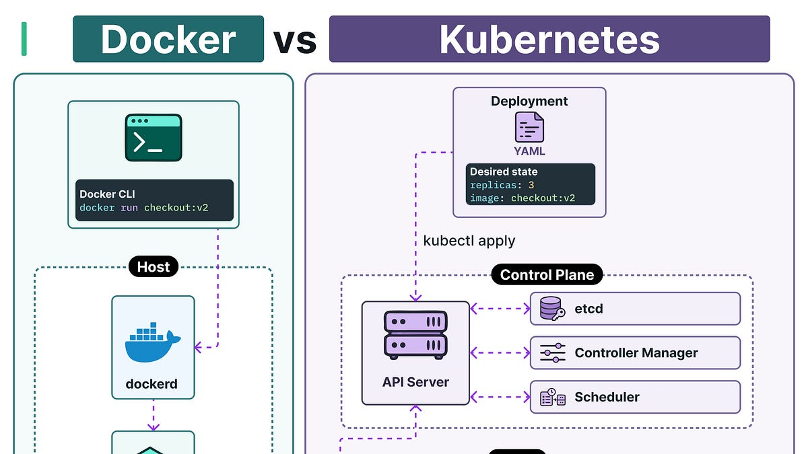

# EP234: Docker vs Kubernetes

> Originally published at [ByteByteGo](https://blog.bytebytego.com/p/ep234-docker-vs-kubernetes) · 2026-11-21

---

# EP234: Docker vs Kubernetes

[ByteByteGo](<https://substack.com/@bytebytego399569>)

Nov 21, 2026

## [Monitoring infrastructure that never sits still (Sponsored)](<https://go.bytebytego.com/datadog_112126>)

Hosts and containers shift by the hour, so when latency spikes, it’s hard to tell which of your hundreds of signals actually matters. This free Datadog eBook lays out a practical framework for monitoring dynamic, cloud-native infrastructure, with worked examples for Kubernetes and AWS Lambda.

You’ll learn how to:

  * Separate work metrics (throughput, success, errors, latency) from resource metrics

  * Cut alert noise by paging on symptoms, not causes

  * Apply the framework to Kubernetes clusters and Lambda functions

[Download the eBook](<https://go.bytebytego.com/datadog_112126>)

* * *

This week’s system design refresher:

  * Docker vs Kubernetes

  * How Redis Works Under the Hood

  * Open Weights vs Closed Models: 7 Tradeoffs in 1 Diagram

  * How does Claude’s text watermark work?

  * 9 Distributed Systems Patterns You Should Know

* * *

## Docker vs Kubernetes

Docker: It’s a tool for packaging an application, including its code, libraries, runtimes, and configurations, into a portable unit called a container image. That image is used to spin up a container, which can be deployed on a laptop, server, or in the cloud.

Docker usually runs on a single machine. You can manage multiple containers on a single host with the help of Docker Compose. 

Kubernetes: It's an orchestration platform that manages the deployment and maintenance of containerized applications, particularly on multiple machines. It can start and stop containers, spin up more containers, and reduce their numbers as needed. It can distribute network traffic and roll out application updates. 

Kubernetes is useful when you need features for your production application, like automatic scaling, self-healing, high availability, and deployment across multiple machines.

* * *

## How Redis Works Under the Hood

Redis is fast because it keeps everything in RAM and uses efficient in-memory data structures. Let’s see how Redis works under the hood:

  * The application sends a Redis command to the server. If replication is configured, commands that update data are normally sent to the primary server. 

  * Redis decodes the request, which is usually encoded using the Redis Serialization Protocol (RESP). It separates the request into the command name, key(s), values, and other arguments. 

  * Redis parses and validates the request command. It checks whether the command exists, and the arguments are correctly formatted. It checks whether the client is authenticated and authorized. If the request is invalid, an error is returned. 

  * Redis looks up the command in its internal command table and finds the corresponding code to execute it. 

  * Redis executes the command. Commands are executed sequentially. 

  * Redis updates the RAM by locating the relevant keys in its in-memory dictionaries and then performs the requested operation. 

  * If a key has a time-to-live, Redis stores its expiration timestamp separately. Expired keys are removed by lazy or active expiration.

  * Commands that change data in RAM may need to propagate such writes to supporting systems through different mechanisms. For example, AOF is a persistent mechanism based on logging writes. RDB is another persistent mechanism based on snapshots, or the data replication mechanism, which copies writes to other Redis servers. 

  * If Redis reaches its configured memory limit, it applies its eviction policy. 

  * Finally, Redis creates the response in RESP format and returns to the client.

* * *

## [Most RAG Pipelines Answer, Then Forget (Sponsored)](<https://fandf.co/4frF1CG>)

Basic RAG is good at looking things up, but not so good at remembering. Nothing a user says gets written back, so every session starts from zero and your agent repeats the same questions. The fix isn’t a bigger prompt. It’s a memory system that handles different kinds of information differently, so rules are retrieved exactly instead of by similarity search, and only what’s worth keeping gets saved.

[See the memory types + runnable code](<https://fandf.co/4frF1CG>)

* * *

## Open Weights vs Closed Models: 7 Tradeoffs in 1 Diagram

For every AI project, you have two options: download the weights of an open model and run it yourself, or call a vendor's API. The diagram below puts the 7 tradeoffs side by side.

Fine-tuning: Open weights allow fine-tuning on your own GPUs and data. Closed models do not allow users to access their weights for fine-tuning.

Versioning: With open weights, you keep the artifact. Pin any version and run it for as long as you want. Closed models serve pinned, dated snapshots but retire them on the vendor's schedule.

Transparency: Open weights are inspectable, but a closed model is a black box with an API.

Deployment: Open weights can be deployed on various hardware. With closed models, every device connects inward to one endpoint.

Licensing: Open-weight licenses are custom, and terms vary by model. Closed models run on a commercial ToS that the vendor sets.

Self-hosting: Open weights are self-hosted by default. It is your stack. Closed models are API-first, though some vendors sell on-prem or private VPC deployments.

Cost: Self-hosting wins only at high volume, once you add ops overhead. APIs are cheaper at low volume, with zero upfront cost.

* * *

## How does Claude’s text watermark work?

Anthropic recently shared their intent to watermark text so they can identify AI-generated text. This post is based on my understanding of how it works.

LLMs produce text word by word. At each step, they generate probabilities for the next likely word. Instead of sampling randomly from those words, the watermarking trick changes which words are allowed to be picked.

How to watermark a response?

Step 1: The model produces probabilities for the next word.

Step 2: Normally a random number generator picks one of the good candidates. With watermarking, a keyed function takes a secret key plus the previous few words and decides which candidates are valid to pick from.

Step 3: This repeats for the whole response. Places where there are multiple plausible choices carry the watermark signal.

How to detect a watermarked text?

Step 1: For any candidate word in the text, we check whether it is a valid choice based on the secret key and the few preceding words. If the word is valid, that is counted as a match.

Step 2: Run this across the entire text. Watermarked text matches far more often. The overall match rate can be treated as an AI-generated score.

I’m personally getting quite annoyed by the false negatives from all these AI text detection techniques, especially for technical writing.

What’s your thoughts on AI text detection? Do you think AI text detection is useful, or will it create more problems?

* * *

## 9 Distributed Systems Patterns You Should Know

  * In replication, you make exact copies of your data and store them on different servers.

  * In sharding, you break a large database horizontally, so different rows live on separate machines.

  * In consistent hashing, you distribute data across different machines or servers using a virtual circular ring.

  * PubSub is an asynchronous messaging pattern that decouples service creators from service consumers.

  * In circuit breaker distributed pattern, it stops an application from repeatedly executing an operation that is likely to fail.

  * In Retry with a backoff pattern, you handle temporary network glitches or brief service timeouts. It is a resiliency pattern.

  * In the leader election pattern, you designate a single master node to manage actions and maintain cluster state. It’s what stops two nodes from thinking they’re in charge.

  * In quorum read/write pattern, you ensure enough replicas agree on each read and write so that the set overlaps. It is a data consistency pattern that is used in distributed databases to guarantee up-to-date information.

  * Saga is a design pattern that manages distributed transactions through a sequence of local transactions across multiple microservices. If one step fails, each earlier step is undone by its own compensating action.

---
*Fetched by article-pipeline · 2026-11-22*
