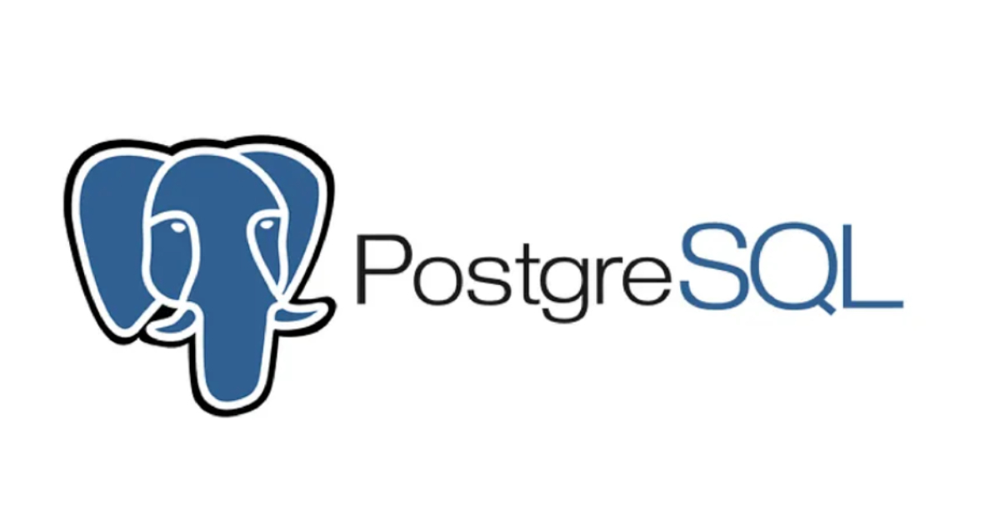

# PostgreSQL 19 Released with Online Table Repacking and Query Planning Controls

> Originally published at [InfoQ](https://www.infoq.com/news/2026/11/postgresql-19-released/?utm_campaign=infoq_content&utm_source=infoq&utm_medium=feed&utm_term=global) · 2026-11-22

---

[InfoQ Homepage](</> "InfoQ Homepage") [News](</news> "News") PostgreSQL 19 Released with Online Table Repacking and Query Planning Controls

[ AI, ML & Data Engineering ](</ai-ml-data-eng/> "AI, ML & Data Engineering")

[Guardrails, Not Gatekeepers: How to Govern AI Tooling Spend Without Slowing Developers (Webinar Dec 10th) ](<https://www.infoq.com/url/t/f1384b1c-d1ab-4bd7-b2f2-e79897bfdaf7/?label=Harness-EventPromoBox >)

#  PostgreSQL 19 Released with Online Table Repacking and Query Planning Controls 

Nov 22, 2026 2 min read 

by

  *  [Robert Krzaczyński](</profile/Robert-Krzaczy%C5%84ski/>)

#### Follow us on 

[Youtube232K Followers](<https://bit.ly/4bg6QM8>) [Linkedin26K Followers](<https://bit.ly/44IzAtf>) [InstagramNew](<https://bit.ly/4eYXrtM>) [RSS19K Readers](<https://bit.ly/3RaJalC>) [X57.1k Followers](<https://bit.ly/4pfxivv>) [Facebook21K Likes](<https://bit.ly/3QrGMH2>) [BlueskyNew](<https://bit.ly/4eS8FjG>)

Listen to this article - 0:00

Audio ready to play

Your browser does not support the audio element. 

0:00

0:00

  * [Reading list](</showbookmarks.action>)

The PostgreSQL Global Development Group released PostgreSQL 19, introducing changes to database maintenance, query planning, replication, and application development. The release focuses on reducing administrative overhead and improving performance, with new tools for reorganizing tables without downtime and controlling query plans.

One of the main additions is `REPACK`, which reclaims unused table space and can reorder data to match an index. Its `CONCURRENTLY` option allows the operation to run without blocking reads or writes, making it a potential replacement for common uses of `VACUUM FULL` and `CLUSTER`. PostgreSQL 19 also introduces `pg_plan_advice` and `pg_stash_advice`, extensions that let administrators influence query plan selection and apply stored advice to queries by identifier, without changing application code.

Other maintenance improvements include parallel index vacuuming, changes to autovacuum prioritization, and additional monitoring views. `EXPLAIN ANALYZE` and related logging now report asynchronous I/O activity and WAL generated for full-page images. PostgreSQL also reports that changes to foreign key checks made bulk inserts nearly twice as fast in testing. Query planner improvements include more efficient anti-joins for eligible `NOT IN` clauses and eager aggregation before joins.

The release adds several features for replication and application development. Logical replication now supports sequence values, and PostgreSQL automatically raises the effective WAL level to `logical` when the first logical replication slot is created. The new `WAIT FOR LSN` command lets applications wait until a standby has replayed a specified WAL position before querying data, providing read-your-writes consistency. Developers also get `INSERT ... ON CONFLICT DO SELECT` for get-or-create operations, JSON output from `COPY`, additional SQL/JSON string methods, and `IGNORE NULLS` support for window functions.

Security and compatibility changes include server-side TLS Server Name Indication (SNI), which allows a server to present different certificates based on the hostname used by the client. PostgreSQL 19 also warns after successful MD5 password authentication. MD5 was deprecated in PostgreSQL 18 and is planned for removal in a future release, with SCRAM recommended instead. JIT compilation is now disabled by default because its cost estimates proved unreliable, while LZ4 becomes the default TOAST compression method when supported by the build.

The release has also prompted [discussion](<https://news.ycombinator.com/item?id=50570414>) on Hacker News about whether production users should wait for PostgreSQL 19.1.

Another user [recommended](<https://news.ycombinator.com/item?id=50572000>) waiting for the first minor release on critical production systems:

> Personally, I would say, for critical production systems, it's still good to wait for the .1 release.

PostgreSQL 19 is available now. The complete list of changes is available in the [official release notes](<https://www.postgresql.org/docs/19/release-19.html>).

## About the Author

#### **Robert Krzaczyński**

Show moreShow less

####  This content is in the [AI, ML & Data Engineering](</ai-ml-data-eng/>) topic 

##### Related Topics:

  * [AI, ML & Data Engineering](</ai-ml-data-eng/>)
  * [Postgres](</Postgres/>)
  * [Database](</Database/>)

  * #### Related Editorial

  * #### Related Sponsors

    * #####  [ The Agentic AI Threat: Why Your Java Patching Strategy Is No Longer Enough ](</url/f/4516ff5c-4026-4ffb-9e70-07aaa508aaa7/>)

  * #### Related Sponsor

Explore how Azul helps Java teams reduce JVM vulnerability risk, strengthen application security, and prepare their Java environments for agentic AI. Discover practical strategies for securing Java workloads while maintaining performance and reliability. **[Learn more](</url/f/82358b21-6ee1-4d1b-9d0d-1f68cb9bb816/>).**

---
*Fetched by article-pipeline · 2026-11-23*
