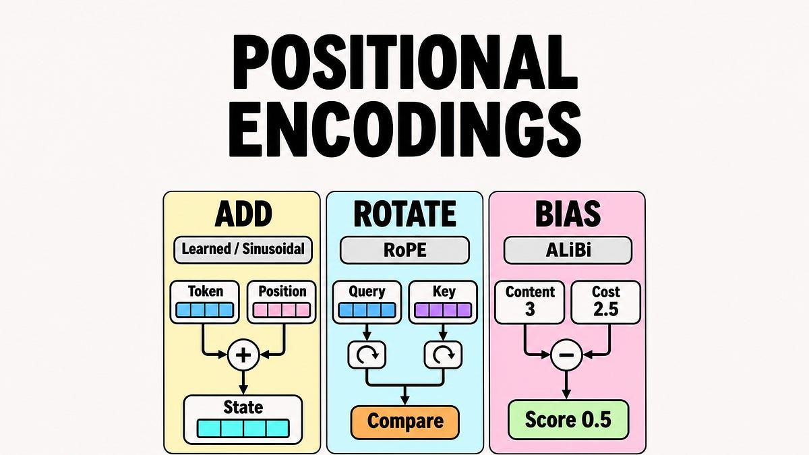

# How LLMs Encode Token Position

> Originally published at [The AI Edge](https://newsletter.theaiedge.io/p/how-llms-encode-token-position) · 2026-11-23

---

# How LLMs Encode Token Position

### Follow learned vectors, sinusoids, RoPE, and ALiBi from token indices to attention scores.

[Damien Benveniste](<https://substack.com/@damienbenveniste>)

Nov 23, 2026

∙ Paid

**Positional encodings make a token's place in a sequence affect an LLM's computation.** They introduce position numbers while the model processes its input or compares tokens inside attention. The same word can then be represented differently at two locations, or receive a different attention score because it is farther away.

Ahead of AI's recent [positional-embedding explainer](<https://magazine.sebastianraschka.com/p/understanding-positional-embeddings>) connects these architecture choices to context extension, making their behavior relevant when judging what a longer context setting actually changes.

How does a position number become something a neural network can use?

The useful organizing question is **where position enters the calculation**. We will develop four members of the positional-encoding family:

  * **Learned absolute positions:** look up a trained vector for each slot and add it to the token's vector.

  * **Sinusoidal positions:** compute that added vector from sine and cosine functions instead of learning a table.

  * **Rotary position embeddings, or RoPE:** rotate the vectors used to compare tokens, making their dot product depend on relative position.

  * **Attention with Linear Biases, or ALiBi:** subtract a distance cost directly from attention scores, with different strengths across attention heads.

Token identity alone does not specify where an occurrence sits relative to the current token.

Here is an immediate consequence. A positional rule and an attention mask answer different questions. A causal mask determines whether a token may consult a particular position at all. A positional encoding changes the information or score used when that consultation is allowed. The final attention weight also depends on content and on the other available tokens.

That distinction explains why a nearby token need not receive the largest weight, and why giving every position a coordinate does not ensure that the model will retrieve the right distant fact. To understand those outcomes, we need to follow the coordinate into the calculation.

**Contents**

  * What position changes in attention

  * Learned positions add a coordinate

  * Sinusoids provide reusable coordinates

  * RoPE rotates queries and keys

  * ALiBi adds a distance cost

  * What changes when context grows

## Continue reading this post for free, courtesy of Damien Benveniste.

[Or purchase a paid subscription.](<https://newsletter.theaiedge.io/subscribe?simple=true&next=https%3A%2F%2Fnewsletter.theaiedge.io%2Fp%2Fhow-llms-encode-token-position&utm_source=paywall&utm_medium=web&utm_content=225953856&just_signed_up=falsesimple=true&utm_source=paywall&utm_medium=email&utm_content=225953856&next=https://newsletter.theaiedge.io/p/how-llms-encode-token-position>)

---
*Fetched by article-pipeline · 2026-11-24*
